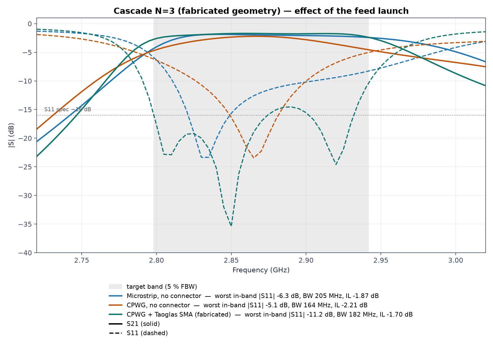

# SIW Bandpass Filter — 2.87 GHz

A 3-cavity substrate integrated waveguide (SIW) bandpass filter on Rogers
RO4350B. This repository designs it in Python, simulates it with Palace
(FEM), and exports the files needed to manufacture it.

## Where things stand

The board has been **sent to JLCPCB** as a prototype; measurements will be
added when it arrives. The simulated design does not fully meet the spec: the
passband is wider and the matching is weaker than the targets.

|                        | Target    | Simulated |
|------------------------|-----------|-----------|
| Centre frequency       | 2.87 GHz  | 2.876 GHz |
| Bandwidth              | 143.5 MHz | 182 MHz   |
| Worst in-band S11      | −16 dB    | −11.2 dB  |
| Insertion loss (peak)  | —         | −1.7 dB   |
| Board size             | —         | 165.8 × 45.8 mm |

## Key files

- **Order the board:** [`docs/final_check/fab/`](docs/final_check/fab/)
  holds the gerbers, drill files and fab notes.
- **Is it ready?** [`docs/final_check/REPORT.md`](docs/final_check/REPORT.md)
  gives the verdict and what to write in the JLCPCB order notes.
- **The paper (English, the whole project):**
  [`docs/paper/ai_driven_rf_design.md`](docs/paper/ai_driven_rf_design.md).
- **Simulate in CST:** [`docs/cst_guide/`](docs/cst_guide/) (in Spanish).
- **University report (Spanish):**
  [`docs/paper/Anteproyecto_Filtro_SIW_287GHz.md`](docs/paper/Anteproyecto_Filtro_SIW_287GHz.md).

## Does the connector matter?

Yes. The filter was tuned with the SMA connector in place. Removing it and
feeding the board directly by microstrip or CPWG costs about 5 dB of return
loss. See [`docs/launch_comparison/`](docs/launch_comparison/) for 3D views
and S-parameters.



## Specs

- **Substrate:** Rogers RO4350B, 0.76 mm thick, εr 3.66
- **Vias:** 1.5 mm diameter, 3.0 mm pitch
- **Connector:** Taoglas EMPCB.SMAFSTJ.B.HT edge-mount SMA
- **Response:** Chebyshev, 3rd order, 0.1 dB ripple

## Quick start

```bash
uv sync      # install
siw          # fast pipeline: synthesis → geometry → layout → CST macro
siw --list   # show every stage and subcommand
```

The EM simulations need [Palace](https://awslabs.github.io/palace/). It is
found through `$PALACE_BIN`, your `$PATH`, or `~/opt/palace/bin/palace`.

## Rebuilding the fabricated board

```bash
P=l_cav1=33.939,l_cav2=35.503,w_iris=14.416,w_ext=13.96,l_taper=15.738,w_ms=1.6636

siw kicad --topology cascade --N 3 --params $P --launch cpwg   # KiCad + gerbers → output/kicad/
siw cst   --topology cascade --N 3 --params $P --launch cpwg   # CST macro → output/bas/
```

## Designing a new filter

```bash
siw calibrate --what both --N 3   # measure the coupling curves (cached)
siw synth-design --N 3            # turn them into a design and check it
```

`siw --help` lists the other commands: optimisation, sweeps, scans and
comparison plots.

## Repository layout

```
src/siwfilter/   Python package and the `siw` command
golden/          validated designs and their simulated S-parameters
docs/            status, fab package, reports, figures
output/          generated files (not committed)
```
