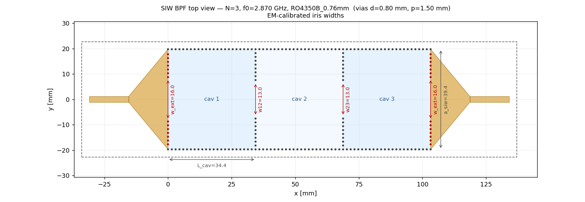

# Filtro SIW 2.87 GHz — Correr en CST y exportar resultados

Gracias por la ayuda. Es muy simple: **importás la macro, corrés la simulación y me
mandás el archivo `.s2p` exportado.** No hay que tunear nada — el diseño ya está listo.

---

## 1. Armar el modelo (importar la macro)

1. Abrí **CST Studio Suite 2021**. **File → New → New Template** → cualquier plantilla
   de *Microwaves & RF* hasta tener un proyecto vacío.
2. **Home → Macros → Open VBA Macro Editor**.
3. En el editor: **File → Open** → elegí **`siw_filter.bas`** → **Open** → apretá **F5**.
4. Cerrá el editor. En el árbol de la izquierda deberías ver el sustrato, los planos de
   masa, las vías y las transiciones microstrip.

> Si la macro corta con un error cerca del final (bloque de solver): apretá **OK**, la
> geometría ya quedó armada. El solver lo configurás en el paso 2.

---

## 2. Simular

1. **Home → Setup Solver → Time Domain Solver**.
2. *Source* = **Port 1**, S-Parameters activado. Rango de frecuencia **2.0 – 3.6 GHz**
   (ya viene de la macro; si no, ponelo en **Simulation → Frequency**).
3. Apretá **Start**. Tarda unos minutos.

---

## 3. Exportar el `.s2p` y mandármelo  ← (lo único que necesito)

1. Cuando termine: **Navigation Tree → 1D Results → S-Parameters**.
2. Botón derecho sobre **S-Parameters** → **Post-Processing → Import/Export → Touchstone**
   (o **Export → Touchstone .sNp**).
3. Guardá el archivo **`.s2p`** y **mandámelo**. Eso es todo. ¡Gracias!

---

## (Opcional) Comparar mientras lo tenés abierto

Si querés ver cómo da, podés importar `palace.s2p` (mi simulación) y `target.s2p` (la
respuesta ideal) con **1D Results → S-Parameters → Import Touchstone File** y superponerlas.
Deberías ver una banda de paso centrada en ~2.87 GHz con buena adaptación.

---

**Sustrato:** Rogers RO4350B 0.76 mm (εr = 3.66, tanδ = 0.0037). Todo el modelo es
paramétrico, pero **no hace falta tocar nada** para esta corrida.
