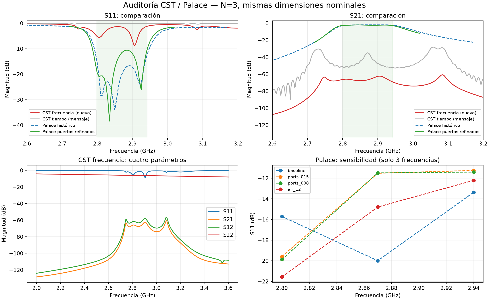

# Auditoría CST / Palace — 6 de septiembre de 2026

El nuevo resultado del solver de frecuencia **todavía no valida el filtro ni el ZIP anterior**. Desapareció la ondulación rápida del resultado temporal, pero la transmisión sigue siendo prácticamente nula. La evidencia nueva apunta primero a revisar el puerto 2, los modos usados y la exportación de la matriz S. Palace también tiene errores de discretización y sensibilidad a los límites del dominio; sus valores históricos no son una referencia convergida.

## 1. Datos examinados y lectura correcta

Se examinó `output/data/cst_runs/cst_freq_solver_cascade_N3_2026-09-06.s2p`, exportado por CST el 6 de septiembre a las 19:14:33 desde `test.cst`. Tiene 1001 frecuencias, de 2 a 3.6 GHz, con paso de 1.6 MHz. Su SHA-256 consta en `audit_metrics.json`.

La cabecera es `# GHz S MA R 50`: magnitud **lineal** y fase en grados, referencia declarada de 50 Ω. El orden de los pares es S11, S21, S12, S22. Se comprobó la lectura con scikit-rf contra las nueve columnas numéricas del propio archivo; no hay intercambio de S21/S12 ni un error de conversión a dB. Esta interpretación sigue la [especificación Touchstone de IBIS](https://www.ibis.org/touchstone_ver2.1/touchstone_ver2_1.pdf).

Los parámetros nominales coinciden con el N=3 guardado: cavidades 34.239/35.503/34.239 mm, iris 14.416 mm, apertura externa 13.96 mm, pista 1.6636 mm y taper 15.738 mm. `Lsub=166.382` es compatible con el redondeo del valor anterior. La cabecera no identifica la revisión de la macro, la geometría efectiva de los SMA, la malla ni los modos; por tanto, no demuestra que se haya ejecutado exactamente la macro actual.

Las otras dos curvas pegadas en la conversación se conservaron completas en `cst_chat_export.txt`: 1001 S11 y 1001 S21, sin volver a aplicar logaritmos a esos valores ya expresados en dB. Los valores S se transcribieron con su precisión original; la frecuencia se reconstruyó con la misma rejilla float32 del texto y se verificaron puntos de control. `docs/paper/swi_CST_data.txt` es una corrida anterior con otras dimensiones y vías; no se utilizó como si fuera este diseño.

## 2. Qué dice la nueva corrida de frecuencia

| Resultado | Valor |
|---|---:|
| Mejor S11 del barrido | −8.645 dB a 2.9072 GHz |
| Máximo S21 | −60.695 dB a 3.0848 GHz |
| S11 a 2.8704 GHz, muestra más cercana al objetivo | −1.507 dB |
| S21 a 2.8704 GHz | −66.755 dB |
| S12 a 2.8704 GHz | −62.336 dB |
| S22 a 2.8704 GHz | −6.204 dB |
| Fase de S22, en todo el barrido | −180.000° a −179.999° |

A 2.8704 GHz, interpretando el archivo tal como declara su referencia, vuelve al puerto 1 el 70.68 % de la potencia y llega al puerto 2 apenas el 0.0000211 %. Que S11 tenga un valle no significa que esa energía salga por S21: puede perderse, radiarse o estar mal representada por la configuración de puertos.

Los máximos de S21 aparecen a 2.7472, 2.9056 y 3.0848 GHz, todos por debajo de −60 dB. Se ve estructura resonante, pero no un pasabanda útil. El resultado temporal pegado antes alcanzaba −28.08 dB; esta corrida tiene curvas más suaves, pero **no mejor transmisión**. La ondulación temporal anterior es compatible con truncamiento o problemas numéricos; sin el registro temporal no se puede asignar una causa única.

## 3. Por qué revisar primero el puerto 2

El diseño nominal es simétrico y emplea materiales recíprocos. En una matriz S correctamente calculada y referida a las mismas impedancias reales, se espera S12≈S21. Aquí hay unos 4.42 dB y 90.03° de diferencia a 2.8704 GHz. Como ambas transmisiones son diminutas, su diferencia absoluta máxima es solo 0.00179: esto podría incluir ruido numérico o datos incompletos, y no demuestra un dispositivo físicamente no recíproco.

Más llamativo es S22: no muestra las resonancias de S11 y su fase permanece prácticamente fija. En conjunto, conviene comprobar:

1. Si el puerto 2 realmente selecciona el modo TEM coaxial, con campo eléctrico radial entre pin y blindaje, propagación en 2–3.6 GHz e impedancia próxima a 50 Ω.
2. Si se resolvieron **ambas excitaciones** y los cuatro parámetros pertenecen a la misma corrida. La macro actual configura inicialmente excitación 1 y simetría de parámetros S para el solver temporal; cambiar de solver no prueba qué ajustes conservó CST.
3. La normalización, las caras elegidas para los puertos y posibles resultados anteriores conservados en el proyecto.
4. Que la sección del puerto de salida contenga el anillo de PTFE, el pin y el blindaje correctos; no una cara vecina, una tapa metálica o un modo por debajo de corte.

El [manual de CST, sección del ejemplo coaxial](https://perso.telecom-paristech.fr/begaud/intra/MWS_Getting_Started.pdf) explica que la renormalización completa requiere calcular todos los parámetros. Esto justifica volver a exportar una matriz completa, pero no prueba que esta corrida esté incompleta.

**Indicio adicional, no diagnóstico confirmado:** al convertir S22 a impedancia de entrada con el otro puerto adaptado, `Zin2=50(1+S22)/(1−S22)`, resulta aproximadamente 11.93–21.52 Ω, casi real. Su dependencia con la frecuencia encaja extraordinariamente bien con la *magnitud* de una impedancia TE por debajo de corte: suponiendo PTFE con εr=2.08, el corte equivalente queda entre 43.8525 y 43.8539 GHz. Esto refuerza la sospecha de un modo/normalización inadecuado. **Zin2 no es la impedancia modal medida por CST**, y el número 43.85 GHz no debe presentarse como un corte confirmado sin el informe de modos.

La matriz exportada cumple el chequeo de pasividad (`máxima singular ≈0.989988 <1`). Eso descarta ganancia artificial en este archivo; no certifica ni la geometría ni los puertos.

## 4. Auditoría de Palace: hay errores reales de precisión

Se regeneró la malla original y se hicieron cuatro barridos cortos de diagnóstico. Después se completó un barrido de 61 frecuencias, 2.72–3.02 GHz cada 5 MHz, con los puertos refinados. Los registros y configuraciones se conservan en `output/data/audit_*` y `output/audit_cst_palace/`.

### Puertos insuficientemente resueltos

El coaxial nominal de radios 0.38/1.2639 mm y εr=2.08 da aproximadamente 50 Ω. Pero el cálculo modal original no reproducía eso:

| Malla | Tetraedros | Triángulos en puertos 1/2 | Z_PV en puertos 1/2 |
|---|---:|---:|---:|
| Original: máximo 3.5 mm, mínimo 0.6 mm | 107382 | 37 / 37 | 44.07 / 46.38 Ω |
| Refinamiento de puertos 0.15 mm | 176397 | 509 / 517 | ≈49.83 / 49.84 Ω |
| Refinamiento de puertos 0.08 mm | 215277 | 1744 / 1752 | ver valores medidos en `audit_metrics.json` |

El área del anillo de cada puerto era 4.29963 mm² en la malla original frente a 4.56487 mm² en CAD: aproximadamente 5.81 % de error. Con 0.15 mm pasa a 4.56469 mm². La limitación global de tamaño mínimo impedía representar bien la curvatura del pin. El refinamiento también baja ese límite global, por lo que parte de la malla del resto del dispositivo cambia: no debe atribuirse toda la diferencia de S11 exclusivamente a los triángulos del puerto.

| Prueba, a 2.87 GHz | S11 | S21 |
|---|---:|---:|
| Original | −19.99 dB | −1.858 dB |
| Puertos 0.15 mm, aire 4.56 mm | −11.52 dB | −2.223 dB |
| Puertos 0.08 mm, aire 4.56 mm | −11.49 dB | −2.226 dB |
| Puertos 0.15 mm, aire 9.12 mm | −14.79 dB | −1.746 dB |

0.15→0.08 mm produce cambios pequeños en las tres frecuencias probadas; eso es buena evidencia local para los puertos. **Duplicar la altura de aire cambia S21 hasta unos 0.51 dB y S11 hasta 3.27 dB en esas muestras. El dominio tampoco está convergido.** Esa prueba cambia tanto la frontera como la malla del aire, así que no separa ambas contribuciones.

### Barrido de 61 puntos con puertos refinados

El centro entre los cruces a 3 dB respecto del máximo es 2.87194 GHz; la pérdida mínima es 2.013 dB; el ancho a ese nivel es 183.70 MHz; el peor S11 entre las muestras de la banda objetivo es −10.558 dB. Los extremos exactos de la banda objetivo no caen en la rejilla, por lo que ese S11 no es una cota continua.

La frecuencia del máximo de S21 es 2.845 GHz; no debe confundirse con el centro de banda 2.87194 GHz. El proyecto calcula el ancho a `máximo(S21)−3 dB`, aquí aproximadamente −5.013 dB absolutos; no son cruces a −3 dB absolutos. El objetivo de 143.5 MHz de un Chebyshev también requiere definir el nivel de borde de la especificación antes de comparar anchos.

Además, ya existía una corrida de 121 puntos con malla 2.5/0.45 mm que daba centro 2.872 GHz y S11 peor −9.34 dB, frente al −13.37 dB histórico. Esa evidencia no había sido incorporada en los documentos que afirmaban que no había estudio de malla.

### Geometría, materiales y calidad de elementos

- Hay 102 vías del filtro y 16 vías de tierra del lanzador. La geometría de la pista CPWG y ambas transiciones se contrastó con los contornos usados por el mallador.
- La malla examinada tiene ambos puertos exteriores, volúmenes etiquetados y ninguna cara exterior sin condición asignada. Esto verifica cobertura, no que toda condición sea físicamente adecuada.
- No se encontraron tetraedros con `minSICN≤0`; sí elementos muy deformados. El mínimo original es 0.0000545; con puertos refinados, 0.000444. La malla se puede resolver, pero no queda certificada por ello.
- La corrida usa elementos de campo de orden 1 y geometría lineal. La convergencia del solucionador lineal no equivale a convergencia de la discretización.
- El dominio de Palace incluye aire sobre los alimentadores, no todo el espacio que rodea la placa de CST. Usa fronteras absorbentes de primer orden muy cercanas. La [documentación de Palace](https://awslabs.github.io/palace/stable/guide/boundaries/) describe esas condiciones y el cálculo modal de puertos.
- El SMA es una aproximación con dimensiones de pin y un radio dieléctrico deducido de 50 Ω; no un CAD completo del conector comercial con soldadura y contactos.
- Palace recorta el PTFE junto al borde a z=0 y asigna PEC a la cara plana; la cara vertical del escalón queda absorbente. La macro actual de CST utiliza cilindros sin recorte. No son modelos idénticos. Tampoco es correcto afirmar que los cilindros de CST solo contacten la placa en una línea: el cobre tiene espesor y existen contactos entre caras terminales.
- La descripción histórica del cobre real es inexacta: el código asigna conductividad a **170 caras exteriores**, incluidas superficies cilíndricas de vías y del coaxial. Las seis hojas internas de pista/tierra superior siguen PEC. El valor −2.44 dB no es una simulación de todos los metales reales del conjunto.

## 5. ¿Tiene sentido el diseño?

Sí como **candidato de filtro SIW de tres cavidades**: escala dimensional, vía de 1.5 mm a paso 3 mm, sustrato de 0.76 mm y resonancias de varios GHz son coherentes. εr de diseño 3.66 y tanδ 0.0037 figuran en la [hoja de datos de Rogers](https://www.rogerscorp.com/-/media/project/rogerscorp/documents/advanced-electronics-solutions/english/data-sheets/ro4000-laminates-ro4003c-and-ro4350b---data-sheet.pdf); mantenerlos iguales entre solvers es una comparación razonable. No explican por sí solos una diferencia de transmisión superior a 60 dB.

Las simulaciones de Palace examinadas conservan un pasabanda cerca del objetivo. Sin embargo, ni el S11 histórico ni las afirmaciones de óptimo físico definitivo, penalización exacta de fabricación o tolerancia quedan demostradas por una optimización sobre una malla y dominio no convergidos. Tampoco los resultados anómalos de capas finas prueban por sí solos que tales capas sean imposibles de simular: requieren un modelo adecuado y un estudio de convergencia.

No conviene retocar iris o longitudes para ajustar esta curva de CST antes de verificar sus puertos. El orden recomendado es control coaxial, modos de ambos puertos, matriz completa de frecuencia, convergencia de malla/dominio y, después, ajuste del filtro.

## 6. Alcance del paquete de prueba

El ZIP contiene una macro del filtro que conserva la geometría actual sin recorte del SMA, una macro separada de coaxial recto, instrucciones para seleccionar el solver de frecuencia y todos los datos de comparación. No contiene un proyecto `.cst` ya ejecutado ni una promesa de que la respuesta esté corregida.

La macro de construcción para frecuencia omite el bloque que seleccionaba el solver temporal; la selección y los ajustes del solver de frecuencia se hacen en la interfaz, siguiendo `LEEME_PRIMERO.md`. Esto evita introducir propiedades VBA de frecuencia no verificadas. Las macros siguen necesitando ejecución en CST para validarlas. La guía anterior y su Touchstone de Palace con fase artificial no forman parte del paquete de diagnóstico.

Para confirmar la causa faltan el informe/log del solver de frecuencia, los modos e impedancias de los dos puertos, las excitaciones efectivamente resueltas, el `.bas` usado o el proyecto `.cst` y una segunda exportación tras esas comprobaciones. Las curvas solas permiten localizar el problema probable, no probar cuál operación de CST lo originó.

## Reproducibilidad

`analyze.py` lee los archivos conservados, verifica su formato y genera CSV, figura y `audit_metrics.json`. `run_mesh_checks.py` reproduce las cuatro pruebas cortas; `run_refined_sweep.py`, el barrido de 61 puntos. Las pruebas cortas **no** sirven para medir un ancho de banda completo; por eso sus valores automáticos de ancho no se utilizan como resultados de convergencia.
