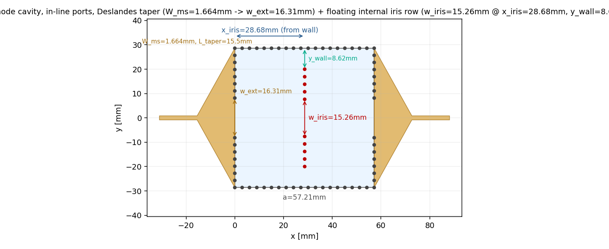
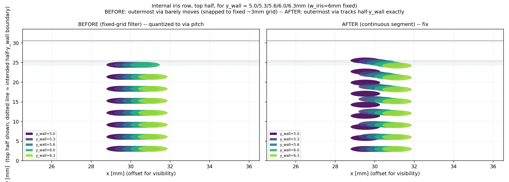
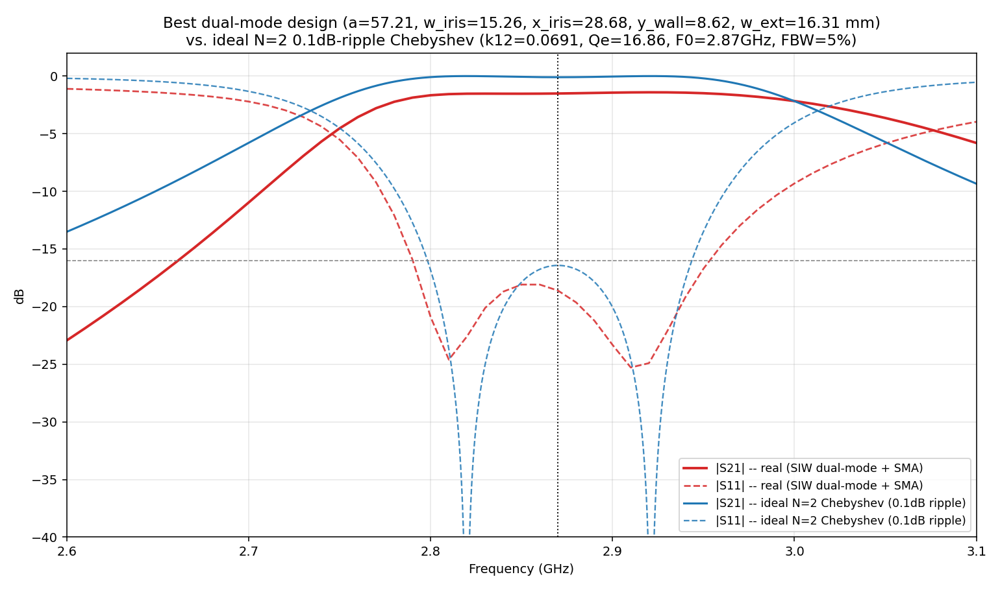
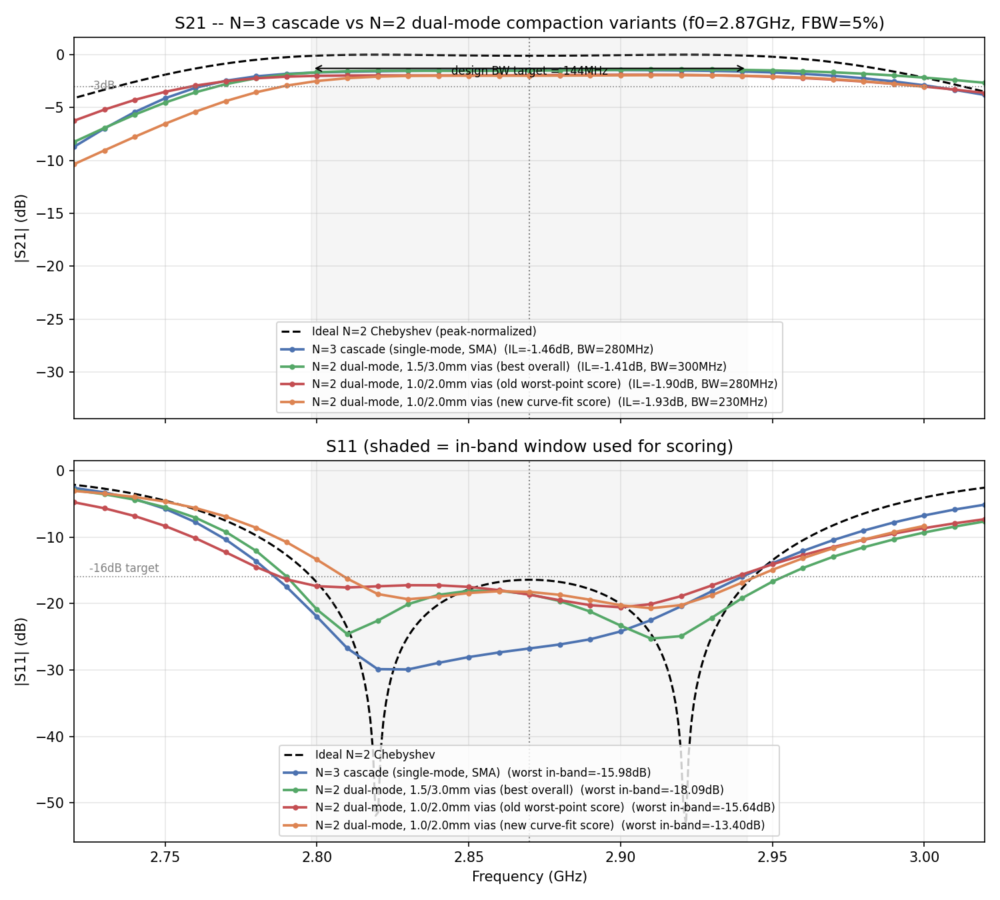
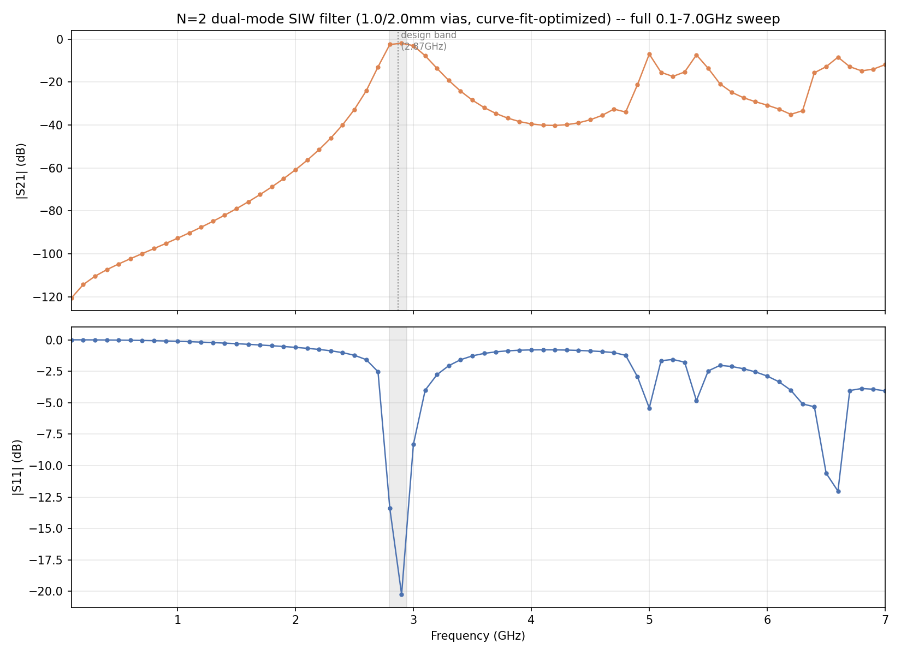

# Dual-mode cavity compaction — findings and status

Branch `sma_conn`. Follow-on from the SMA connector work (`../sma_connector/`):
replace the N=3 cascade of 3 single-mode SIW cavities (~119mm long) with a
single **dual-mode cavity** realizing N=2 (2 filter poles from 1 physical
cavity, via a TE102/TE201 degenerate-mode pair split by an internal
perturbation), roughly halving board length while matching or beating the
N=3 cascade's S11/S21.

## Topology

In-line ports (input/output on opposite walls, same axis as the rest of the
filter chain — not adjacent walls), with an internal floating via row
(a straight transverse iris row at distance `x_iris` from the input wall,
centered gap `w_iris`, held off both side walls by `y_wall` rather than
running wall-to-wall) providing the mode-splitting coupling, and the same
Deslandes-taper external iris pattern as the main project filter (microstrip
flares from the true-50Ω width out to the cavity wall width, with `w_ext` an
independent narrower gap in that flare).

## Key files

- `src/siwfilter/palace_dualmode.py` — closed-cavity eigenmode-only model
  (all-PEC boundaries), used for cheap k12(w_iris, x_iris, y_wall)
  calibration sweeps before ever running the expensive driven model.
- `src/siwfilter/palace_dualmode_driven.py` — the 2-port driven model with a
  real SMA coax launch (reuses the SMA construction from `palace_driven.py`).
  `build_mesh()`, `_segment_vias()` (continuous via positioning — see
  bugfix below), `plot_layout_2d()` (fast matplotlib sanity check, no mesh
  needed), `_dims()` (true-50Ω `W_ms`/taper/feed length, NOT the stale
  `config.py` `OPTIMIZED_DESIGN` cache which was tuned against an idealized
  self-normalizing port).
- `src/siwfilter/palace_opt_dualmode.py` — Bayesian re-tune (skopt GP
  surrogate) against the driven+SMA model. Docstring has the full N=2
  coupling-matrix derivation (g-values, k12, Qe) and scoring history (v9-v16).
- `scripts/dualmode_calibrate_v2.py`, `dualmode_calibrate_ywall.py` — eigenmode
  k12 calibration sweeps.
- `scripts/dualmode_2port_test.py` — isolated 2-port driven sanity check.
- `scripts/dualmode_wideband_sweep.py` — full 0.1-7GHz overview sweep of a
  chosen design (spurious-mode check).

## Bugs found and fixed along the way

- **Via-position quantization.** The original via-fence construction filtered
  a FIXED a/p spacing grid by threshold, so multiple different parameter
  values could collapse onto the identical mesh — actively fighting the GP
  optimizer's smoothness assumption. Fixed with `_segment_vias(lo, hi, p)`
  (`n = round((hi-lo)/p); linspace(lo, hi, n+1)`), verified visually:

  

  Residual: via COUNT can still jump ±1 at the `round()` boundary — a real
  but secondary noise source, not fully eliminated.
- **Coarse-grid aliasing (the big one).** A 50MHz frequency step is coarser
  than the ~100-150MHz ripple period of a near-spec 2-pole response, so a
  coarse sweep can land entirely on either side of a narrow ripple peak and
  report scores far better than the true fine-mesh value (one case: -23.8dB
  coarse vs -13.25dB true). Fixed by tightening to a 20MHz coarse step
  (documented in the optimizer as "DO NOT widen again") and narrowing the
  frequency *range* rather than the step when eval cost needs controlling.
  **Even the 20MHz step isn't proof against this** — see the v16 result
  below, where the true worst point at the very band edge still wasn't
  caught until the wide, fine (10MHz) confirmation sweep.
- **Weak external coupling (early driven model).** Pinning the wall opening
  directly to the bare microstrip width (no taper) capped peak S21 at
  -24dB across a wide search box regardless of internal-iris tuning — fixed
  by reintroducing the real Deslandes taper (see Topology above).

## Scoring methodology (v16 — current)

Earlier scores (v9-v15) used a worst-point-in-a-fixed-box S11 term plus
separate ad-hoc fc-centering and bandwidth penalties. These could not tell
an asymmetric/off-center response from a properly centered one scoring the
same, and duplicated logic that a curve-shape comparison already gives for
free. v16 instead **fits the simulated response against the ideal (lossless)
N=2 Chebyshev target**, computed via the standard normalized coupling-matrix
formulation (Cameron, Kudsia & Mansour, *Microwave Filters for Communication
Systems*, Wiley — coupling-matrix synthesis/CAD tuning, already this
project's reference per `CLAUDE.md` §8; also Hong & Lancaster, *Microstrip
Filters*, Ch. 8, extraction/tuning methods):

- `ideal_response_db()` in `palace_opt_dualmode.py` builds the ideal |S11|,
  |S21| from the N=2 g-values (g=[1, 0.8430, 0.6220, 1.3554] → k12=0.0691,
  Qe=16.86 — **do not reuse the project's N=3 default k12=k23=0.0460,
  Qe=20.63 here**).
- RMSE of simulated vs. ideal is computed over a window slightly wider than
  the design band (`FIT_WINDOW`, 1.5× the half-bandwidth either side of f0).
- S21 is **peak-normalized before fitting** (both curves shifted so their own
  peak = 0dB), specifically to exclude real insertion loss — a
  substrate-loss-limited, geometry-unfixable quantity — from the shape-fit
  error, per explicit request.
- Fabrication-tolerance robustness is checked **post-hoc** (round the winning
  design to 0.1mm, re-run fine confirm, compare) rather than baked into every
  eval's score, to avoid multiplying compute cost.

## Results

Three via pitches were searched (1.5/3.0mm, 1.0/2.0mm, and a quick
1.0/2.0mm 0.8/1.6mm scan) across three different scoring methodologies
(old worst-point score, a bandwidth-focused variant, and the v16
curve-fit score above) — all fine-mesh-confirmed (10MHz step, wide
2.5-3.0GHz or wider sweep) before being trusted:

| Design | fc | Insertion loss | 3dB BW | Worst in-band S11 |
|---|---|---|---|---|
| N=3 cascade (single-mode, SMA) | 2.89 GHz | -1.46 dB | 280 MHz | -15.98 dB |
| **N=2 dual-mode, 1.5/3.0mm vias (best overall)** | 2.92 GHz | -1.41 dB | 300 MHz | **-18.09 dB** |
| N=2 dual-mode, 1.0/2.0mm vias (old worst-point score) | 2.91 GHz | -1.90 dB | 280 MHz | -15.64 dB |
| N=2 dual-mode, 1.0/2.0mm vias (v16 curve-fit score) | 2.92 GHz | -1.93 dB | 230 MHz | -13.40 dB |

**Conclusion: the 1.5mm/3.0mm N=2 dual-mode design is the best landed
filter** — half the length of the N=3 cascade, and beats it on both S11 and
S21. The tighter 1.0mm/2.0mm via pitch was tried three separate times under
three different objectives and never matched the 1.5mm design once properly
fine-confirmed; treat that question as settled rather than re-opening it
without a new reason to.

Full 0.1-7GHz sweep of the 1.0/2.0mm v16 design (done specifically to check
for early/nearby spurious higher-order-mode passbands — none found closer
than ~1.7x f0, a normal SIW spurious spacing):

Winning 1.5mm/3.0mm design parameters (`a`, `w_iris`, `x_iris`, `y_wall`,
`w_ext` in mm): **57.21, 15.26, 28.68, 8.62, 16.31** — tag
`optDmF_57.21_15.26_28.68_8.62_16.31` in `output/data/postpro/` (not
committed — regenerate via `palace_opt_dualmode.evaluate(..., fine=True)`
with these params, or see `opt_dualmode_best.json` history in the master
log if still present locally).

## Open items / next

See `HANDOFF.md` at the repo root for the current task: swap in a real,
sourceable edge-mount SMA connector (Taoglas EMPCB.SMAFSTJ.B.HT) in place of
the connector modeled so far, plus top-layer ground via stitching at the
connector footprint.
