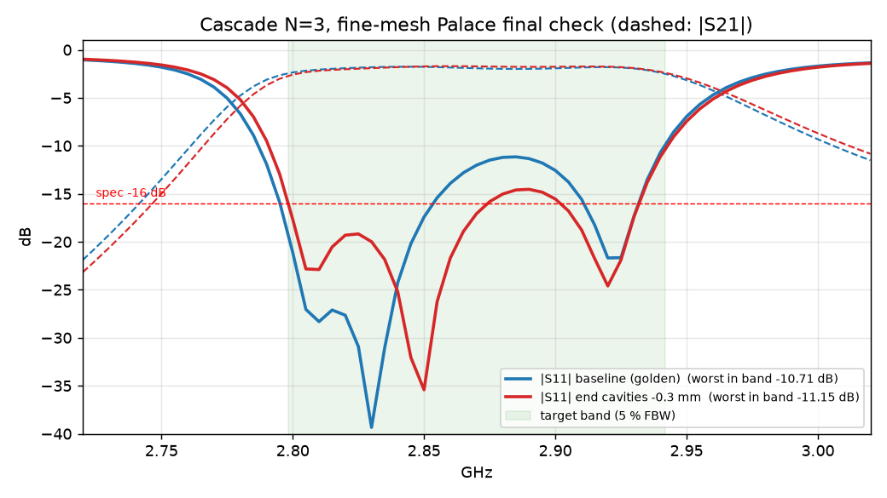
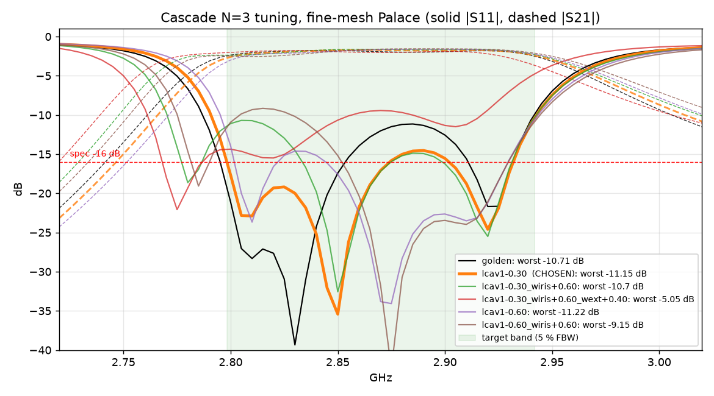
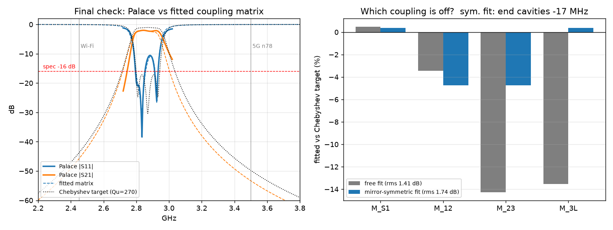

# Final pre-fab check — cascade N=3 (2026-09-23)

**Verdict: GO, with the end cavities trimmed −0.3 mm (`l_cav1` = 33.939 mm),
as a prototype that deviates from spec in writing. It is not a
spec-compliant part.** Fine-mesh final check: −11.15 dB worst in band (golden:
−10.71 dB). This was the best of six fine-mesh variants (sec. 2c). The fab
package is `fab/siw_cascade_N3_jlcpcb.zip` (34/34 checks pass). Every model agrees on the passband: fc ≈ 2.872 GHz,
BW ≈ 184 MHz, IL ≈ 2.0 dB. None of them reaches the −16 dB return-loss spec.
The coupling-matrix fit (sec. 3) says why. The one correction tried so far
(sec. 2a) gains 3.4 dB of interior ripple but only 0.44 dB on the
worst-in-band number.

## 1. Board verification

`siw kicad --topology cascade --N 3 --params <golden> --launch cpwg` was re-run
into a scratch directory and diffed against `output/kicad/`:

- Gerbers (F/B Cu, masks, silk, Edge.Cuts) and PTH/NPTH drill match
  `output/kicad/` **line for line apart from timestamps**. The board being
  uploaded is the one in the golden.
- **33/33 automated file-level checks pass.** The 34th (drawn geometry = meshed
  geometry) was skipped this time to save memory. It passed on 2026-09-06 on the
  same geometry and is still ticked in `output/kicad/FAB_CHECKLIST.md`.
- Items still marked for **manual** confirmation with the fab:
  - Laminate must really be **RO4350B 0.76 mm** (JLCPCB defaults to FR-4, which invalidates the design).
  - **No soldermask**: say so in the order notes.
  - **Hole-to-edge clearance of 0.25 mm** on the launch stitching vias.
  - **0.5 oz copper is load-bearing.** The finished stack is 0.795 mm against the SMA fork's 0.80 mm maximum. 1 oz copper does not fit.

## 2a. Final Palace run — DONE (2026-09-23, on a 16 GB host)

`run_final.py` (0.15 mm coax ports, 9.12 mm air, 2.5/0.45 mm volume mesh,
direct solver, 4 ranks, ~5.5 GB) completed all 61 points, then the same run
with the end cavities trimmed per sec. 3 (`run_final.py 4 -0.3`):

| fine mesh | golden (baseline) | `l_cav1` −0.3 mm |
|---|---|---|
| worst in-band S11 | −10.71 dB (at 2.940 GHz) | **−11.15 dB** (at 2.940 GHz) |
| interior ripple peak (2.83–2.92 GHz) | −11.15 dB | **−14.53 dB** |
| S11 at 2.87 GHz | −12.0 dB | −17.1 dB |
| BW / fc (−3 dB from peak) | 184.3 MHz / 2.872 GHz | 182.3 MHz / 2.876 GHz |
| IL peak / worst in band | −1.76 / −2.38 dB | −1.70 / −2.58 dB |
| fit: end-cavity detune | −19 MHz | −11 MHz |
| fit: internal k error | −5 % | −8 % |
| fit: Qu | 276 | 229 |

**The fine-mesh baseline confirms the refined-port sweep** (−10.71 vs
−10.56 dB). The golden's −13.37 dB was a coarse-mesh artefact.

**The trim works as predicted**. It lifts the interior ripple by 3.4 dB and
halves the end-cavity detune. The sensitivity is ~27 MHz/mm here, not the
~50 MHz/mm rule of thumb, so a full correction would be about −0.6 mm. But the
worst-in-band number moved only 0.44 dB. It is now pinned at the **upper edge
of the target band (2.94 GHz)**, where S11 already climbs out of the passband.
The equiripple region ends near 2.935 GHz and the target band ends at 2.942 GHz.
The next knobs are the internal coupling (now 8 % weak, so a wider `w_iris`)
and a slightly higher centre. Neither trim touches the external Qe, which
stays within 5 %.

**Fab files still describe the golden (untrimmed) board.** Adopting the trim
means regenerating `siw kicad` and a new golden entry.

## 2c. Tuning: two iterations, six fine-mesh runs

| run (Δ from golden, mm) | worst in band | interior ripple | BW | fc | IL in band |
|---|---|---|---|---|---|
| golden | −10.71 | −11.15 | 184.3 | 2.872 | −2.38 |
| **l_cav1 −0.3 (CHOSEN)** | **−11.15** | **−14.53** | 182.3 | 2.876 | −2.58 |
| l_cav1 −0.6 | −11.22 | −14.61 | 181.6 | 2.881 | −2.99 |
| l_cav1 −0.3, w_iris +0.6 | −10.70 | −14.51 | 202.9 | 2.867 | −2.37 |
| l_cav1 −0.6, w_iris +0.6 | −9.15 | −10.19 | 204.1 | 2.873 | −2.54 |
| l_cav1 −0.3, w_iris +0.6, w_ext +0.4 | −5.05 | −9.38 | 195.4 | 2.855 | −3.50 |

What the runs showed:

- **`l_cav1` saturates after −0.3 mm.** −0.6 mm matches it on S11 (0.07 dB) but
  pushes the band up to 2.881 GHz and costs 0.4 dB of in-band IL at the lower
  edge. −0.3 mm is chosen.
- **A wider `w_iris` widens the band (203 MHz) without improving the worst
  case.** It opens a new hump between the first two reflection zeros
  (2.81 GHz).
- **A wider `w_ext` is strongly harmful.** The larger aperture also pulls the end
  cavities down (fc falls to 2.855 GHz), so external coupling can't be
  adjusted on its own. The planned +0.8 mm run was cancelled.
- The remaining gap (worst S11 sitting at the 2.94 GHz band edge) would need a
  coordinated multi-parameter move (`w_ext` + `l_cav1` + `w_iris` together).
  That is a job for a local optimiser (`siw design --seed ...`), not
  single-knob trims. It was not pursued, per the 2-iteration budget.

**Fab package regenerated for the chosen geometry.** It has a new golden entry
(`golden/cascade_N3/l_cav133.94_...json`), CST macros for both the time-domain
(TD) and frequency-domain (FD) solvers, and KiCad gerbers/drill. The board is
165.78 × 45.79 mm (0.6 mm shorter), and **34/34 checks pass**, including
drawn-vs-meshed geometry and CST-vs-mesh via positions.

## 2b. First attempt on the 3.7 GB host — did not complete

`run_final.py` combines every audit fix: 0.15 mm coax ports, 9.12 mm air and the
finer 2.5/0.45 mm volume mesh. That gives 315k ND unknowns. **This host has
3.7 GB RAM and no swap.** A comparable run on 2026-09-06 peaked at 5.1 GB.
Four attempts were made:

| attempt | result |
|---|---|
| direct solver, 2 ranks | OOM-killed during setup (3.0 GB peak). The kill also took down the tmux session. |
| direct solver, 1 rank | terminated at the first frequency point |
| AMS iterative, 1 rank, 2.3 GB cgroup cap | OOM at the first solve |
| AMS, GMRES MaxSize 20, 2.55 GB cap | OOM at the first solve |

Adding swap was declined as a system change. **To finish this run, use a
machine with 6 GB of RAM or more, or add swap, then run
`uv run python docs/final_check/run_final.py`.**

The verdict therefore rests on runs that already exist and did complete:

| model | worst in-band S11 | BW | IL |
|---|---|---|---|
| golden (3.5/0.6 mesh, coarse ports) | −13.37 dB | 189 MHz | −1.85 dB |
| finer mesh 2.5/0.45 (`mesh_convergence_cascade_N3.json`) | −9.34 dB | 184 MHz | −2.00 dB |
| **refined ports 0.15 mm, 4.56 mm air** (61 pts, used below) | **−10.56 dB** | **183.7 MHz** | **−2.01 dB** |
| refined ports + 9.12 mm air (spot points only) | −14.8 dB at 2.87 GHz | — | −1.75 dB |

Across the models S11 spans 5 dB, while fc, BW and IL move by less than
10 MHz and 0.3 dB. **The passband is robust. The match is inside the model
uncertainty, and every model puts it short of −16 dB.**

## 3. Analysis: which coupling is off?

`analyze_final.py` fits a lossy N=3 coupling matrix to the refined-port
sweep and compares it with the Chebyshev target. The fit uses four couplings,
the resonator detunings and an unloaded Q.

The board is mirror-symmetric, so the headline fit is the **symmetric** one
(rms 1.74 dB; the free fit reaches 1.41 dB with 3 more knobs):

| quantity | fitted vs target |
|---|---|
| external coupling M_S1 = M_3L (Qe) | **+0.4 %**: on target. The launch/taper is right. |
| internal coupling M_12 = M_23 (k) | **−4.8 %**: slightly weak |
| end cavities 1 & 3 | resonate **17 MHz low** |
| middle cavity 2 | −1 MHz: on tune |
| unloaded Q | ≈ 320 |

So the missing return loss is **not** the external-coupling problem suspected
since 2026-08-30. The main error is the two end cavities sitting about 17 MHz
below the middle one. By the project's rule of thumb (~50 MHz per mm), that
means `l_cav1` is about 0.3 mm too long. The internal irises are also roughly
5 % weak, which is about 0.5 mm of `w_iris`. The `l_cav1` −0.3 mm
correction was then simulated on the fine mesh; see sec. 2a for the result.

### Fun numbers

- **Group delay** (from Palace's S21 phase): 4.3–7.1 ns across the band,
  4.5 ns at f0.
- **Wi-Fi 2.45 GHz**: −61 dB (Palace broadband sweep). The SIW's TE10 cutoff
  does most of this work, which is why the coupling-matrix model, which has no
  cutoff, predicts only −46 dB.
- **5G n78 at 3.5 GHz**: −39.5 dB (Palace broadband sweep).
- **Spurious passband: 5.8–6.8 GHz at −1.8 dB.** It covers 5.8 GHz Wi-Fi
  (UNII-3) and the bottom of Wi-Fi 6E. It is the known second passband, not a
  fault, but a real application would need a low-pass after the filter. Also
  expect it on the VNA.

## Files

- `run_final.py` is the fine-mesh final check (needs ≥ 6 GB RAM).
- `analyze_final.py` does the coupling-matrix fit, rejection and group delay.
- `runs_*.json` are all six fine-mesh runs (`runs_final_golden.json` is the golden). `tuning_summary.json` and `tuning_comparison.png` summarise them, and `compare_runs.py` rebuilds both.
- `analysis_final.json` and `analysis_trim.json` are the coupling-matrix fits of the golden and chosen runs. `trim_comparison.png` compares those two.
- `fab/` holds the files to order: `siw_cascade_N3_jlcpcb.zip` (gerbers + drill), `FAB_CHECKLIST.md`, `FAB_NOTES.md`, and the CST macros (`.bas`, TD and FD).
- `refined_sweep.json` is the Palace data analysed (copied from `output/data/postpro/audit_refined_sweep/`).
- `analysis.json` and `analysis.png` are the fit results.

## 4. JLCPCB check (2026-09-23): the board as drawn cannot be ordered there as-is

Checked against JLCPCB's own pages ([capabilities](https://jlcpcb.com/capabilities/pcb-capabilities),
[high-frequency PCB](https://jlcpcb.com/pcb-fabrication/high-frequency-pcb),
[Rogers announcement](https://jlcpcb.com/blog/112-rogers-pcb-ptfe-pcb-high-frequency-pcb-is-available-on-jlcpcb)):

| our assumption | JLCPCB RO4350B offer | status |
|---|---|---|
| RO4350B 0.76 mm core | cores 0.51 / 0.76 / 1.52 mm; finished 0.6(0.65) / **0.9** / 1.65 mm, 2-layer | ✔ laminate available |
| **0.5 oz copper**, finished stack 0.795 mm | **"Outer Copper Weight: 1 oz"** only; finished ≈ 0.9 mm catalogue (±0.1 mm) | ⚠ **marginal**. At the (mask-free) pads it is ≈ 0.84 mm vs the fork slot 0.81 ± 0.1 mm (datasheet §3 front view; §1/§2 say 0.8 max, §3.1 says 0.79). Fix if tight: scrape ~15–20 µm of copper per side under the leg pads only, never the laminate, then re-tin. RF effect is nil (skin depth 1.2 µm). |
| **No soldermask** | colour "Green"; no no-mask option in the form | ⚠ **order note**. Mask coverage comes from the gerbers, and ours open F.Mask/B.Mask over the whole board, so no mask is applied. State it in the remarks so their CAM doesn't "fix" it. |
| ENIG | ENIG only (1U/2U) | ✔ |
| Dk 3.66 (Rogers *design* Dk) | quotes 3.48 (Rogers *process* Dk at 10 GHz) | ✔ same laminate. 3.66 is the right value to design with |
| copper to routed edge (launch pads run to the edge for the edge-mount SMA) | "≧0.2 mm" | ⚠ needs an explicit order note, or they pull the copper back |
| via annular ring 0.15 mm (1.5 mm and 0.6 mm drills) | via pad ≥ hole + 0.1 mm (0.05 mm ring) ✔. If they classify the holes as PTH: min 0.18 mm ✘ | ⚠ confirm |
| min track / space 0.10 mm, drill ≥ 0.2 mm, hole-to-hole 0.2 mm | ours 1.2 mm / 0.2512 mm / 0.6–1.5 mm / 1.5 mm | ✔ |
| board 165.78 × 45.79 mm | max 590 × 438 mm; the $99.5 promo covers only ≤ 10 × 10 cm | ✔ (quoted price, not promo) |

**Conclusion (revised the same day):** orderable at JLCPCB with order notes.
The earlier "blocker" reading was too strict. 1 oz is about 0.03 mm over the
nominal fork slot and can be fixed at assembly by scraping. No-mask is set by
our gerbers and only needs a remark. The remaining DFM question for their
engineers is the copper and stitching vias intentionally at the board edge
(0.10 mm copper-to-edge vs their 0.2 mm rule, 0.25 mm hole-to-edge) for the
edge-mount SMA.
