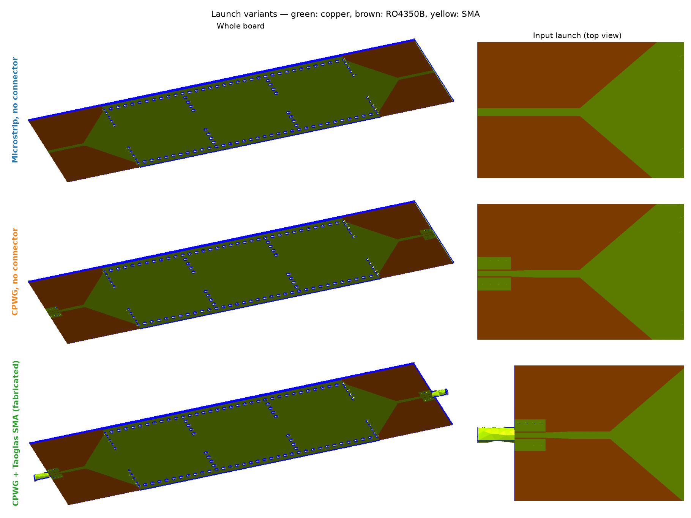

# Launch comparison — cascade N=3

The fabricated geometry (`golden/cascade_N3/l_cav133.94_…`) with three feed
launches. All three use the same fine Palace mesh as the final check
(2.5/0.45 mm, 2.72–3.02 GHz, 5 MHz step).




| Launch | Worst in-band S11 | BW (−3 dB) | IL peak / worst in band | fc |
|---|---|---|---|---|
| Microstrip, no connector | −6.3 dB | 205 MHz | −1.87 / −4.06 dB | 2.897 GHz |
| CPWG, no connector | −5.1 dB | 164 MHz | −2.21 / −4.54 dB | 2.875 GHz |
| **CPWG + Taoglas SMA (fabricated)** | **−11.2 dB** | 182 MHz | −1.70 / −2.58 dB | 2.876 GHz |

**Reading it:**

- **The connector is part of the filter.** The design was tuned with the
  SMA in place. Its reactance is part of the end cavities' external coupling.
  Without it, only one reflection zero remains instead of three, and the match
  drops to −5 to −6 dB.
- **Wave-port caveat.** Without a connector, the ports sit directly on the
  planar line and normalise to its own impedance. These two curves therefore
  show the filter behind an ideally matched feed, not a 50 Ω measurement.
- **CPWG port mode.** A bare CPWG port face has four conductors. Palace's
  modes 1–2 there are the ground pours against the bottom plane
  (S21 ≈ −78 dB). The signal mode is mode 3, which is what `run_launch.py`
  uses.

## Reproduce

```bash
uv run python docs/launch_comparison/run_launch.py ms 4     # ~8 min each
uv run python docs/launch_comparison/run_launch.py cpwg 4
uv run python docs/launch_comparison/render.py             # 3D renders → output/
uv run python docs/launch_comparison/compare.py            # figures + summary.json
```

The `cpwg_sma` curve is the golden run (`docs/final_check/run_final.py 4 -0.3`).
