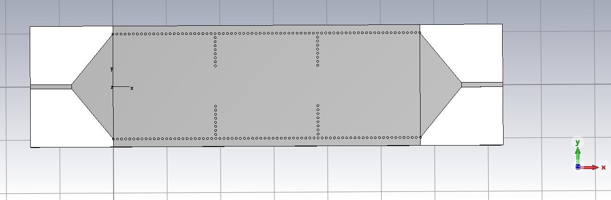
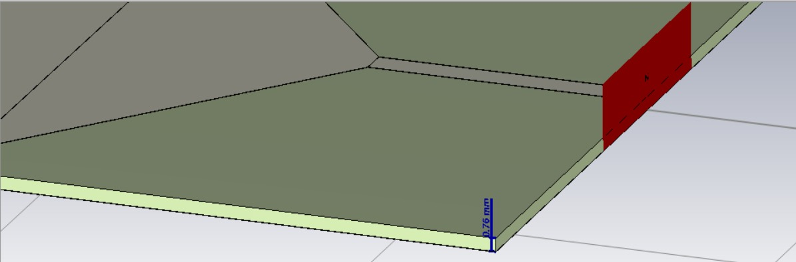
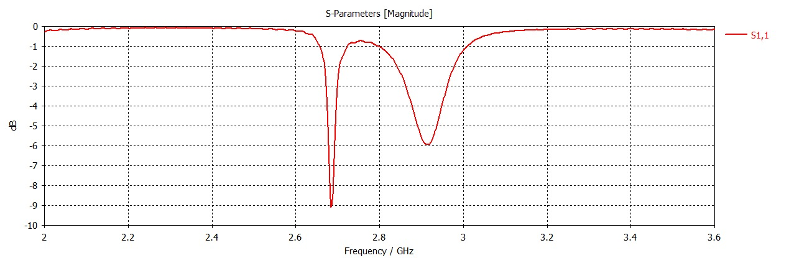

```{=latex}
\begin{IEEEkeywords}
banda S, filtro pasabanda, guía de onda integrada en sustrato, SIW,
cavidades resonantes, síntesis de Chebyshev, simulación electromagnética,
Palace, optimización bayesiana
\end{IEEEkeywords}
```

# Introducción {#sec:intro}

La tecnología de guía de onda integrada en sustrato (SIW, del inglés
*Substrate Integrated Waveguide*) permite construir guías de onda rectangulares
sobre un sustrato laminado de microondas. Combina el bajo costo y la
integrabilidad de los circuitos planos con el alto factor de calidad y la
capacidad de manejo de potencia de las guías metálicas
[@deslandes2001integrated; @bozzi2011review]. Una guía SIW se forma confinando
el campo entre dos filas de vías metalizadas que conectan los planos de masa
superior e inferior, y que hacen de paredes laterales de una guía rectangular.

Los filtros pasabanda son un bloque básico de cualquier cadena de recepción o
transmisión de radiofrecuencia. En este trabajo diseñamos, simulamos, mandamos
a fabricar y medimos un filtro SIW de tercer orden centrado en
$f_0 = 2.87$ GHz, con una respuesta de Chebyshev de ancho de banda fraccional
$\text{FBW} = 5\%$ y rizado de 0.1 dB. La Tabla \ref{tab:specs} resume las
especificaciones de partida.

Este informe cuenta el camino completo, con lo que no funcionó incluido, en el
orden en que lo recorrimos. En cada etapa explicamos qué queríamos probar, qué
hicimos, qué obtuvimos y qué decidimos; la Tabla \ref{tab:chrono} lo resume. La
primera iteración (junio de 2026) ocupa las Secciones \ref{sec:sintesis} a
\ref{sec:palace}: la síntesis, un diseño analítico con vías de 0.8 mm y paso de
1.5 mm, openEMS, CST y una primera optimización con Palace. La conservamos
porque explica las decisiones posteriores. La Sección \ref{sec:tools} cuenta con
qué herramientas y con qué máquinas trabajamos. Desde la Sección \ref{sec:sma}
contamos la evolución hasta el diseño que mandamos a fabricar: el conector SMA
real, las otras topologías (ya con vías de 1.5 mm y paso de 3.0 mm), la
calibración con inversión y la verificación final (Secciones \ref{sec:fab} y
\ref{sec:fabricacion}). La Sección \ref{sec:vna} presenta las mediciones de la
placa fabricada y la Sección \ref{sec:concl} cierra con las conclusiones.

```{=latex}
\begin{table}[t]
\centering
\caption{Especificaciones del filtro}
\label{tab:specs}
\begin{tabular}{ll}
\hline
\textbf{Parámetro} & \textbf{Valor} \\
\hline
Frecuencia central $f_0$ & 2.87 GHz \\
Orden $N$ & 3 cavidades \\
Ancho de banda fraccional & 5 \% \\
Rizado (Chebyshev) & 0.1 dB \\
Sustrato & Rogers RO4350B \\
Espesor $h$ & 0.76 mm \\
Permitividad $\varepsilon_r$ & 3.66 \\
Tangente de pérdidas $\tan\delta$ & 0.0037 \\
Diámetro de vía $d$ & 0.8 mm (1ª iter.) / 1.5 mm (final) \\
Paso de vía $p$ & 1.5 mm (1ª iter.) / 3.0 mm (final) \\
\hline
\end{tabular}
\end{table}
```

```{=latex}
\begin{table*}[t]
\centering
\footnotesize
\setlength{\tabcolsep}{4pt}
\caption{Cronología del trabajo}
\label{tab:chrono}
\begin{tabular}{p{0.13\textwidth}p{0.27\textwidth}p{0.32\textwidth}p{0.21\textwidth}}
\hline
\textbf{Etapa} & \textbf{Qué hicimos} & \textbf{Resultado} & \textbf{Decisión} \\
\hline
Diseño analítico (Secs.~\ref{sec:sintesis}--\ref{sec:iter1}) & Síntesis de Chebyshev ($g_i$, $k$, $Q_e$) y fórmulas de SIW para una cavidad de 38.23 mm & $a_{\text{siw}} = 39.45$ mm; objetivo de $k = 0.046$ y $Q_e = 20.6$ & Verificarlo con simulación de onda completa \\
\hline
openEMS (Sec.~\ref{sec:iter1}) & Calibramos el iris con dos cavidades acopladas y barrimos $L_{\text{cav}}$ con alimentación microstrip & Iris de 13.66 mm para $k = 0.046$; banda centrada en 2.82--2.905 GHz; los puertos no dan un $S_{11}$ confiable (incluso $|S_{11}| > 1$) & Usarlo solo para $S_{21}$ y centro de banda; cambiar de solver para la adaptación \\
\hline
CST (Sec.~\ref{sec:iter1}) & Modelo 3D paramétrico con macro generada por nuestro código & Frecuencia central de 2.818 GHz, 293 MHz de ancho de banda, 3.65 dB de pérdida de inserción y 1.02 dB de pérdida de retorno: sobreacoplado & Agregar un iris externo $w_{\text{ext}}$ para ajustar $Q_e$ \\
\hline
Palace (Sec.~\ref{sec:palace}) & Validación contra CST y optimización por coordenadas & Cavidades de 34.4 mm, banda en 2.87 GHz y $S_{11} < -16$ dB, pero con un puerto que ocultaba una línea de 41\,$\Omega$ & Adoptar Palace como solver; desconfiar del puerto ideal \\
\hline
Conector SMA y alimentación CPWG (Sec.~\ref{sec:sma}) & Modelo 3D del conector Taoglas y alimentación CPWG de 50\,$\Omega$ & La línea de 2.26 mm era de $\approx 41~\Omega$ (el ancho correcto es 1.664 mm); un pin de 0.82 mm cortocircuita; el diseño de Palace daba $\approx -4.6$ dB con el conector real & Pin real (0.38 mm de radio) y alimentación CPWG en todos los modelos \\
\hline
Otras topologías (Sec.~\ref{sec:topo}) & Modo dual N=2, tres cavidades únicas, cascadas N=3 y N=4 (Tabla~\ref{tab:topos}) & N=2: 119 mm, $-10.76$ dB y 316.6 MHz; cavidades únicas alternativas entre $-6$ y $-9$ dB; N=4: 211 mm y $-6.1$ dB & Cascada N=3 (166 mm); vías de 1.5 mm con paso de 3.0 mm \\
\hline
Calibración e inversión (Sec.~\ref{sec:calib}) & Medimos $k$ y $Q_e$ en estructuras pequeñas y las invertimos & La búsqueda global no pasó de $-5$ dB en más de 60 evaluaciones; la inversión dio $w_{\text{iris}} = 13.85$ mm y $w_{\text{ext}} = 13.53$ mm con unas 3 simulaciones por curva & Búsqueda bayesiana solo como pulido local \\
\hline
Verificación y fabricación (Secs.~\ref{sec:fab}--\ref{sec:fabricacion}) & Malla fina, ajuste de matriz de acoplamiento y verificación cruzada con CST; paquete de fabricación y pedido a JLCPCB & 2.876 GHz, 182.3 MHz y $-11.15$ dB en el peor punto de la banda: no llega a $-16$ dB & Fabricar con el desvío conocido (ENIG, unos USD 120) \\
\hline
Mediciones (Sec.~\ref{sec:vna}) & Analizador vectorial de redes, calibración del instrumento y recalibración por software & 2.894 GHz, 171 MHz, 2.0 a 2.4 dB y peor $S_{11}$ en banda de $-5$ dB; los estándares genéricos limitan la lectura de los ceros (piso de $\approx -18$ dB) & No se cumple $-16$ dB; recentrar y calibrar con estándares caracterizados \\
\hline
\end{tabular}
\end{table*}
```

# Punto de partida: la síntesis del filtro {#sec:sintesis}

Partimos del prototipo pasabajos de Chebyshev, cuyos valores normalizados
$g_i$ se obtienen por recursión [@hong2001microstrip]. Para $N = 3$ y rizado de
0.1 dB resultan $g_1 = g_3 = 1.0316$, $g_2 = 1.1474$ y $g_4 = 1.0$.

Con esos valores calculamos los coeficientes de acoplamiento entre cavidades
adyacentes y el factor de calidad externo de los puertos de entrada y salida:

$$ k_{i,i+1} = \frac{\text{FBW}}{\sqrt{g_i \, g_{i+1}}}, \qquad
   Q_e = \frac{g_0 \, g_1}{\text{FBW}}. $$

Con $\text{FBW} = 0.05$ obtuvimos $k_{12} = k_{23} = 0.0460$ y $Q_e = 20.63$.
Estos números no dependen de la frecuencia ni de cómo se construya el filtro:
son el objetivo que la geometría SIW tiene que reproducir, y los usamos como
referencia en todo el resto del proyecto.

Una observación que nos sirvió después para leer los gráficos: como el rizado
es de solo 0.1 dB, la banda de paso de $|S_{21}|$ parece perfectamente plana,
porque una variación de 0.1 dB no se ve en escala logarítmica. El carácter
equirrizado (Chebyshev) aparece en cambio en $|S_{11}|$, que tiene exactamente
$N = 3$ ceros de reflexión con picos de igual nivel ($\approx -16.4$ dB para
0.1 dB de rizado). Esa es la firma de una respuesta de Chebyshev y no de una de
Butterworth.

# Primera iteración: diseño analítico, openEMS y CST {#sec:iter1}

Queríamos saber si alcanzaba con el cálculo analítico de una cavidad SIW,
verificado con simulación de onda completa, para obtener la banda y la
adaptación del filtro. Armamos el diseño con las fórmulas clásicas, lo
simulamos en openEMS y en CST y lo comparamos con la síntesis. En esta primera
iteración usamos vías de 0.8 mm de diámetro con paso de 1.5 mm.

## Diseño analítico

Elegimos el ancho equivalente de la guía para que la frecuencia de corte del
modo fundamental TE10 quedara en $f_c \approx 0.7\,f_0$. Así el filtro trabaja
cerca de $1.4\,f_c$, donde la guía es monomodo y de bajas pérdidas:

$$ a_{\text{eff}} = \frac{c}{2 \, f_c \, \sqrt{\varepsilon_r}}. $$

La separación física entre filas de vías la corregimos con la fórmula de
Cassivi--Wu [@cassivi2002dispersion]:

$$ a_{\text{siw}} = a_{\text{eff}} + \frac{d^2}{0.95 \, p}. $$

La longitud de cada cavidad sale de la condición de resonancia del modo TE101:

$$ f_{101} = \frac{c}{2\sqrt{\varepsilon_r}}
   \sqrt{\left(\frac{1}{a_{\text{eff}}}\right)^2 +
         \left(\frac{1}{L}\right)^2}. $$

Verificamos las reglas de diseño de las vías ($0.5 \le p/d \le 2.5$ y
$d < \lambda_g/5$) para evitar fugas por radiación entre vías. La Tabla
\ref{tab:dim} resume las dimensiones resultantes (el ancho de iris sale de la
calibración de la subsección siguiente) y la Fig. \ref{fig:layout} muestra la
vista superior del layout.

```{=latex}
\begin{table}[t]
\centering
\caption{Dimensiones físicas del filtro}
\label{tab:dim}
\begin{tabular}{ll}
\hline
\textbf{Dimensión} & \textbf{Valor} \\
\hline
Ancho equivalente $a_{\text{eff}}$ & 39.00 mm \\
Separación de vías $a_{\text{siw}}$ & 39.45 mm \\
Longitud de cavidad $L_{\text{cav}}$ & 38.23 mm \\
Ancho de iris $w_{12} = w_{23}$ & 13.66 mm \\
Ancho de microstrip 50 $\Omega$ & 1.664 mm \\
\hline
\end{tabular}
\end{table}
```

{#fig:layout width=88%}

## Calibramos el iris y verificamos la cavidad en openEMS

No nos fiamos de las fórmulas cerradas para el ancho de iris en SIW, porque son
poco confiables, y medimos el acoplamiento con simulación de onda completa en
openEMS [@liebig2013openems]. Simulamos dos cavidades acopladas por un iris de
ancho variable y, del par de modos resonantes desdoblados $(f_1, f_2)$,
calculamos el coeficiente de acoplamiento:

$$ k = \frac{f_2^2 - f_1^2}{f_2^2 + f_1^2}. $$

Ajustando $w(k)$ vimos que el acoplamiento objetivo $k = 0.046$ se consigue con
un iris de $w = 13.66$ mm, bastante mayor que la estimación analítica inicial.
La calibración era necesaria.

Después verificamos la longitud de cavidad. Probamos dos modelos de excitación,
que llevan a conclusiones distintas. Con puertos concentrados (sondas de
50 $\Omega$ dentro de la cavidad) ubicamos la resonancia rápidamente y a bajo
costo, pero el modelo no incluye la carga de la línea de alimentación real: la
frecuencia sale sesgada y el nivel absoluto de $|S_{21}|$ no es representativo.
El modelo físico, con alimentación microstrip de 50 $\Omega$ adaptada mediante
una transición cónica (taper) microstrip--SIW [@deslandes2006accurate],
reproduce las condiciones de medición, y lo tomamos como referencia.

Con la alimentación adaptada, openEMS y CST coincidieron. La longitud analítica de
$L_{\text{cav}} = 38.23$ mm ubicó el centro de la banda de paso en 2.82 GHz
(openEMS, $-3$ dB) / 2.905 GHz (pico) y 2.818 GHz (CST), todos a unos 50 MHz
del objetivo de 2.87 GHz. El cálculo analítico de la longitud de cavidad
resultó adecuado y **no necesitó una corrección apreciable**; acortar la
cavidad desplazaba la banda por encima del objetivo, como muestran la Tabla
\ref{tab:sweep} y la Fig. \ref{fig:cmpall}.

```{=latex}
\begin{table}[t]
\centering
\caption{Barrido de $L_{\text{cav}}$ con alimentación microstrip adaptada (openEMS)}
\label{tab:sweep}
\begin{tabular}{cc}
\hline
$L_{\text{cav}}$ (mm) & $f_{\text{centro}}$ (GHz) \\
\hline
\textbf{38.23} & \textbf{2.905} \\
35.93 & 2.982 \\
33.64 & 3.077 \\
\hline
\end{tabular}
\end{table}
```

```{=latex}
\begin{figure*}[t]
\centering
\includegraphics[width=0.86\textwidth]{compare_all.png}
\caption{Barrido de la longitud de cavidad en openEMS con alimentación
microstrip adaptada (resolución media), comparado con la respuesta objetivo de
síntesis y con la simulación de CST. La longitud analítica de 38.2 mm (curva en
banda) coincide con el objetivo, lo que valida el diseño.}
\label{fig:cmpall}
\end{figure*}
```

Con la alimentación adaptada y la longitud analítica, openEMS reprodujo una banda de
paso de tres polos con una pérdida de inserción de unos pocos decibelios,
comparable a la de CST. Con eso dimos por confirmada la validez del diseño, en
frecuencia y en forma de respuesta.

## Armamos el modelo 3D en CST

Para tener una segunda opinión, y un modelo que se pudiera resintonizar sin
volver a programar, construimos el modelo tridimensional paramétrico en CST
Studio Suite 2021 con una macro que genera nuestro código. El modelo está hecho
de sólidos nativos (sustrato, planos de masa, vías metalizadas y transiciones
microstrip), con todas las dimensiones guardadas como parámetros editables, de
modo que el diseño se puede resintonizar directamente en el entorno gráfico.
Las Figs. \ref{fig:cst1}, \ref{fig:cst2} y \ref{fig:cst3} muestran distintas
vistas del modelo.

Simulamos en CST con la longitud de cavidad analítica
$L_{\text{cav}} = 38.23$ mm, el mismo valor que habíamos validado con el barrido
con alimentación adaptada en openEMS.

{#fig:cst1 width=88%}

{#fig:cst2 width=88%}

{#fig:cst3 width=88%}

## Qué obtuvimos con la primera iteración

La Fig. \ref{fig:compare} superpone la respuesta objetivo de síntesis con la
simulación de CST. Las Figs. \ref{fig:s11} y \ref{fig:s21} muestran los
parámetros $S_{11}$ y $S_{21}$ que obtuvimos en CST. La Tabla \ref{tab:res}
resume la comparación cuantitativa.

```{=latex}
\begin{figure*}[t]
\centering
\includegraphics[width=0.86\textwidth]{compare.png}
\caption{Comparación de la respuesta objetivo de síntesis (líneas
discontinuas) con la simulación de CST (líneas continuas, $L_{\text{cav}} =
38.23$ mm, $w_{12} = w_{23} = 13.66$ mm, $W_{\text{ms}} = 1.66$ mm), para
$|S_{11}|$ (superior) y $|S_{21}|$ (inferior).}
\label{fig:compare}
\end{figure*}
```

```{=latex}
\begin{table}[t]
\centering
\caption{Comparación síntesis vs. simulación CST ($L_{\text{cav}} = 38.23$ mm analítico)}
\label{tab:res}
\begin{tabular}{lcc}
\hline
\textbf{Parámetro} & \textbf{Objetivo} & \textbf{CST} \\
\hline
Frecuencia central & 2.870 GHz & 2.818 GHz \\
Ancho de banda ($-3$ dB) & 143 MHz & 293 MHz \\
Pérdida de inserción & $\sim$0 dB & 3.65 dB \\
Pérdida de retorno & $>$16 dB & 1.02 dB \\
\hline
\end{tabular}
\end{table}
```

{#fig:s11 width=88%}

{#fig:s21 width=88%}

La simulación de CST confirmó una respuesta pasabanda con tres polos, en
concordancia con el orden $N = 3$ del diseño. La frecuencia central (2.818 GHz)
quedó a unos 50 MHz del objetivo, dentro de lo que se espera entre la síntesis
y la simulación de onda completa, y coincidió con la predicción de openEMS para
la misma longitud de cavidad. El ancho de banda salió más amplio que el
objetivo porque todavía no habíamos calibrado electromagnéticamente el
acoplamiento externo $Q_e$, que fijan las transiciones microstrip, y el
filtro quedó sobreacoplado. La pérdida de inserción ($3.65$ dB en CST y unos pocos
decibelios en el modelo microstrip adaptado de openEMS) combina una leve
desadaptación residual con la pérdida dieléctrica propia del sustrato
($\tan\delta = 0.0037$); ambos simuladores coincidieron en el orden de magnitud.

En resumen, la primera iteración validó la síntesis y el centro de la banda,
pero no la adaptación: la pérdida de retorno de 1.02 dB estaba muy lejos de los
16 dB pedidos. Decidimos atacar el ancho de banda y el acoplamiento externo.

## Qué probamos para centrar y angostar la banda

Un filtro de cavidades acopladas tiene dos grados de libertad de sintonización
casi independientes, y los fuimos explorando sobre el modelo paramétrico de CST.

La frecuencia central la fija la resonancia TE101 de cada cavidad, que depende
sobre todo de la longitud $L_{\text{cav}}$. De la relación de resonancia se ve
que al alargar la cavidad la frecuencia baja, y al revés. El barrido con
alimentación adaptada (Tabla \ref{tab:sweep}) cuantifica esa sensibilidad: entre
33.64 mm y 38.23 mm la frecuencia central pasa de 3.077 GHz a 2.905 GHz, una
pendiente de $\approx -37$ MHz/mm. Como la relación es casi lineal, se puede
centrar la banda con un único ajuste de $L_{\text{cav}}$ sin tocar el resto del
filtro.

El ancho de banda, en cambio, lo determina la intensidad de los acoplamientos,
que escalan con el ancho de banda fraccional: los acoplamientos internos cumplen
$k_{i,i+1} \propto \text{FBW}$ y el factor de calidad externo
$Q_e \propto 1/\text{FBW}$. Por eso hay dos perillas. Los iris internos
($w_{12}, w_{23}$) controlan $k$: uno más ancho aumenta $k$ y ensancha la
banda, uno más angosto la estrecha. El iris externo de entrada y salida fija
$Q_e$: una apertura más angosta debilita el acoplamiento con la línea de
alimentación (aumenta $Q_e$) y estrecha la banda.

CST nos dio 293 MHz de ancho de banda, aproximadamente el doble del objetivo de
143 MHz, lo que indica un sobreacoplamiento externo ($Q_e$ cercano a la
mitad del valor de síntesis). Para corregirlo introdujimos en el modelo un iris
inductivo de entrada y salida parametrizable (apertura $w_{\text{ext}}$): una
fila transversal de vías con un hueco central ajustable que regula $Q_e$.
Reduciendo $w_{\text{ext}}$ se incrementa $Q_e$ y la banda se estrecha hacia el
objetivo. Como regla de orden de magnitud, para pasar de 293 MHz a 143 MHz hace
falta aproximadamente la mitad del acoplamiento interno y el doble de $Q_e$.

## Por qué dejamos openEMS para la adaptación {#sec:openems-ports}

Intentamos calibrar $Q_e$ en openEMS por el método del retardo de grupo de
$S_{11}$, pero antes de llegar a eso nos topamos con un problema de fondo: **los
puertos de openEMS no entregan un $S_{11}$ confiable** para esta estructura. El
puerto concentrado radia (se comporta como una fuente puntual, no como el modo
distribuido de la microstrip), y el puerto de microstrip (MSLPort) excita bien
el modo, pero su de-embedding del $S_{11}$ es inestable: llegamos a obtener
$|S_{11}| > 1$, lo cual no es físico. En síntesis, openEMS nos sirvió para el
$S_{21}$ y el centro de la banda, pero no para ajustar la adaptación. Decidimos
cambiar de herramienta para la optimización.

# Pasamos a Palace {#sec:palace}

Teníamos un diseño que centraba la banda pero no se adaptaba, y una herramienta
que no nos dejaba ajustar la adaptación. Necesitábamos un solver cuyos puertos
dieran un $S_{11}$ confiable y que además nos sirviera para calibrar
acoplamientos. Esta sección cuenta por qué dejamos openEMS, qué probamos en su
lugar y qué optimización hicimos con Palace.

## Por qué dejamos openEMS y qué nos dio Palace

Dejamos openEMS por tres motivos. El primero es el que ya contamos: sus puertos
no entregan un $S_{11}$ confiable para esta estructura (Sección
\ref{sec:openems-ports}), y la adaptación era justamente lo que faltaba ajustar. El
segundo fue el costo de cómputo. El método FDTD representa las vías cilíndricas
con una grilla escalonada que exige al menos tres celdas por diámetro en toda
la placa, y además el filtro resonante, de alto $Q$, tarda en decaer; cada
simulación completa llevaba de minutos a decenas de minutos. El tercero fue que
openEMS no tiene un solver de autovalores, así que los acoplamientos había
que estimarlos leyendo picos en barridos excitados.

Probamos entonces **Palace**, un solver de elementos finitos (FEM) de código
abierto [@palace2023], basado en MFEM [@anderson2021mfem] y que trabaja con
mallas de gmsh [@geuzaine2009gmsh]. Resolvió los tres problemas: la malla
tetraédrica se ajusta a las vías, incluye un solver de autovalores y se controla
íntegramente con archivos JSON. Además implementa **puertos modales (wave ports)**, que
resuelven el modo 2D en la sección del puerto, igual que CST. A diferencia de
los puertos de openEMS, son pasivos por construcción y entregan un $S_{11}$
confiable.

Antes de usarlo para optimizar, lo verificamos: simulamos en Palace la
geometría de la primera iteración (sin $w_{\text{ext}}$) y la comparamos con la
simulación de CST. Las dos respuestas coincidieron, y con eso decidimos usar
Palace como sustituto de CST en el lazo de optimización.

## Primera optimización

Con Palace validado ejecutamos una **optimización automática** (descenso por
coordenadas) sobre seis variables: las longitudes de cavidad, los iris internos
$w_{12}=w_{23}$, el iris externo $w_{\text{ext}}$ y la línea de alimentación
($W_{\text{ms}}$, $L_{\text{taper}}$). La función objetivo penaliza la
desviación del centro respecto de 2.87 GHz y, sobre todo, el peor $|S_{11}|$
dentro de la banda objetivo.

Lo más importante que salió de ese proceso fue un resultado físico: las
cavidades reales tienen que ser **más cortas** que el valor analítico
($\approx 34.4$ mm frente a 38.2 mm), porque los tapers de microstrip y los
iris externos cargan las cavidades y bajan su frecuencia de resonancia. El cálculo analítico,
que supone paredes ideales, no captura esa carga. La Tabla \ref{tab:opt} resume
las dimensiones finales optimizadas.

```{=latex}
\begin{table}[t]
\centering
\caption{Dimensiones finales optimizadas con Palace}
\label{tab:opt}
\begin{tabular}{lcc}
\hline
\textbf{Dimensión} & \textbf{1ra iter. (analítico)} & \textbf{Final (Palace)} \\
\hline
$L_{\text{cav}}$ & 38.23 mm & 34.40 mm \\
$w_{12} = w_{23}$ & 13.66 mm & 13.00 mm \\
$w_{\text{ext}}$ & sin iris & 16.00 mm \\
$W_{\text{ms}}$ & 1.66 mm & 2.26 mm \\
$L_{\text{taper}}$ & 15.46 mm & 15.46 mm \\
\hline
\end{tabular}
\end{table}
```

La Fig. \ref{fig:layoutopt} muestra el layout final optimizado; comparado con la
Fig. \ref{fig:layout} (primera iteración) se ven las cavidades más cortas y el
iris externo más cerrado.

{#fig:layoutopt width=88%}

La Fig. \ref{fig:cmpfinal} compara, en un mismo gráfico, la respuesta objetivo
de síntesis, la primera iteración de CST, la simulación de openEMS (ambas a
$L_{\text{cav}} = 38.23$ mm, sin $w_{\text{ext}}$) y el diseño final optimizado
con Palace. El diseño final centró la banda en 2.87 GHz y llevó $|S_{11}|$ en
banda por debajo de $-16$ dB, frente a la fuerte desadaptación y el exceso de
ancho de banda de la primera iteración. Como contamos al final de esta sección,
esa adaptación resultó depender del modelo de puerto.

```{=latex}
\begin{figure*}[t]
\centering
\includegraphics[width=0.92\textwidth]{compare_final.png}
\caption{Comparación de $|S_{11}|$ (superior) y $|S_{21}|$ (inferior): objetivo
de síntesis; primera iteración de CST y openEMS, ambas con $L_{\text{cav}} =
38.23$ mm, $w_{12}=w_{23}=13.66$ mm y sin iris externo; y diseño final
optimizado con Palace ($L_{\text{cav}} = 34.4$ mm, $w_{12}=w_{23}=13.0$ mm,
$w_{\text{ext}} = 16.0$ mm, $W_{\text{ms}} = 2.26$ mm).}
\label{fig:cmpfinal}
\end{figure*}
```

## Cómo leímos la respuesta final

El diseño final centró la banda en 2.87 GHz y consiguió $|S_{11}| < -16$ dB. Su
ancho de banda de $-3$ dB fue de $\approx 277$ MHz (FBW $\approx 9.7\%$), casi
el doble del valor nominal de síntesis de 143 MHz (5 %). El ancho de banda **no
es un requisito estricto** en esta aplicación y no lo consideramos
crítico, así que la optimización privilegió a propósito el centrado y la
adaptación en banda ($|S_{11}| < -16$ dB), que sí eran los objetivos críticos.
Decidimos aceptar una banda algo más ancha a cambio de una mejor adaptación.
Sabíamos cómo angostarla después: el ancho lo gobiernan los acoplamientos y no
la longitud, de modo que bastaría con **reducir en conjunto** el iris interno
$w_{12}=w_{23}$ (baja $k$) y el externo $w_{\text{ext}}$ (sube $Q_e$), mientras
que $L_{\text{cav}}$ solo recentra. Ese ajuste fino quedaba disponible como
refinamiento sin comprometer lo ya logrado.

Dos rasgos más de la respuesta pedían explicación. Primero, el $|S_{21}|$ no
llegaba a 0 dB sino a $\approx -1.5$ dB: es la pérdida de inserción, dominada
por la pérdida dieléctrica. Para un filtro angosto la estimación analítica es
$\text{IL} \approx 4.343\,\sum g_i / (Q_u\,\text{FBW}) \approx 1$ dB con
$Q_u \approx 270$ (factor de calidad descargado fijado por
$\tan\delta = 0.0037$, medido por análisis modal en Palace), y el valor
simulado es consistente. Segundo, un barrido de banda ancha (0.5--6 GHz) mostró
una **banda espuria** en torno a 4.5 GHz. Corresponde a los modos de orden
superior de las cavidades (TE$_{102}$/TE$_{201}$, a $\approx 1.5$--$1.7\,f_0$),
algo inherente a los resonadores SIW [@bozzi2011review] y ajeno a la
especificación a 2.87 GHz.

## Verificamos el diseño optimizado en CST

Exportamos el diseño final a CST Studio Suite 2021 con la macro paramétrica que
genera nuestro código, de modo que la geometría optimizada se reconstruye en un
único paso. La Fig. \ref{fig:cstfinal} muestra la simulación de CST del diseño
optimizado (idénticas dimensiones: $L_{\text{cav}}=34.4$ mm,
$w_{12}=w_{23}=13.0$ mm, $w_{\text{ext}}=16.0$ mm) superpuesta con la respuesta
de Palace y el objetivo de síntesis.

La concordancia entre CST y Palace fue muy buena, y con eso dimos por validada
toda la cadena de diseño (síntesis $\rightarrow$ Palace $\rightarrow$
optimización). CST ubica el centro (criterio $-3$ dB) en **2.858 GHz**
($-12$ MHz respecto de 2.87 GHz), con un $|S_{11}|$ de $-20.9$ dB en el centro
de banda y una pérdida de inserción de $|S_{21}| = -1.19$ dB en el pico. Este
valor confirma cuantitativamente el piso de pérdida que habíamos estimado
($\approx 1$ dB, dominado por $\tan\delta = 0.0037$). El $|S_{21}|$ de ambos
solvers prácticamente coincide; la diferencia más visible está en el
$|S_{11}|$, donde CST presenta un único mínimo profundo centrado, mientras que
Palace resuelve los dos mínimos del Chebyshev de orden 3. Atribuimos esa
discrepancia a la malla y al de-embedding del puerto, no al diseño. El ancho de banda de
$-3$ dB en CST es de 234 MHz, algo más angosto que en Palace (277 MHz) y en la
dirección del objetivo de síntesis.

```{=latex}
\begin{figure*}[t]
\centering
\includegraphics[width=0.92\textwidth]{compare_cst_v2.png}
\caption{Verificación en CST del diseño optimizado ($L_{\text{cav}} = 34.4$ mm,
$w_{12}=w_{23}=13.0$ mm, $w_{\text{ext}} = 16.0$ mm, $W_{\text{ms}} = 2.26$ mm):
$|S_{11}|$ y $|S_{21}|$ de CST (rojo) superpuestos con la simulación de Palace
(\texttt{palace.s2p}, azul) y el objetivo de síntesis (\texttt{target.s2p}, punteado).
CST: centro $-3$ dB en 2.858 GHz, $|S_{11}|=-20.9$ dB y $|S_{21}|=-1.19$ dB en banda.}
\label{fig:cstfinal}
\end{figure*}
```

## Lo que descubrimos después: el puerto nos engañó

Esta subsección incorpora lo que aprendimos en agosto de 2026, cuando
reemplazamos el puerto modal de este modelo por un modelo 3D del conector SMA
real (Sección \ref{sec:sma}). El resultado de esta sección se había obtenido
con un puerto modal colocado directamente sobre la microstrip, que se normaliza
a la impedancia de la propia pista. Con el conector real comprobamos que el
ancho optimizado $W_{\text{ms}} = 2.26$ mm corresponde a una línea de
$\approx 41~\Omega$, no de 50 $\Omega$: el optimizador había aprovechado un
defecto del puerto. El ancho correcto de 50 $\Omega$ es 1.664 mm, y con el
conector real este diseño daba $\approx -4.6$ dB. Todos los valores de esta
sección, incluidos los $-16$ dB de adaptación, valen solo para ese modelo de
puerto.

# Herramientas y cómputo: el paquete en Python, la GPU y la CPU {#sec:tools}

Con Palace armamos las herramientas con las que trabajamos el resto del
proyecto, y descubrimos qué máquina nos alcanzaba y cuál no. Lo contamos acá
porque varias decisiones posteriores dependieron de esas restricciones.

## Un paquete de Python con una sola herramienta

Implementamos todo el flujo como un paquete de Python con una única herramienta
de línea de comandos (`siw`). Esa herramienta cubre la síntesis, el layout, las
simulaciones de autovalores y excitadas, la optimización bayesiana, los
barridos, las calibraciones y la exportación a KiCad y CST. Los diseños
validados se guardan junto con sus parámetros S y el comando que los reproduce.

## Cómo funciona la herramienta que armamos {#sec:herramienta}

Para no repetir a mano en cada iteración los mismos pasos, fuimos armando una
herramienta de línea de comandos en Python (`siw`) que encadena todo el camino,
desde la especificación hasta los archivos de fabricación y la comparación con
la medición. La Tabla \ref{tab:pipeline} muestra los pasos que tradicionalmente
se hacen a mano, con sus ecuaciones [@hong2001microstrip;
@cassivi2002dispersion; @deslandes2006accurate], y qué comando los resuelve. Lo
que cambia respecto del método clásico es que cada paso que antes era una curva
ajustada a mano pasa a ser una medición hecha con el solver, y que toda la
cadena es una secuencia de comandos que se puede repetir.

```{=latex}
\begin{table*}[t]
\centering
\footnotesize
\caption{Pasos de diseño de un filtro SIW de resonadores acoplados: el método clásico y lo que hace la herramienta.}
\label{tab:pipeline}
\begin{tabular}{p{0.7cm}p{2.5cm}p{6.5cm}p{6.5cm}}
\hline
 & \textbf{Paso} & \textbf{A mano} & \textbf{En la herramienta} \\
\hline
1 & Síntesis & Valores $g_i$ de Chebyshev por recursión; $k_{i,i+1}=\mathrm{FBW}/\sqrt{g_ig_{i+1}}$, $Q_e=g_0g_1/\mathrm{FBW}$; respuesta ideal con la matriz de acoplamiento & \texttt{synthesis.py}: objetivos de $k$ y $Q_e$, y la respuesta ideal \texttt{target.s2p} \\
2 & Ancho de la guía & $a_\mathrm{eff}=c/(2f_c\sqrt{\varepsilon_r})$ con $f_c\approx0.7f_0$; $a_\mathrm{siw}=a_\mathrm{eff}+d^2/(0.95p)$; reglas de $p/d$ para las vías & \texttt{siw\_geometry.py}, a partir del sustrato y las vías de \texttt{config.py}; arma las filas de vías y la placa \\
3 & Longitud de cavidad & $f_{101}=\dfrac{c}{2\sqrt{\varepsilon_r}}\sqrt{a_\mathrm{eff}^{-2}+L^{-2}}$ & solo una primera estimación; se corrige con una simulación excitada en el paso 7 \\
4 & Alimentación & Ancho de microstrip de 50\,$\Omega$ (Hammerstad), taper (Deslandes), ranura coplanar por mapeo conforme & \texttt{siw\_geometry.py}, \texttt{launch.py}: taper y huella CPWG del SMA \\
5 & Acoplamiento interno & Simular dos cavidades acopladas, leer el desdoblamiento $k=(f_2^2-f_1^2)/(f_2^2+f_1^2)$ y ajustar $w(k)$ & \texttt{siw calibrate --what k}: modo propio en Palace de un modelo cerrado de dos cavidades, ajuste polinómico e inversión para el $k$ objetivo \\
6 & Acoplamiento externo & Un resonador, $Q_L$ del ancho a $-3$\,dB o del retardo de grupo, $Q_e=2/(1/Q_L-1/Q_u)$ & \texttt{siw calibrate --what qe}: una cavidad excitada con dos aperturas, ajuste de $w_\mathrm{ext}(Q_e)$ \\
7 & Armado y ajuste & Simular el filtro completo y cambiar longitudes e iris a mano hasta que los ceros de reflexión queden equirrizados & \texttt{siw synth-design}: refinamiento conjunto $(k,f_c)$, ajuste del centro con simulación excitada, corrección de la cavidad central, control de la forma de los polos \\
8 & Ajuste fino & Barridos manuales de un parámetro por vez & \texttt{siw design --seed}: búsqueda bayesiana local (abajo) \\
9 & Diseño y CAD & Modelo de CST dibujado a mano; gerbers desde una herramienta de PCB & \texttt{siw cst}, \texttt{siw kicad} y 34 verificaciones sobre los archivos \\
10 & Verificación & Medición con VNA y su calibración & \texttt{siw measure}: recalibración por software y comparación con las simulaciones \\
\hline
\end{tabular}
\end{table*}
```

**El optimizador.** El código de búsqueda es propio del proyecto: está armado
alrededor de Palace y no es un módulo de una herramienta de diseño. Un candidato
es un conjunto de parámetros geométricos: las longitudes de las cavidades
(espejadas respecto del centro), los anchos de los iris, la apertura externa y
la longitud del taper; el ancho de microstrip se mantiene en su valor de
50 $\Omega$. Para evaluar un candidato, el código malla toda la placa con gmsh,
con conectores y alimentación incluidos, escribe la configuración de Palace, corre
un barrido excitado en una malla gruesa y lee $|S_{11}|$ y $|S_{21}|$. Antes
corre un prefiltro rápido en $f_0$ que descarta los candidatos que no resuenan, y
a los descartados se les asigna una penalización graduada, de modo que el modelo
sustituto igual ve un gradiente.

La función objetivo suma el error cuadrático medio de $|S_{11}|$ respecto de la
respuesta de Chebyshev ideal (ambas recortadas a un piso), la forma de
$|S_{21}|$, la pérdida de inserción, el error de frecuencia central fuera de una
zona muerta, un error de ancho de banda en los dos sentidos y la longitud de la
placa. Tres penalizaciones unilaterales incorporan la especificación real: peor
$S_{11}$ en banda de $-16$ dB o menos, pérdida dentro de una tolerancia sobre el
piso del dieléctrico, y simetría. La función pasó por diez versiones: las
primeras evaluaban puntos sueltos de la respuesta y las últimas ajustan la
respuesta completa.

Un proceso gaussiano (scikit-optimize [@skopt; @rasmussen2006gaussian],
adquisición `gp_hedge`) propone cada candidato nuevo después de una fase de
muestreo aleatorio cuyo tamaño crece con el presupuesto. Una regla de paciencia
detiene la búsqueda en las mesetas, y el ganador se vuelve a resolver en malla
fina y se revisa de nuevo redondeando cada dimensión a la resolución de
fabricación de 0.1 mm. En modo local (`--seed`, `--span`) la región de búsqueda
abarca unos pocos milímetros alrededor de un diseño ya calibrado. Una
evaluación en malla gruesa tarda de 6 a 20 minutos, por eso importa más
reducir la cantidad de evaluaciones que la velocidad de cada una, y un bloqueo
evita que dos simulaciones de Palace corran a la vez.

## La GPU que no alcanzó

Para acelerar la búsqueda trasladamos el trabajo a una estación con una GPU
NVIDIA GTX 1660 SUPER de 6 GB, con Palace compilado con soporte de GPU. La GPU
resultó 1.24 veces más rápida que 4 procesos de CPU en el filtro de modo dual,
con parámetros S idénticos. El problema fue la memoria: la GPU terminó una
simulación con 174.6 mil tetraedros y se quedó sin memoria con 178.4 mil, así
que 6 GB limitan el modelo a unos 176 mil. La cascada de 166 mm excede ese
límite con cualquier malla adecuada, y la verificación final (315 mil
incógnitas, $\approx 5.5$ GB) tampoco entra en la GPU.

Terminamos corriendo todas las simulaciones de producción en CPU con 4 procesos
MPI, en una máquina de 16 GB. Una máquina de 3.7 GB resultó insuficiente:
cuatro intentos fallaron, tres de ellos explícitamente por falta de memoria. La
memoria, y no la velocidad de cálculo, fue siempre la restricción dominante.

# Qué aprendimos del conector SMA real {#sec:sma}

Hasta acá los puertos de todos los modelos estaban directamente sobre la
microstrip. Queríamos ver cómo se comportaba el diseño con el conector que iba
a tener la placa, así que modelamos en 3D el conector de borde Taoglas
EMPCB.SMAFSTJ.B.HT [@taoglas_sma], con su pin, su dieléctrico de PTFE y su
blindaje. Aparecieron dos problemas.

El primero fue que el ancho de microstrip que habíamos optimizado en junio
(2.26 mm) resultaba ser una línea de $\approx 41~\Omega$. El ancho correcto de
50 $\Omega$ es 1.664 mm [@hammerstad1980accurate]. El segundo fue que un pin del
grosor de un cable (0.82 mm) es más grueso que la placa (0.76 mm) y
cortocircuita la alimentación ($|S_{11}| \approx -0.2$ dB), como muestra la Fig.
\ref{fig:sma}.

Decidimos usar el pin real del conector (0.38 mm de radio) y diseñar en el
borde de la placa una alimentación CPWG de 50 $\Omega$ dentro de la huella del
conector [@wadell1991transmission; @simons2001coplanar]: pista de 1.2 mm,
ranura de 0.2512 mm y vías de costura a masa. Desde ahí todos los modelos
incluyeron el conector real.

```{=latex}
\begin{figure}[t]
\centering
\includegraphics[width=\columnwidth]{figures/fig_sma_v1.png}
\caption{Primer modelo con conector real: el puerto ideal ocultaba una
alimentación de 41\,$\Omega$, y un pin del tamaño de un cable coaxial, más grueso que la
placa, cortocircuita la alimentación.}
\label{fig:sma}
\end{figure}
```

# Probamos otras topologías {#sec:topo}

Queríamos una placa más chica. Con tres cavidades en cascada la placa mide
166 mm de largo, así que probamos otras formas de armar el filtro, desde una
sola cavidad de modo dual hasta cascadas de cuatro cavidades (Figs.
\ref{fig:layouts} y \ref{fig:designs}). En esta etapa también cambiamos las
vías, que pasaron a 1.5 mm de diámetro con paso de 3.0 mm. Tres búsquedas
independientes, con tres funciones objetivo distintas, confirmaron esa elección
frente a vías de 0.8 mm.

La Tabla \ref{tab:topos} reúne lo que comparamos. Hay que leerla con cuidado,
porque no todas las cifras salen de la misma malla ni de la misma alimentación: las
notas debajo de la tabla indican de dónde viene cada una. Las comparaciones más
confiables son las que usan la alimentación CPWG con SMA real (filas de N=2, N=3 y
N=4); las tres cavidades únicas alternativas se probaron antes, con un
alimentación más simple.

```{=latex}
\begin{table*}[t]
\centering
\footnotesize
\setlength{\tabcolsep}{4pt}
\caption{Qué comparamos: candidatos para la misma especificación (2.87 GHz, 143.5 MHz de ancho de banda, $S_{11} \le -16$ dB en banda). No todas las cifras salen de la misma malla ni de la misma alimentación; ver las notas debajo de la tabla.}
\label{tab:topos}
\begin{tabular}{p{0.20\textwidth}cccp{0.36\textwidth}}
\hline
\textbf{Candidato} & \textbf{Longitud de placa (mm)} & \textbf{Ancho de banda (MHz)} & \textbf{$S_{11}$ en banda (dB)} & \textbf{Veredicto} \\
\hline
Modo dual N=2, una cavidad (a) & 119 & 316.6 & $-10.76$ / -- & Perdió: ancho de banda y adaptación se oponen en todos los parámetros. Con la alimentación anterior (c) llegó a $-17.7$ dB, pero esa no es la que fabricamos. \\
\hline
Cascada N=3, la elegida (b) & 165.78 & 182.3 & $-11.15$ / $-35.4$ & Elegida y fabricada. Un grado de libertad más, con 1.4 veces la longitud; no cumple $-16$ dB ni 143.5 MHz. Con malla de producción (a) había dado $-13.37$ dB y 189 MHz. \\
\hline
Cascada N=4 (a) & 211.0 & 199.5 & $-6.1$ / -- & Cerrada como punto de comparación: dos rondas de búsqueda local convergieron al mismo punto ($-8.5$ dB con las dimensiones redondeadas a 0.1 mm). \\
\hline
Cavidad única con esquina recortada (c) & 121.2 & 223 & $-8.73$ / -- & No superó al modo dual; la mejor de las tres alternativas. \\
\hline
Cavidad única circular con cruz (c) & 127.2 & 288 & $-6.15$ / -- & No superó al modo dual; sin taper en la alimentación. \\
\hline
Cavidad única rómbica (c) & 126.1 & 368 & $-5.95$ / -- & La peor de las tres: la pérdida de inserción no bajó de unos 5 dB en todo el barrido, y tampoco tiene taper. \\
\hline
N=4 compacto, dos cavidades de modo dual & -- & -- & -- & Cerrado: cinco mecanismos y una búsqueda conjunta se detuvieron en 2 de 4 polos. \\
\hline
\end{tabular}

\vspace{3pt}
\par\noindent{\footnotesize\textit{Notas.} $S_{11}$ en banda: peor valor dentro de la banda / cero de reflexión más profundo; ``--'' indica que el dato no está disponible. Origen de las cifras: (a) alimentación CPWG + SMA, malla de producción (gruesa); (b) alimentación CPWG + SMA, malla fina; (c) alimentación anterior con solo los pads del conector (sin ranura adaptada), malla de producción: el $S_{11}$ y el ancho de banda son los del mejor punto de los barridos de acoplamiento de agosto de 2026, y la longitud de placa es la del mejor diseño de la búsqueda conjunta previa, cuya cavidad es la que fijaron esos barridos. Las filas con distinto origen no son comparables en rigor.\par}
\end{table*}
```

```{=latex}
\begin{figure*}[t]
\centering
\includegraphics[width=0.95\textwidth]{figures/fig_layouts.png}
\caption{(a) Filtro de modo dual N=2 de una sola cavidad. (b) Cascada N=3
fabricada, con aperturas externas en rojo y las huellas CPWG/SMA en los
bordes.}
\label{fig:layouts}
\end{figure*}
```

## Modo dual N=2: una sola cavidad

Probamos primero el filtro más chico. Una única cavidad cuadrada ($a = 57.16$
mm) soporta el par degenerado TE$_{102}$/TE$_{201}$. Una fila interna de vías
flotantes separa y acopla ese par [@shen2009dualmode; @xu2014hexagonal], de modo
que obtuvimos dos polos con una sola cavidad y la placa se redujo a 119 mm.

Con la alimentación CPWG real, su mejor respuesta fue $f_c = 2.904$ GHz, con
316.6 MHz de ancho de banda, $-10.76$ dB de adaptación y 1.45 dB de pérdida de
inserción. Los barridos que hicimos sobre el filtro ensamblado mostraron que en
esta topología el ancho de banda y la adaptación se oponen en todos los
parámetros. Con $w_{\text{iris}} = 11$ mm la banda mide 145.6 MHz, que es lo que
pedíamos, pero la adaptación cae a $-1.75$ dB. Un acoplamiento interno y uno
externo no alcanzan para ubicar dos polos y adaptarlos a la vez. Con la alimentación
anterior, de solo pads, el mismo tipo de filtro había llegado a $-17.7$ dB, pero
esa no es la alimentación que fabricamos.

```{=latex}
\begin{figure*}[t]
\centering
\includegraphics[width=0.95\textwidth]{figures/fig_designs.png}
\caption{Mejor diseño de cada topología con la misma alimentación CPWG + SMA
(Palace).}
\label{fig:designs}
\end{figure*}
```

## La cascada N=3 gana; las otras cavidades y la cascada N=4 no

La cascada N=3 agrega un grado de libertad, a costa de 1.4 veces la longitud, y
ganó la comparación directa. Vale la pena contar cómo la ganamos, porque la
justificación cambió. Cuando la elegimos, con la malla de producción
daba $-13.37$ dB y 189 MHz, contra $-10.76$ dB y 316.6 MHz del modo dual. Una
revisión posterior con una malla más fina corrigió la cifra: la misma geometría
daba $-10.71$ dB antes del recorte de las cavidades extremas (Sección
\ref{sec:fab}) y $-11.15$ dB después. La decisión se mantuvo, pero ya no
podíamos decir que la cascada era mejor en todo: la adaptación de los dos
candidatos es parecida, aunque calculada con mallas distintas, y la ventaja de
la cascada está en el ancho de banda y en tener un grado de libertad más para
ajustar.

Otras tres cavidades únicas (esquina recortada, circular con cruz y rómbica) no
superaron al modo dual: su mejor $S_{11}$ estuvo entre $-6$ y $-9$ dB. En la
primera búsqueda conjunta las cuatro cavidades únicas dieron anchos de banda de
318 a 352 MHz, de 2.2 a 2.5 veces lo pedido, sin importar la forma. Para ver si
el problema era que la búsqueda mezclaba el tamaño de la cavidad con los
acoplamientos, hicimos barridos de 97 puntos que variaban solo los
acoplamientos. Mejoraron algo a la circular y a la rómbica (entre 9 y 16 %),
pero ninguna cerró más que una fracción de la distancia al modo dual y a la
especificación. Las dos más débiles (la circular y la rómbica) no tienen taper
en la alimentación; sospechamos que eso influye, pero no lo probamos.

La cascada N=4 de 211 mm quedó en $-6.1$ dB y 199.5 MHz. Dos rondas
de búsqueda local, una iniciada con el diseño de calibración e
inversión y otra recentrada en el resultado de la primera, convergieron al
mismo punto. Tener más grados de libertad (dos anchos de iris independientes)
hizo la búsqueda más difícil, no más fácil. Las cascadas de cuatro cavidades
monomodo necesitan entre 180 y 206 mm, y el punto que guardamos como referencia
mide 211 mm. Por último, la variante compacta N=4 con dos cavidades de modo dual
quedó cerrada: cinco mecanismos distintos y una búsqueda conjunta se detuvieron
en 2 de 4 polos.

## Cómo cambiaron las longitudes de las cavidades

Mientras comparábamos topologías, la longitud de las cavidades de la cascada
fue cambiando. Partimos de 38.23 mm, el valor analítico. El barrido de openEMS
(35.93 y 33.64 mm) dio una pendiente de $\approx -37$ MHz/mm. La primera
optimización con Palace llegó a $\approx 34.4$ mm, porque ese modelo incluye la
carga de los tapers. La calibración e inversión (Sección \ref{sec:calib}) dio cavidades
desiguales, 34.24/35.50/34.24 mm. Por último recortamos las cavidades extremas
a 33.94/35.50/33.94 mm (Sección \ref{sec:fab}); también probamos $-0.6$ mm, que
ganó solo 0.07 dB y agregó 0.4 dB de pérdida en el borde de banda. La
sensibilidad que medimos en las cavidades extremas fue de $\approx 27$ MHz/mm.

# Por qué la optimización global no funcionó, y qué hicimos en su lugar {#sec:calib}

Queríamos que un optimizador bayesiano encontrara por sí solo el diseño del
filtro completo. No lo logró, y entender por qué nos llevó al método que sí funcionó.

## La búsqueda global no pasó de $-5$ dB

Aplicada al filtro ensamblado, la optimización bayesiana global nunca superó
$-5$ dB de adaptación en más de 60 evaluaciones. La causa es estructural. El
ancho de banda es **discontinuo** en la apertura externa: por debajo de un
umbral de acoplamiento solo el polo central supera $-3$ dB, y por encima los
tres polos se unen. Sobre la geometría fabricada (Fig. \ref{fig:calib}c), el
ancho de banda sube de 96 a 123 MHz entre $w_{\text{ext}} = 10$ y 12 mm, salta
a 195 MHz en 13 mm y luego vuelve a bajar, porque las cavidades extremas quedan
sobreacopladas y los ceros de reflexión pasan de tres a uno. El objetivo de
143.5 MHz se cruza dos veces; el segundo cruce, en 16 mm, tiene un solo cero de
reflexión y $-4$ dB de adaptación. Un proceso gaussiano supone una función
suave, así que no puede modelar ese salto y además converge hacia la solución
falsa.

## Calibramos cada acoplamiento y lo invertimos

El método que funcionó mide cada acoplamiento en la estructura más pequeña que
lo contiene (Fig. \ref{fig:calib}). Para el acoplamiento interno resolvimos dos
cavidades cerradas como problema de autovalores: el modo de cada cavidad se
desdobla en dos frecuencias, $f_1$ y $f_2$, y el coeficiente de acoplamiento
sale de [@hong2001microstrip]

```{=latex}
\begin{equation}
k = \frac{f_2^{2} - f_1^{2}}{f_2^{2} + f_1^{2}} ,
\label{eq:k}
\end{equation}
```

que medimos en función de $w_{\text{iris}}$. Para el acoplamiento externo
excitamos una cavidad por dos aperturas, lo que da el $Q$ cargado $Q_L$, y de él
obtuvimos

```{=latex}
\begin{equation}
Q_e = \frac{2}{1/Q_L - 1/Q_u} ,
\qquad Q_u = \frac{1}{\tan\delta} = 270 .
\label{eq:qe}
\end{equation}
```


Ambas curvas son monótonas y se invierten para los valores de síntesis:
$w_{\text{iris}} = 13.85$ mm y $w_{\text{ext}} = 13.53$ mm. Cada curva
convergió en unas tres simulaciones, y el acoplamiento interno quedó dentro del
2 % del objetivo. Conservamos la optimización bayesiana solo como pulido local
alrededor de ese resultado.

```{=latex}
\begin{figure*}[t]
\centering
\includegraphics[width=0.95\textwidth]{figures/fig_calib.png}
\caption{(a), (b) Las magnitudes de calibración son monótonas e invertibles
(punteado: objetivo de síntesis y ancho invertido). (c) Ancho de banda a
$-3$\,dB del filtro ensamblado: salta entre 12 y 13\,mm y luego baja.
Etiquetas: número de ceros de reflexión. Malla gruesa.}
\label{fig:calib}
\end{figure*}
```

## Errores silenciosos

Durante el desarrollo aparecieron numerosos defectos de modelado, y en la
mayoría de los casos el defecto no generaba ningún mensaje de error: la
simulación convergía, el gráfico parecía razonable y el número estaba mal.
Además del puerto que ocultaba la línea de 41 $\Omega$ (Sección
\ref{sec:sma}), encontramos una selección equivocada del par de modos, que daba
un $k$ 21 veces menor; caras de la malla sin condición de borde, que producían
pérdidas menores que las de un modelo sin pérdidas; y una macro de CST que
dibujaba la alimentación 1000 veces más grande.

Conviene explicar uno de estos defectos con un dibujo: la cuantización de las
vías (Fig. \ref{fig:quant}). Nuestro código ubicaba las vías de los brazos del
iris a partir de una grilla fija, así que el ancho de apertura realmente
mallado saltaba en escalones de unos 6 mm. Pedir un iris de 6 mm o de 9 mm
producía exactamente la misma placa, y seis anchos pedidos distintos caían en
solo tres geometrías. Para el optimizador, que ajustaba el ancho del iris para
mover el acoplamiento, eso era girar una perilla que no hacía nada: cambiaba el
valor pedido y la placa quedaba igual, hasta que el valor cruzaba un escalón y
la placa cambiaba de golpe. Lo corregimos haciendo que los brazos del iris
empiecen en $w/2$, de modo que cada ancho pedido da una malla distinta.

```{=latex}
\begin{figure*}[t]
\centering
\includegraphics[width=0.95\textwidth]{figures/fig_quantizacion_es.png}
\caption{Error de cuantización de las vías que encontramos en la malla de la
cascada. (a) Con la grilla fija, pedir un iris de 6 mm o de 9 mm daba
exactamente las mismas vías (la línea punteada es el borde pedido, $w/2$).
(b) Con la corrección, los brazos del iris empiezan en $w/2$ y cada ancho pedido
da una malla distinta. (c) Ancho de apertura realmente mallado en función del
ancho pedido: escalones de unos 6 mm antes, una recta después. Seis anchos
pedidos caían en solo tres geometrías.}
\label{fig:quant}
\end{figure*}
```

Cada caso dejó una verificación automática en el código. La regla más útil fue
comparar cada resultado con lo que la física permite.

# El diseño que fabricamos y cómo lo verificamos {#sec:fab}

Antes de pagar la fabricación queríamos saber cuánto se alejaba el diseño de la
especificación y por qué. Para eso lo simulamos con malla fina, ajustamos una
matriz de acoplamiento a la respuesta, lo cruzamos con CST y comparamos tres
alimentaciones sobre la misma geometría.

## El diseño elegido

El diseño elegido es
$l_{\text{cav1}} = 33.939$, $l_{\text{cav2}} = 35.503$,
$w_{\text{iris}} = 14.416$, $w_{\text{ext}} = 13.96$,
$l_{\text{taper}} = 15.738$ y $W_{\text{ms}} = 1.6636$ mm, sobre una placa de
165.78 $\times$ 45.79 mm. La simulación con malla fina (2.5/0.45 mm, puertos
coaxiales de 0.15 mm, 61 puntos) da una frecuencia central de 2.876 GHz, un
ancho de banda de $-3$ dB de 182.3 MHz, un peor $|S_{11}|$ en banda de
$-11.15$ dB (objetivo: 143.5 MHz y $-16$ dB) y una pérdida de inserción de
1.70 dB en el pico y 2.58 dB en el peor punto de la banda. La Tabla
\ref{tab:comparison} (Sección \ref{sec:vna}) compara estos valores con la
especificación y con la medición.

```{=latex}
\begin{figure}[t]
\centering
\includegraphics[width=\columnwidth]{figures/fig_final_trim.png}
\caption{Verificación final con malla fina: el recorte de $-0.3$ mm de las
cavidades extremas mejora el rizado interior de $-11.2$ a $-14.5$ dB.}
\label{fig:trim}
\end{figure}
```

## Por qué no llegamos a $-16$ dB

Para entender el desvío ajustamos una matriz de acoplamiento con pérdidas
[@cameron2018microwave] a la respuesta simulada de la placa sin recortar. El
ajuste indicó que el acoplamiento externo estaba en el objetivo (+0.4 %), que
el acoplamiento interno estaba 4.8 % débil y que las cavidades extremas
resonaban 17 MHz por debajo. De ahí salió el recorte de $-0.3$ mm de las
cavidades extremas (Fig. \ref{fig:trim}).

El recorte corrige la mitad del desvío de las cavidades: el mismo ajuste sobre
la geometría fabricada da las cavidades extremas 11 MHz por debajo, el
acoplamiento interno 8 % débil y el externo 4.5 % débil ($Q_e$ de 22.6 frente a
20.6). El peor punto queda en el borde superior de la banda (2.94 GHz).
Terminar de corregirlo requiere mover $w_{\text{ext}}$, $l_{\text{cav1}}$ y
$w_{\text{iris}}$ de forma coordinada. No lo hicimos antes de fabricar; lo
dejamos como trabajo futuro.

## ¿Es razonable la pérdida de inserción?

Sí, dentro de la incertidumbre de la medición. Lo comprobamos con un cálculo a
mano que necesita pocos números, y que además muestra cuánto cambian el
resultado la longitud real de las cavidades y el cobre real.

*Paso 1: la fórmula de pérdida.* El factor de calidad descargado $Q_u$ es el
factor de calidad de una cavidad sola, sin el circuito externo: mide cuánta
energía guarda la cavidad frente a la que pierde en cada ciclo. Cuanto mayor es
$Q_u$, menor es la pérdida de inserción. En un filtro angosto la pérdida la fija
ese factor [@hong2001microstrip]:

```{=latex}
\begin{equation}
\mathrm{IL}_0 \approx \frac{4.343 \sum_i g_i}{\mathrm{FBW}\; Q_u}\ \text{dB} .
\label{eq:il}
\end{equation}
```

Para $N=3$ la suma de los elementos del prototipo es $\sum g_i = 3.21$ y el
ancho de banda fraccional de diseño es FBW = 0.05, de modo que

```{=latex}
\begin{equation}
\mathrm{IL}_0 \approx \frac{4.343 \times 3.21}{0.05\, Q_u} = \frac{279}{Q_u}\ \text{dB}.
\label{eq:il279}
\end{equation}
```

*Paso 2: el $Q$ de una cavidad.* Las pérdidas del dieléctrico y del cobre se
combinan en serie,

```{=latex}
\begin{equation}
\frac{1}{Q_u} = \frac{1}{Q_d} + \frac{1}{Q_c} ,
\qquad Q_d = \frac{1}{\tan\delta} = 270 .
\label{eq:qu}
\end{equation}
```

Solo el dieléctrico da $279/270 = 1.03$ dB. Para el cobre usamos el $Q$ del
conductor de una cavidad TE$_{101}$ [@pozar2012microwave],

```{=latex}
\begin{equation}
Q_c = \frac{(kaL)^3\, b\,\eta}{2\pi^2 R_s}\;
\frac{1}{2a^3b + 2bL^3 + a^3L + aL^3},
\label{eq:qc}
\end{equation}
```

con $k = 2\pi f\sqrt{\varepsilon_r}/c$, $\eta = 377/\sqrt{\varepsilon_r}$, el ancho
efectivo $a = 39.0$ mm, la altura del sustrato $b = 0.76$ mm, la longitud de la
cavidad $L$ y la resistencia superficial del cobre a 2.87 GHz,
$R_s = 14$ m$\Omega$ (profundidad pelicular $\delta = 1.23$ $\mu$m). Las
cavidades fabricadas, de 33.9 mm (extremos) y 35.5 mm (central), dan
$Q_c = 519$ y 547, así que $Q_c$ es de unos 530 a 540 y usamos 540. El cobre solo
cuesta $279/540 = 0.52$ dB, y los dos juntos dan $Q_u = 180$ y 1.55 dB.

*Paso 3: de las cavidades a la placa.* Palace trata las paredes como conductor
perfecto, así que sus 1.70 dB incluyen el dieléctrico pero no el cobre. Son
0.67 dB más que el 1.03 dB de la fórmula. La placa simulada tiene además unos
60 mm de línea de alimentación de 50 $\Omega$, la transición SMA, radiación en
las secciones abiertas de microstrip y la desadaptación entre los ceros de
reflexión, y la fórmula no incluye nada de eso. No separamos esos términos. Solo
la línea es fácil de estimar: en este laminado una línea de 50 $\Omega$ pierde
1.5 dB/m en el dieléctrico y 1.5 dB/m en cobre liso, de modo que 60 mm cuestan
0.09 dB en cada caso.

*Paso 4: sumamos el cobre a la simulación.* El cobre es un término adicional, y
la pérdida esperada es $1.70 + 0.52 + 0.09 = 2.3$ dB (Tabla
\ref{tab:lossbudget}). La lámina de cobre real es rugosa. El factor de Hammerstad
$K = 1 + \tfrac{2}{\pi}\arctan\!\big(1.4(\Delta/\delta)^2\big)$ multiplica la
pérdida del conductor. Para una rugosidad rms $\Delta$ de 0.5, 1 y 2 $\mu$m vale
1.14, 1.47 y 1.83, y el total pasa a 2.4, 2.6 y 2.8 dB. Los 2.0--2.4 dB medidos
($\pm0.3$ dB) quedan en el valor de cobre liso o por debajo, de modo que no hay
una pérdida sin explicar. Los datos no distinguen cobre liso de una rugosidad de
hasta 1 $\mu$m rms.

```{=latex}
\begin{table}[t]
\centering
\caption{Balance de pérdida de inserción en 2.87\,GHz (dB), a partir de las Ecs. (\ref{eq:il279})--(\ref{eq:qc}).}
\label{tab:lossbudget}
\begin{tabular}{p{0.74\columnwidth}c}
\hline
Dieléctrico de las cavidades ($Q_d = 270$) & 1.03 \\
Líneas de alimentación, transición SMA, radiación, desadaptación (resto de Palace) & 0.67 \\
\textbf{Palace, paredes de conductor perfecto} & \textbf{1.70} \\
Cobre en las cavidades ($Q_c \approx 540$) & $+0.52$ \\
Cobre en las líneas de alimentación (unos 60\,mm) & $+0.09$ \\
\textbf{Esperado, cobre liso} & \textbf{2.3} \\
Ídem, rugosidad rms 0.5 / 1 / 2\,$\mu$m & 2.4 / 2.6 / 2.8 \\
\textbf{Medido (Sec.~\ref{sec:vna})} & \textbf{2.0--2.4} \\
\hline
\end{tabular}
\end{table}
```

La primera versión de este balance la escribimos antes de medir la placa y daba
2.1--2.3 dB. Usaba en la fórmula el ancho de banda simulado de 6.3 % en lugar
del 5 % del prototipo, al que pertenecen los $g_i$, y un término de cobre de
0.4 dB. Con los términos corregidos la parte del dieléctrico pasa de 0.8 a
1.0 dB, la del cobre de 0.4 a 0.5 dB, y el total de 2.2 a 2.3 dB. Los 0.52 dB
de cobre concuerdan con los 0.55 dB que suma el modelo de matriz de acoplamiento
cuando $Q_u$ baja de 270 a 180, y con los 0.59 dB de un modelo de cobre en las
caras exteriores en Palace (una cota inferior, porque la pista y los planos
internos siguen siendo ideales allí).

**Cómo influyen en el resultado la longitud real y el cobre.**

* *Longitud de la cavidad.* $Q_c$ crece con el tamaño de la cavidad: 519 con
  33.9 mm y 593 con los 38.2 mm del diseño analítico. Las cavidades recortadas
  pierden entonces unos 0.07 dB más que las analíticas. Una tolerancia de
  $\pm0.1$ mm mueve la frecuencia central 2.7 MHz (27 MHz/mm) pero $Q_c$ solo
  0.3 %, así que no cambia la pérdida.
* *Longitud de la placa.* Cada 10 mm de línea de 50 $\Omega$ cuesta 0.03 dB en
  cobre liso. La placa de 165.8 mm lleva unos 60 mm de línea, que cuestan 0.2 dB
  del total.
* *Rugosidad del cobre.* Duplicar la pérdida del conductor ($K$ = 2) sumaría
  0.6 dB. La medición sugiere que es menor.
* *Ancho de banda.* La pérdida escala como $1/\mathrm{FBW}$: con el mismo $Q_u$,
  un filtro de 10 % perdería la mitad que este de 5 %.
* *Laminado.* La pérdida escala con $\tan\delta$: un cambio de 10 % en
  $\tan\delta$ mueve 0.1 dB la parte del dieléctrico.

Un sustrato de menor pérdida, como RT/duroid 5880 de 1.52 mm, reduciría la
pérdida a $\approx 0.5$ dB.

## Verificación cruzada con CST

Con la macro que genera nuestro código, el solver en el dominio de la
frecuencia de CST coincide con Palace en la frecuencia central (2.876 frente a
2.875 GHz) y en la pérdida (1.80 frente a 1.85 dB). Llegar a ese resultado nos
exigió diez pasos de depuración de la macro y de la configuración (siete de
ellos correcciones reales), y un modelo de control con un tramo de coaxial
recto. El solver en el dominio del tiempo de CST nunca quedó del todo estable.

## El conector forma parte del filtro

Las Figs. \ref{fig:launch} y \ref{fig:renders} comparan tres alimentaciones
sobre la misma geometría. Con microstrip sin conector el peor $S_{11}$ en banda
es de $-6.3$ dB; con CPWG sin conector, de $-5.1$ dB; y con CPWG con SMA, que
es la versión fabricada, de $-11.1$ dB. Sintonizamos el filtro con la
reactancia del conector incluida, de modo que el conector forma parte del
diseño.

```{=latex}
\begin{figure}[t]
\centering
\includegraphics[width=\columnwidth]{figures/fig_launch_sparams.png}
\caption{Misma geometría con tres alimentaciones distintas. Quitar el SMA
empeora la adaptación en unos 5 dB.}
\label{fig:launch}
\end{figure}
```

```{=latex}
\begin{figure*}[t]
\centering
\includegraphics[width=0.9\textwidth]{figures/fig_launch_renders.png}
\caption{Modelos 3D (Palace) de las tres alimentaciones: placa completa y
detalle de la alimentación de entrada. Verde: cobre; marrón: RO4350B; amarillo:
conector SMA.}
\label{fig:renders}
\end{figure*}
```

# Fabricación {#sec:fabricacion}

Con el diseño cerrado, generamos la documentación de fabricación con nuestra
herramienta. El comando `siw kicad` genera la placa de KiCad, los gerbers, los
archivos de taladrado, un sólido STEP y 34 verificaciones automáticas. Entre
ellas están la comparación de la geometría dibujada con la mallada y la de las
posiciones de las vías de la macro de CST con las de la malla.

Elegimos JLCPCB, que dispone de RO4350B de 0.76 mm pero solo ofrece cobre
exterior de 1 oz [@jlcpcb_caps]. El espesor terminado en las pistas del
conector queda en $\approx 0.84$ mm, frente a una ranura de 0.81 $\pm$ 0.1 mm en
el conector. El ajuste es marginal y se resuelve quitando del orden de
15--20 $\mu$m de cobre bajo las patas del conector. En la práctica lo hicimos
limando ese cobre con una lima de uñas hasta que el conector asentó en la
ranura. La ausencia de máscara antisoldante queda definida por los gerbers y la
aclaramos en las notas del pedido.

Compramos las placas a JLCPCB sobre Rogers RO4350B, con acabado ENIG, sin
máscara antisoldante. El pedido costó unos USD 120, incluido el recargo por el
laminado. El recubrimiento ENIG se ubica sobre la cara de cobre en contacto con
el aire, por lo que supusimos que no afecta los campos de las cavidades; la
medición no nos permite descartar un efecto sobre las líneas de alimentación.
Las placas llegaron y las medimos (Sección \ref{sec:vna}).

# Mediciones {#sec:vna}

Cuando llegaron las placas queríamos saber dos cosas: si la banda caía donde la
simulación decía y si la adaptación mejoraba o empeoraba respecto de lo
simulado. También queríamos saber cuánto podíamos confiar en nuestra propia
medición, porque no teníamos un kit de calibración caracterizado.

## Cómo medimos y calibramos

Medimos la placa (Fig. \ref{fig:setup}) con un analizador vectorial de redes
portátil Keysight FieldFox N9917A (18 GHz), entre 100 MHz y 5 GHz con 10 001
puntos, 10 kHz de ancho de banda de FI y $-15$ dBm de potencia de la fuente.
Calibramos el instrumento en los extremos de los dos cables de prueba en modo
SOLR (*short-open-load-reciprocal*) completo de dos puertos, con un kit SMA
genérico. En cada puerto conectamos el corto, el abierto y la carga. Los dos
cables terminan en SMA macho y no se pueden enchufar entre sí, así que como
thru los unimos con un adaptador SMA hembra-hembra, de longitud y pérdida
desconocidas; SOLR está pensado justamente para eso (la R es de *reciprocal*,
thru recíproco desconocido). Omitimos el aislamiento. Los estándares del kit genérico no son un kit comercial
caracterizado; configuramos el instrumento con las definiciones del kit
85033D/E de 3.5 mm, las más cercanas que ofrece, de modo que los retardos de
desplazamiento, la capacidad del abierto y la pérdida de retorno de la carga
reales son desconocidos. Los cables terminan en conectores SMA que se acoplan
directamente con los de la placa, de modo que el plano de referencia es la cara
del conector, como en las simulaciones. Guardamos cuatro mediciones de la misma
placa: con los conectores soldados o apoyados contra la placa sin soldar, y en
cada caso con la calibración del instrumento aplicada y sin ella. También
guardamos los datos crudos del abierto, el corto, la carga y el thru, en el
mismo plano.

```{=latex}
\begin{figure}[t]
\centering
\includegraphics[width=\columnwidth]{figures/fig_setup.jpg}
\caption{Montaje de medición. Arriba: la placa fabricada con sus conectores y
los cables de prueba (sin máscara antisoldante, acabado ENIG). Abajo a la
izquierda: banco de medición con el analizador. Abajo a la derecha: pantalla de
calibración del instrumento (definiciones del kit 85033D/E de 3.5 mm
seleccionadas, SOLR completo de dos puertos con thru desconocido).}
\label{fig:setup}
\end{figure}
```

## Recalibración por software

Como los estándares nos dejaban dudas, guardamos los archivos crudos y con
ellos hicimos una segunda corrección, independiente de la del instrumento.
Resolvimos por software el modelo de error de ocho términos, con una
calibración de un puerto corto-abierto-carga (SOL) en cada puerto y el paso del
thru desconocido para los términos de transmisión [@ferrero1992unknownthru], con
scikit-rf [@arsenovic2022scikitrf], y la aplicamos a las dos placas sin
calibrar.

**Cómo funciona, en términos simples.** El analizador no ve la placa
directamente: entre su receptor y la cara de cada conector hay cables, el
conmutador y la electrónica del propio equipo. Ese tramo se modela en cada
puerto como una *caja de error*, un cuadripolo desconocido (modelo de ocho
términos, siete independientes por frecuencia). Calibrar es medir patrones
conocidos para despejar las dos cajas; corregir es quitarlas de la medición
del filtro. Lo hicimos en tres pasos, frecuencia por frecuencia:

1. *Un puerto por vez (SOL).* En el puerto 1, el coeficiente de reflexión
   medido $\Gamma_m$ y el verdadero $\Gamma$ se relacionan por
   $$ \Gamma_m = e_{00} + \frac{e_{10}e_{01}\,\Gamma}{1 - e_{11}\Gamma}, $$
   con $e_{00}$ la directividad, $e_{11}$ la adaptación de fuente y
   $e_{10}e_{01}$ el seguimiento de reflexión. Son tres incógnitas. Multiplicando
   por el denominador la ecuación queda lineal,
   $\Gamma_m = e_{00} + \Gamma\,\Gamma_m\,e_{11} - \Gamma\,\Delta_e$ con
   $\Delta_e = e_{00}e_{11} - e_{10}e_{01}$, y los tres patrones de $\Gamma$
   conocido (corto $\approx -1$, abierto $\approx +1$, carga $\approx 0$) dan
   un sistema de $3\times3$. Lo mismo en el puerto 2 da $e_{33}$, $e_{22}$ y
   $e_{23}e_{32}$.
2. *Transmisión con el thru desconocido.* Falta un solo término, el
   seguimiento de transmisión $e_{10}e_{32}$, que vincula las dos cajas. Un
   SOLT clásico lo saca de un thru de longitud cero, que acá no existe porque
   el adaptador hembra-hembra tiene longitud y pérdida que no conocemos. El
   método de thru desconocido [@ferrero1992unknownthru] solo usa que el
   adaptador es recíproco, $S_{21} = S_{12}$. Con las cajas del paso 1 ya
   conocidas, esa condición da
   $$ (e_{10}e_{32})^2 = e_{10}e_{01}\; e_{23}e_{32}\;
      \frac{S_{21,m}}{S_{12,m}}, $$
   donde $S_{21,m}$ y $S_{12,m}$ son las transmisiones medidas del adaptador.
   La raíz tiene dos soluciones de signo opuesto; en cada frecuencia
   elegimos la que deja la fase del adaptador corregido más cerca de la de un
   thru ideal (dentro de $\pm 90^\circ$). El signo cambia solo la fase de
   $S_{21}$, no su módulo, que es lo que informamos.
3. *Corrección.* Con las dos cajas conocidas, cada medición del filtro se pasa
   a parámetros de transferencia $T$, en los que una cascada es un producto:
   $T_m = T_A\,T_{\text{filtro}}\,T_B$, de modo que
   $T_{\text{filtro}} = T_A^{-1}\,T_m\,T_B^{-1}$, y se vuelve a parámetros $S$.

No medimos los términos de conmutación del instrumento (*switch terms*), así
que suponemos el conmutador adaptado, igual que el aislamiento omitido. El abierto y el corto siguen las definiciones con que configuramos el
instrumento: un modelo del 85033D/E (unos 30 ps de retardo de desplazamiento y
49 fF de capacidad de borde; valores típicos, no leídos del instrumento). El
resultado coincide con los archivos corregidos por el instrumento con un
$|\Delta\Gamma|$ medio de 0.03 en $S_{11}$ y 0.04 en $S_{22}$, y de 0.17 dB en
$S_{21}$, entre 2.6 y 3.2 GHz (Fig. \ref{fig:calcheck}). Reemplazar el modelo
del kit por estándares ideales $+1/-1/0$ cambia las magnitudes en menos de
0.03 dB ($S_{21}$) y 0.09 dB ($S_{11}$), y solo desplaza el plano de
referencia.

**Comparación con TOSM.** La calibración clásica TOSM (*thru-open-short-match*,
el SOLT de Keysight) usa los mismos patrones y es idéntica en los pasos 1 y 3;
solo cambia el paso 2. TOSM declara el thru ideal, de longitud cero
($S_{11} = S_{22} = 0$, $S_{21} = S_{12} = 1$), y con esa hipótesis la medición
del thru da el término de transmisión directamente:
$$ S_{21,m} = \frac{e_{10}e_{32}}{1 - e_{11}\,e_{22}'}
   \;\Rightarrow\; e_{10}e_{32} = S_{21,m}\,(1 - e_{11}\,e_{22}'), $$
$$ e_{22}' = \frac{S_{11,m} - e_{00}}{S_{11,m}\,e_{11} - \Delta_e}, $$
donde $e_{22}'$ es la adaptación de carga del puerto 2 vista desde el puerto 1
a través del thru, que se obtiene invirtiendo la ecuación del paso 1 (modelo de
12 términos; el sentido inverso es análogo). Con thru desconocido, en cambio,
$S_{21,m}$ y $S_{12,m}$ tienen el mismo denominador, y su cociente lo cancela
junto con la transmisión propia del adaptador; por eso UOSM (SOLR) no necesita
conocer el thru y TOSM sí. Si el thru no es ideal, TOSM le carga a los términos
de error su pérdida, su fase y su desadaptación.

Para medir esa discrepancia calibramos los mismos archivos crudos de las dos
formas, con las mismas definiciones de los patrones (Tabla \ref{tab:tosm}). TOSM
cambia el término de transmisión en $+0.33$ dB y $-3.4^\circ$ en 2.87 GHz, y
por construcción deja el adaptador corregido en 0 dB y $0^\circ$; con thru
desconocido el adaptador queda en $+0.27$ dB y $-3.1^\circ$, y el instrumento
lo lee en $+0.18$ dB y $-2.2^\circ$. Sobre la placa soldada, TOSM sube la
pérdida de inserción de 2.04 a 2.39 dB, angosta la banda en 2.3 MHz y corre
$f_c$ en 2 MHz; el peor $S_{11}$ en banda casi no cambia, y el mejor se
profundiza 4 dB, porque en TOSM $e_{22}'$ sale del $S_{11}$ del thru y al
declarar nula la reflexión del adaptador ($-22$ dB después de la corrección por
thru desconocido) esa reflexión pasa a $e_{22}'$. Que la pérdida de TOSM
coincida con la del instrumento (2.38 dB) es casual: el instrumento no trató el
adaptador como ideal, como muestra su lectura de $+0.18$ dB, y en el resto de la
banda TOSM no se acerca más al instrumento en transmisión ($\Delta S_{21}$
medio $+0.14$ frente a $+0.17$ dB) y se aleja en reflexión ($|\Delta\Gamma|$
medio 0.041 frente a 0.030). La diferencia entre los dos métodos, unos 0.35 dB
en la pérdida de inserción, es del orden de la incertidumbre de 0.3 dB que
asignamos a $S_{21}$ más abajo.

<!-- BEGIN siw-table:tosm -->
```{=latex}
\begin{table*}[t]
\centering
\footnotesize
\setlength{\tabcolsep}{6pt}
\caption{Calibración por software de los mismos archivos crudos con thru desconocido (la informada) y con TOSM, que declara el adaptador hembra-hembra thru ideal de longitud cero. Placa soldada; la última columna es la calibración del propio instrumento (SOLR, thru desconocido). La fila del adaptador es el propio thru después de la corrección, en 2.87\,GHz. Diferencias medias entre 2.6 y 3.2\,GHz.}
\label{tab:tosm}
\begin{tabular}{lccc}
\hline
 & \textbf{Thru desconocido} & \textbf{TOSM} & \textbf{Instrumento} \\
\hline
$e_{10}e_{32}$ en 2.87\,GHz & $-$12.04 dB $\angle$81.7$^\circ$ & $-$11.71 dB $\angle$78.3$^\circ$ & -- \\
$S_{21}$ del adaptador corregido & +0.27 dB $\angle$$-$3.1$^\circ$ & 0 dB $\angle$0$^\circ$ (por definición) & +0.18 dB $\angle$$-$2.2$^\circ$ \\
$f_c$ (GHz) & 2.8945 & 2.8926 & 2.8943 \\
BW (MHz) & 172.5 & 170.2 & 171.2 \\
IL pico (dB) & 2.04 & 2.39 & 2.38 \\
Mejor $S_{11}$ (dB) & $-$18.8 & $-$22.8 & $-$16.8 \\
Peor $S_{11}$ en banda (dB) & $-$4.6 & $-$4.5 & $-$5.3 \\
$\Delta S_{21}$ medio frente al instrumento (dB) & +0.17 & +0.14 & -- \\
$|\Delta\Gamma|$ medio en $S_{11}$ frente al instrumento & 0.030 & 0.041 & -- \\
\hline
\end{tabular}
\end{table*}
```
<!-- END siw-table:tosm -->

Ambas correcciones suponen las mismas definiciones de los estándares, de modo
que su coincidencia verifica la implementación y los archivos crudos, no los
estándares. Los retardos y la capacidad del abierto desplazan principalmente el
plano de referencia, y la prueba anterior acota su efecto sobre las magnitudes.
El propio adaptador lo muestra: corregido con las definiciones del 85033D/E
tiene un retardo de menos de 1 ps, y con patrones ideales, de $-64$ ps; el
plano de referencia se corre unos 32 ps por puerto según la definición
supuesta, mientras que las magnitudes cambian menos de 0.09 dB.
La carga es distinta: una carga SMA de uso general con 25 dB de pérdida de
retorno, que no medimos, dejaría un error de directividad de 0.056, comparable
a los mínimos que queremos leer. El thru de verificación nos da una cota
empírica. Después de la calibración del instrumento devuelve +0.18 dB en
$S_{21}$ y, en el peor caso entre 2.6 y 3.2 GHz, $-18.4$ dB en $S_{11}$; la
calibración por software aplicada al thru crudo da +0.26 dB y $-17.6$ dB. Un
thru pasivo no puede tener ganancia, de modo que ambas correcciones son
optimistas en $S_{21}$, y tomamos su incertidumbre como unos 0.3 dB. Las
reflexiones por debajo de unos $-18$ dB no se resuelven; el peor $S_{11}$ en
banda es confiable a unos $\pm 2$ dB.

```{=latex}
\begin{figure*}[t]
\centering
\includegraphics[width=0.95\textwidth]{figures/fig_calibration_check.png}
\caption{Placa soldada: medición cruda, calibración del instrumento y
calibración por software. El resultado por software usa solo los archivos
crudos de abierto, corto, carga y thru.}
\label{fig:calcheck}
\end{figure*}
```

## Qué midimos frente a lo simulado

La Tabla \ref{tab:comparison} compara la especificación, ambos simuladores y las
cuatro mediciones corregidas, todos procesados con el mismo código. La Fig.
\ref{fig:measvsim} muestra las curvas.

**Cómo obtenemos $f_c$ y el ancho de banda.** Usamos la misma definición en
todo el informe y para todas las fuentes. En cada curva tomamos el máximo de
$|S_{21}|$ y trazamos una línea 3 dB por debajo. Los dos cruces de esa línea a
cada lado del pico, interpolados linealmente entre puntos del barrido, son los
bordes de la banda $f_1$ y $f_2$. El ancho de banda es $f_2 - f_1$, y la
frecuencia central es el punto medio, $f_c = (f_1 + f_2)/2$, no la frecuencia
del máximo. Con rizado en la banda pasante el máximo cae sobre uno de los polos
y puede estar lejos del centro: en Palace el máximo está en 2.860 GHz y
$f_c$ = 2.876 GHz; en la placa soldada los dos coinciden en 2.894 GHz. Solo cuentan los
cruces que rodean la región contigua del pico, de modo que una banda partida
en dos no se informa como una sola banda ancha. La Fig. \ref{fig:qzoom}
muestra la construcción sobre las curvas.

<!-- BEGIN siw-table:comparison -->
```{=latex}
\begin{table*}[t]
\centering
\footnotesize
\setlength{\tabcolsep}{4pt}
\caption{Filtro N=3 en cascada fabricado: especificación, simulación y medición. Todas las columnas se procesan con el mismo código: $f_c$ es el punto medio de los dos cruces 3\,dB por debajo del pico de $S_{21}$, y el ancho de banda su distancia. La banda es $2.870\pm1.4\%$\,GHz (la banda especificada del 5\,\%). CST corresponde a la geometría previa al recorte. Las cifras de Palace en banda son de la geometría fabricada; su $S_{21}$ en 2.45/3.5\,GHz y la espuria provienen del barrido de 0--8\,GHz previo al recorte. La espuria es el mayor $S_{21}$ entre 3.6 y 5.0\,GHz. Columnas medidas: VNA = calibración del instrumento, SW = recalibración por software de los archivos sin calibrar (Sec.~\ref{sec:vna}); S = conectores soldados, U = sin soldar (\emph{unsoldered}), C = calibrado. $Q_L$ y $Q_u$ efectivo se definen en la Sec.~\ref{sec:q}. El ancho de banda especificado es el de rizado de 0.1\,dB; el $Q_L$ de la especificación es el del prototipo ideal a $-3$\,dB (199\,MHz), no $1/\mathrm{FBW} = 20$.}
\label{tab:comparison}
\begin{tabular}{lccccccc}
\hline
 & \textbf{Espec.} & \textbf{CST} & \textbf{Palace} & \textbf{VNA SC} & \textbf{VNA UC} & \textbf{SW S} & \textbf{SW U} \\
\hline
Frecuencia central (GHz) & 2.870 & 2.878 & 2.876 & 2.894 & 2.898 & 2.895 & 2.898 \\
Ancho de banda a $-3$\,dB (MHz) & 143.5 & 180 & 182 & 171 & 172 & 172 & 174 \\
Ancho de banda fraccional (\%) & 5.0 & 6.2 & 6.3 & 5.9 & 5.9 & 6.0 & 6.0 \\
$Q$ cargado $Q_L = f_c/\mathrm{BW}$ & 14.4 & 16.0 & 15.8 & 16.9 & 16.9 & 16.8 & 16.7 \\
$Q_u$ efectivo (de la IL) & -- & 173 & 179 & 138 & 136 & 159 & 155 \\
$S_{21}$ pico (dB) & -- & $-$1.80 & $-$1.70 & $-$2.38 & $-$2.41 & $-$2.04 & $-$2.08 \\
Peor $S_{21}$ en banda (dB) & -- & $-$3.76 & $-$2.58 & $-$7.14 & $-$7.62 & $-$6.79 & $-$7.26 \\
Peor $S_{11}$ en banda (dB) & $\le -16$ & $-$6.9 & $-$11.1 & $-$5.3 & $-$4.8 & $-$4.6 & $-$4.1 \\
Peor $S_{22}$ en banda (dB) & -- & $-$6.9 & -- & $-$5.2 & $-$4.5 & $-$5.0 & $-$4.3 \\
Mejor $S_{11}$ (dB @ GHz) & -- & $-$17.3 @ 2.877 & $-$35.4 @ 2.850 & $-$16.8 @ 2.899 & $-$17.1 @ 2.884 & $-$18.8 @ 2.881 & $-$20.1 @ 2.873 \\
Ceros de $S_{11}<-10$\,dB & -- & 1 & 3 & 1 & 1 & 1 & 1 \\
$S_{21}$ en 2.45\,GHz (dB) & -- & $-$60.7 & $-$60.9 & $-$45.6 & $-$45.8 & $-$44.9 & $-$45.0 \\
$S_{21}$ en 3.5\,GHz (dB) & -- & $-$39.3 & $-$39.5 & $-$43.3 & $-$43.5 & $-$41.6 & $-$42.3 \\
Mayor espuria (dB @ GHz) & -- & $-$2.5 @ 4.63 & $-$3.8 @ 4.61 & $-$4.4 @ 4.68 & $-$4.2 @ 4.68 & $-$4.5 @ 4.68 & $-$4.4 @ 4.68 \\
\hline
\end{tabular}
\end{table*}
```
<!-- END siw-table:comparison -->

```{=latex}
\begin{figure*}[t]
\centering
\includegraphics[width=0.95\textwidth]{figures/fig_measured_vs_sim.png}
\caption{Respuesta medida y simulada. (a, b) La placa fabricada (calibración
del instrumento y por software, soldada y sin soldar) frente a Palace y CST. (c)
Transmisión de banda ancha: las bandas de paso espurias de 4.4 a 4.9 GHz
aparecen en la medición en las frecuencias simuladas.}
\label{fig:measvsim}
\end{figure*}
```

Lo primero que miramos fue la frecuencia central y el ancho de banda. La banda
medida está centrada en 2.894 GHz (soldada) y 2.898 GHz (sin soldar), frente a
2.876 GHz en Palace y 2.870 GHz en la especificación. El desvío de +18 MHz
(0.6 %) respecto de la simulación corresponde a una permitividad efectiva
alrededor de 1.3 % menor que el 3.66 usado en el diseño, bien dentro de la
dispersión entre los valores de diseño y de proceso de un laminado; no lo
verificamos. El ancho de banda de $-3$ dB es de 171 a 174 MHz, entre 5 y 6 %
menor que en Palace.

Después miramos la pérdida de inserción. El pico de $S_{21}$ es $-2.38$ y
$-2.41$ dB con la calibración del instrumento y $-2.04$ y $-2.08$ dB con la de
software, es decir, de 2.0 a 2.4 dB dentro de la incertidumbre de 0.3 dB
indicada. Palace da 1.70 dB. Antes de medir habíamos predicho entre 2.1 y
2.3 dB (Sección \ref{sec:fab}), de modo que la medición abarca la predicción.
Esa predicción partía de la pérdida del dieléctrico y de una cavidad de cobre
liso. Para interpretar la pérdida medida usamos el modelo directo de la matriz
de acoplamiento ajustada, y la leímos como un factor de calidad descargado
efectivo. Manteniendo los acoplamientos ajustados en Palace y variando solo
$Q_u$, el modelo da 1.1 dB y tres ceros de reflexión con $Q_u$ = 270, 1.7 dB y
dos ceros con 180, y 2.3 dB y un cero con 130 (la Fig. \ref{fig:measvsim}b
muestra uno). La pérdida medida corresponde entonces a un $Q_u$ de
aproximadamente 130 a 185 con ese modelo. La subsección siguiente lo lee
directamente de las curvas. No pudimos separar los efectos de la rugosidad del
cobre, la fuga por la fila de vías, las soldaduras, el conector y el acabado
ENIG en las líneas de alimentación.

La adaptación ($S_{11}$) fue lo que más nos importaba, y es donde quedamos más
lejos de la especificación. La curva medida muestra un mínimo ancho con un
hombro, de $-17$ dB en el mejor caso con la calibración del instrumento ($-19$ a
$-20$ dB con la de software), y el peor $S_{11}$ en banda es $-5$ dB. Los tres
ceros simulados están entre $-23$ y $-35$ dB, por debajo del piso de $-18$ dB de
la verificación de calibración, de modo que la medición no puede confirmarlos
uno por uno; el modelo de matriz indica que tanta pérdida los fusiona en uno, que
es lo que parece la curva medida. El desvío de 24 MHz respecto de la banda
especificada se suma a la cifra en banda. Los puertos difieren levemente (mejor
$S_{22}$ de $-21$ dB, frente a $-17$ dB de $S_{11}$ en la placa soldada), dentro
del piso de calibración.

También probamos si soldar los conectores cambiaba algo. Soldarlos cambia el
resultado calibrado en 3 MHz en frecuencia central, 0.03 dB en pérdida de
inserción y 0.5 dB en el peor $S_{11}$ en banda. A 2.9 GHz el contacto del
conector apoyado es adecuado, y el ajuste en la ranura de las patas, tratado en
la Sección \ref{sec:fabricacion}, no resultó un problema.

Por último miramos fuera de banda. La primera banda de paso espuria aparece en
4.68 GHz y $-4.4$ dB, frente a 4.61 GHz y $-3.8$ dB en Palace y 4.63 GHz y
$-2.5$ dB en CST. Por encima de la banda de paso la medición queda a pocos dB
de Palace ($-45.6$ frente a $-44.2$ dB en 3.7 GHz, $-41.2$ frente a $-41.7$ dB
en 4.0 GHz, $-43.0$ frente a $-39.5$ dB en 3.5 GHz). Por debajo, el rechazo
simulado sigue cayendo ($-61$ dB en 2.45 GHz, $-92$ dB en 2.0 GHz), mientras que
el medido se estabiliza entre $-44$ y $-48$ dB de 2.2 a 2.5 GHz y es de $-55$ dB
en 2.0 GHz, muy por encima del piso de ruido del instrumento (menos de $-70$
dB). Esto apunta a un acoplamiento alrededor del filtro (zonas de alimentación
abiertas, cables) o a una fuga por la fila de vías, que los modelos no incluyen.

## Efecto de la alimentación

La Tabla \ref{tab:launch} agrega la placa medida a las simulaciones de
alimentación de la Sección \ref{sec:fab}.

<!-- BEGIN siw-table:launch -->
```{=latex}
\begin{table}[t]
\centering
\scriptsize
\setlength{\tabcolsep}{2.5pt}
\caption{Efecto de la alimentación sobre la misma geometría de filtro. Las tres primeras filas son simulaciones de Palace (los puertos de las dos variantes sin conector se ubican sobre la línea planar y se normalizan a su propia impedancia, por lo que muestran el filtro detrás de una alimentación idealmente adaptada). Las dos últimas filas son la placa fabricada (calibración del instrumento). $S_{21}$ es el pico y $S_{11}$ el peor valor dentro de la banda especificada.}
\label{tab:launch}
\begin{tabular}{lcccc}
\hline
\textbf{Alimentación} & $f_c$ (GHz) & \textbf{BW (MHz)} & $S_{21}$ (dB) & $S_{11}$ (dB) \\
\hline
Microstrip, sin conect. & 2.897 & 205 & $-$1.87 & $-$6.3 \\
CPWG, sin conect. & 2.875 & 164 & $-$2.21 & $-$5.1 \\
CPWG + SMA, sim. & 2.876 & 182 & $-$1.70 & $-$11.1 \\
CPWG + SMA, sold. & 2.894 & 171 & $-$2.38 & $-$5.3 \\
CPWG + SMA, sin sold. & 2.898 & 172 & $-$2.41 & $-$4.8 \\
\hline
\end{tabular}
\end{table}
```
<!-- END siw-table:launch -->

Las simulaciones sin conector usan puertos que se normalizan a la línea planar y
no son comparables en valor absoluto con una placa medida, que tiene conector y
una referencia real de 50 $\Omega$. Muestran que la reactancia del conector
forma parte de la sintonía. La medición muestra que la placa con su conector
coincide con la simulación con conector en frecuencia central, ancho de banda y
bandas espurias, pero no en adaptación.

# Factor de calidad: Q cargado y Q descargado {#sec:q}

```{=latex}
\begin{figure*}[!t]
\centering
\includegraphics[width=0.85\textwidth]{figures/fig_q_zoom_es.png}
\caption{Q cargado leído de $|S_{21}|$. La línea punteada está 3\,dB por
debajo del pico de cada curva y va de borde a borde de la banda; la flecha
marca el ancho de banda y el recuadro, $Q_L = f_c/\mathrm{BW}$.}
\label{fig:qzoom}
\vspace{0.6em}
\includegraphics[width=0.72\textwidth]{figures/fig_q_comparison_es.png}
\caption{Factores de calidad de las cuatro fuentes frente a la teoría
(barras rayadas). (a) Q cargado: el valor comparable es el del prototipo ideal
a $-3$\,dB (14.4), no $1/\mathrm{FBW}$ (20, banda de rizado). (b) $Q_u$
efectivo despejado de la pérdida de inserción, frente al límite del dieléctrico
(270) y al de dieléctrico más cobre liso (180).}
\label{fig:qcomp}
\end{figure*}
```

La respuesta se puede resumir con dos factores de calidad. El **Q cargado** del
filtro, $Q_L = f_c/\mathrm{BW}_{-3\,\mathrm{dB}}$, dice qué tan angosta es la
banda pasante con los puertos conectados. Lo leímos directamente de $|S_{21}|$:
la línea punteada de la Fig. \ref{fig:qzoom} está 3 dB por debajo del pico de
cada curva, y sus extremos son los bordes de la banda. El **Q descargado**
$Q_u$ mide la pérdida propia de cada resonador y fija la pérdida de inserción
(Ec. \ref{eq:il}). Las dos filas de $Q$ de la Tabla \ref{tab:comparison} y la
Fig. \ref{fig:qcomp} salen del mismo código (`siw measure`) para las cuatro
fuentes.

En el filtro completo los dos cumplen papeles distintos:

- $Q_L$ lo fijan los acoplamientos ($k$ y $Q_e$). Define el ancho de banda y
  casi no depende de $Q_u$ mientras $Q_u \gg Q_L$.
- $Q_u$ no cambia el ancho de banda, pero fija la pérdida de inserción.
  Escribiendo la Ec. \ref{eq:il} en términos del $Q$ cargado de la banda de
  rizado, $Q_{L,\text{rizado}} = 1/\mathrm{FBW}$,
  $$ \mathrm{IL}_0 \approx 4.343 \sum_i g_i \, \frac{Q_{L,\text{rizado}}}{Q_u}\ \text{dB}. $$
  Cuanto más angosto es el filtro ($Q_L$ mayor) o más pérdida tiene cada
  resonador ($Q_u$ menor), mayor es la pérdida.

**Referencia teórica del Q cargado.** El 5 % de la especificación es el ancho
de banda de *rizado* de 0.1 dB, 143.5 MHz, y su $Q$ es
$1/\mathrm{FBW} = 20$. A $-3$ dB el prototipo de Chebyshev ideal de orden 3 es
$\cosh\!\big(\tfrac{1}{N}\operatorname{arccosh}\sqrt{(10^{0.3}-1)/(10^{0.01}-1)}\big)
= 1.39$ veces más ancho: 199 MHz, es decir $Q_L = 14.4$. Ese es el valor
comparable con lo que medimos, porque todas las cifras de ancho de banda de este
informe son a $-3$ dB. Palace da 15.8, CST 16.0 y la placa 16.9 (16.8 con la
calibración por software). Con esa referencia la banda a $-3$ dB no es más
ancha que la del diseño sino entre 9 % (Palace) y 14 % (placa) más angosta, lo
que coincide con un acoplamiento interno algo menor que el objetivo en el
ajuste de matriz ($k_{12} = 0.042$ en Palace y 0.044 en la placa, frente a
0.046). Las comparaciones anteriores contra 143.5 MHz mezclan las dos
definiciones de ancho de banda.

**$Q_u$ efectivo.** Despejamos $Q_u$ de la Ec. \ref{eq:il} con la pérdida
medida en el pico. El FBW de esa ecuación es el de rizado, así que dividimos el
FBW medido a $-3$ dB por 1.39. Probamos el procedimiento sobre el prototipo
ideal con pérdidas: con $Q_u = 270$ devuelve 270, y con 180 devuelve 181. Como
toda la pérdida (desadaptación, alimentación, radiación, conector) se carga a
los resonadores, el resultado es un $Q_u$ *efectivo*, una cota inferior del
propio del resonador. Palace da 179 y CST 173. Las dos simulaciones tienen
paredes de conductor perfecto, cuyo techo es el dieléctrico, $Q_d = 270$; la
diferencia es la desadaptación y la alimentación del balance de la Tabla
\ref{tab:lossbudget}. La placa da 138 con la calibración del instrumento y 159
con la de software, dentro del rango de 130 a 185 que dio el modelo directo de
la matriz de acoplamiento (Sección \ref{sec:vna}). La placa queda entre 0.77 y
0.89 veces el valor de Palace; esa diferencia es lo que suman el cobre, el
acabado ENIG y el conector real, que las simulaciones no tienen. La referencia
con cobre liso, $1/Q_u = 1/Q_d + 1/Q_c$ con $Q_c \approx 540$, da 180 para el
resonador solo.

**Una segunda estimación, desde el retardo de grupo.** La Ec. \ref{eq:il} necesita
los valores $g$ y el ancho de banda. Esta segunda estimación no necesita ninguno
de los dos. En el tiempo $\tau_0$ que una señal pasa dentro del filtro, la
energía almacenada decae en el factor $\exp(-\omega_0\tau_0/Q_u)$, que son
$4.343\,\omega_0\tau_0/Q_u$ dB. Igualando esto a la pérdida disipada,

```{=latex}
\begin{equation}
Q_u = \frac{4.343\,\omega_0\,\tau_0}{L_\mathrm{diss}},
\qquad
L_\mathrm{diss} = -10\log_{10}\frac{|S_{21}|^2}{1-|S_{11}|^2}.
\label{eq:qdelay}
\end{equation}
```

$\tau_0$ es el retardo de grupo de $S_{21}$ en el máximo de transmisión (la
pendiente de la fase en una apertura de 10 MHz) y $L_\mathrm{diss}$ es la
potencia que no se refleja ni se transmite. Sobre el prototipo ideal con
pérdidas, la Ec. \ref{eq:qdelay} devuelve 270 para $Q_u = 270$ y 180 para 180;
la Ec. \ref{eq:il} devuelve 277 y 187. Palace da 222 y la placa 156 (calibración
del instrumento) y 183 (calibración por software), Fig. \ref{fig:qdelay}. Los
dos métodos tratan distinto las líneas de alimentación. La Ec. \ref{eq:il} carga
toda la pérdida a los resonadores, así que es una cota inferior de su $Q_u$. La
Ec. \ref{eq:qdelay} cuenta además el retardo de las líneas y de la transición
como energía almacenada, así que da valores mayores. Para Palace, cuyas
cavidades tienen exactamente $Q_u = 270$, dan 179 y 222. Coinciden en lo
principal: la placa queda entre 11 y 30 % por debajo de Palace. Sumar cobre liso
en serie al valor de Palace da $1/(1/222 + 1/540) \approx 158$, que es donde está la
placa (156 a 183).

```{=latex}
\begin{figure*}[!t]
\centering
\includegraphics[width=0.78\textwidth]{figures/fig_q_delay_es.png}
\caption{$Q$ descargado efectivo desde el retardo de grupo. (a) Retardo de grupo
de $S_{21}$ para Palace y la placa soldada. (b) $Q_u$ de la Ec. (\ref{eq:qdelay}).
La barra gris es el valor de Palace con cobre liso sumado en serie.}
\label{fig:qdelay}
\end{figure*}
```

```{=latex}
\FloatBarrier
```

# Conclusiones y próximos pasos {#sec:concl}

Fuimos corrigiendo el rumbo en cada iteración. La primera (openEMS y CST) validó
la síntesis y el centro de la banda, pero no la adaptación. El paso a Palace,
junto con el modelado del conector real, corrigió un error que el puerto ideal
ocultaba: la alimentación de 41 $\Omega$. Entre lo que no funcionó están la
optimización bayesiana global, que no pasó de $-5$ dB en más de 60 evaluaciones,
el modo dual, que no logró el ancho de banda y la adaptación a la vez, y las
otras cavidades únicas y la cascada N=4, que se quedaron lejos de la
especificación (Tabla \ref{tab:topos}).

Los cambios que más influyeron en el resultado fueron dos. El primero fue
reemplazar la optimización bayesiana global por la calibración de los
acoplamientos en estructuras pequeñas, seguida de inversión. El segundo fue
verificar sistemáticamente cada resultado contra lo que la física permite.

Medimos el filtro N=3 fabricado con un analizador vectorial de redes (Sección
\ref{sec:vna}). La banda medida queda centrada en 2.894 GHz, 18 MHz por encima
de la simulación y 24 MHz por encima del objetivo, con 171 MHz de ancho de
banda. La pérdida de inserción es de 2.0 a 2.4 dB, entre 0.3 y 0.7 dB mayor que
la de Palace, lo que equivale a un factor de calidad descargado efectivo de 130
a 185. En el modelo de matriz, esa pérdida fusiona los tres ceros de reflexión
simulados en uno, y el peor $|S_{11}|$ en banda es de $-5$ dB, frente a $-11$ dB
simulados y $-16$ dB especificados: no alcanzamos la especificación de
adaptación ni de ancho de banda. Los estándares de calibración genéricos
limitan la lectura de los ceros (piso de unos $-18$ dB), pero no la del peor
punto de $-5$ dB. La recalibración por software de los archivos crudos coincide
con la del instrumento en promedio dentro de 0.2 dB en $S_{21}$ (hasta 1 dB en
los flancos), y la banda espuria a partir de 4.4 GHz ($-4$ dB) quedó confirmada
por la medición.

Como trabajo futuro quedan:

- recentrar la banda, lo que requiere cambiar entre 0.5 y 1 mm la longitud de
  las cavidades;
- aplicar la corrección coordinada de $w_{\text{ext}}$, $l_{\text{cav1}}$ y
  $w_{\text{iris}}$;
- repetir la medición con un kit de calibración SMA caracterizado, o con
  estándares thru-reflect-line en la placa, para resolver los ceros;
- evaluar un laminado de menor pérdida;
- suprimir la banda espuria que comienza en 4.4 GHz con un filtro pasabajos.

```{=latex}
\FloatBarrier
\clearpage
```

# Referencias

::: {#refs}
:::
