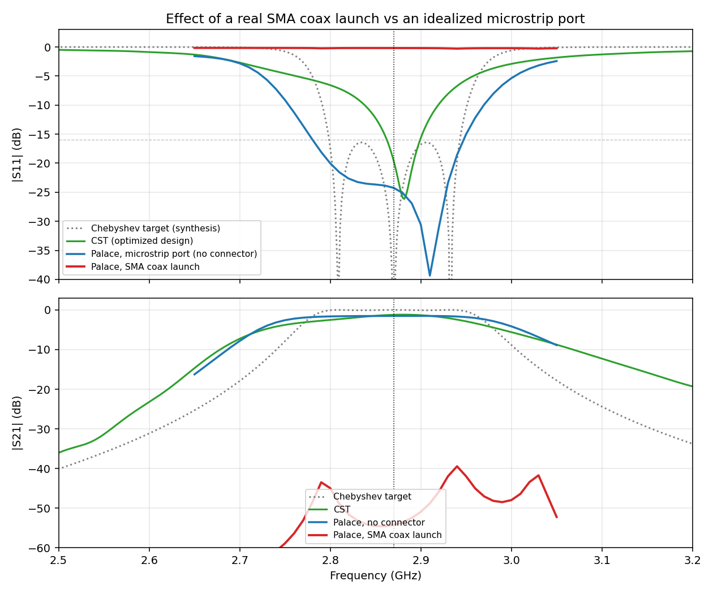
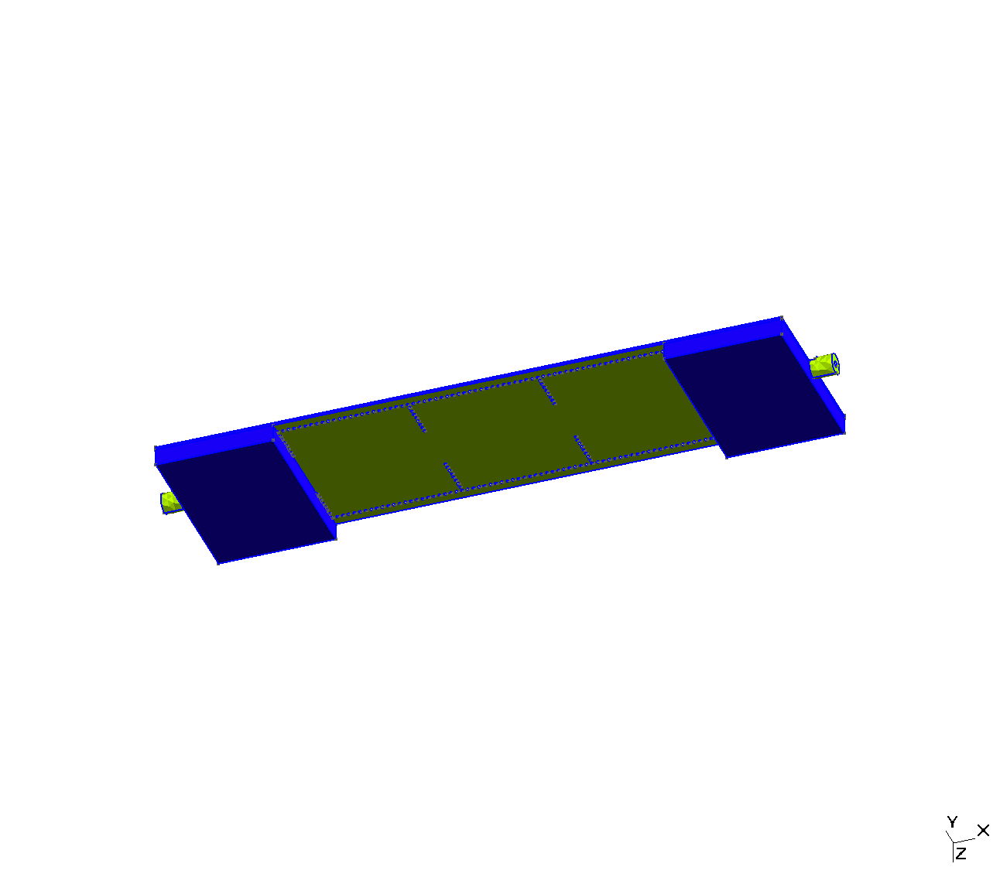
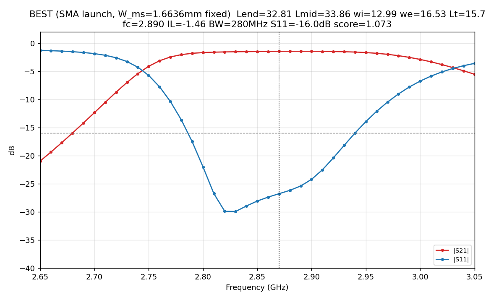
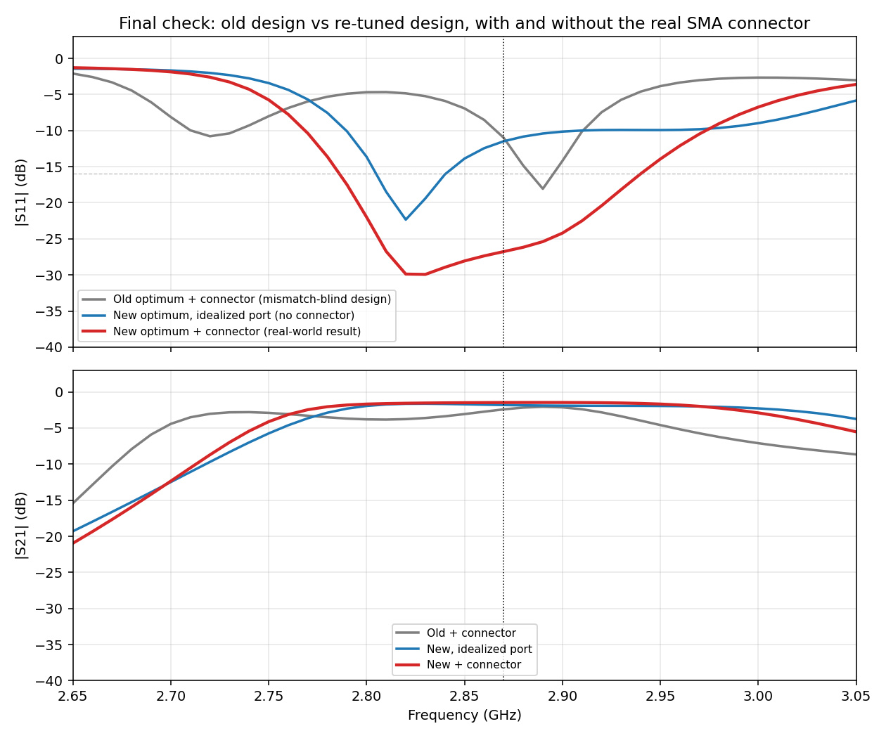

# SMA connector modeling — findings and status

Branch `sma_conn`. Answers a question raised after a presentation: the SIW
filter had only ever been simulated with an idealized wave/lumped port
sitting directly on the microstrip trace. That kind of port self-normalizes
to whatever the local trace impedance happens to be, so it can't reveal
whether the trace is actually 50 ohm, or what a real SMA launch does to the
response. This work adds a real 3D coax launch to the Palace driven model
(`src/siwfilter/palace_driven.py`, `build_mesh(..., with_sma=True)`) and
re-tunes the filter against it.

## v1 — first attempt, and what it found

First pass modeled the coax launch at full SMA/RG-401 body size (pin radius
0.82 mm, PTFE OD 2.73 mm — the standard cable dimensions). Two things came
out of it:

1. **The idealized-port methodology was hiding a real problem.** Computing
   the actual microstrip impedance for the existing design (`W_ms = 2.26 mm`
   on 0.76 mm RO4350B) gives ≈41 Ω, not 50 Ω — `W_ms` had been tuned to
   2.26 mm specifically because it "looked" better matched against the
   self-normalizing port, not because it's a real 50 Ω line. True 50 Ω width
   for this substrate/thickness is 1.664 mm.
2. **The full-size pin made it much worse than that alone would explain.**
   With the coax launch attached, worst-case in-band S11 came out at
   **-0.2 dB** — essentially total reflection, far beyond what a ~41→50 Ω
   mismatch predicts on its own. Root cause: a pin radius of 0.82 mm is
   *larger than the board itself* (0.76 mm thick). Bisection showed this
   reproduces even on a bare 50 Ω line with no filter at all, and confirmed
   it's genuine physics, not a bug — real connectors for boards this thin
   use a proportionally thinner launch pin for exactly this reason.

Reproduce: `uv run python scripts/sma_compare_run.py` (baseline vs. v1
connector), `scripts/sma_compare_plot.py` for the figure.

## Connector geometry, and the bugs along the way

`build_mesh(with_sma=True)` bolts a coax stub (pin + PTFE + grounded shell)
onto each feed end, beyond the existing board edge — the SIW/taper/feed
pipeline itself is untouched. Getting this right took a few rounds:

- **Ring-severing bug (fixed).** The shell needs a ground path to the
  board's bottom plane, which means clipping some of the PTFE cylinder to
  z≥0. Doing this over the *whole* stub length severs the coax ring into a
  simply-connected "C" cross-section wherever the pin radius exceeds the
  board thickness (both the pin and shell hit z<0 at the bottom angle) — a
  simply-connected port cross-section has no TEM mode, only evanescent
  higher modes, which is a second, independent way to get catastrophic
  S11. Fixed by clipping only a short (~1.5 mm) ground-contact segment right
  at the board edge, leaving the port face and most of the stub a proper
  unbroken ring. Verified against Palace's own `examples/coaxial` (finds
  clean TEM, Z=50.0Ω on an unclipped ring) before and after.
- **Oversized pin (fixed, see v1 above).** Not a code bug — a genuine
  physical mismatch from using full cable-size dimensions on a thin board.
- **A razor-thin meshing instability (worked around, not root-caused).**
  Bisecting pin radius found a sharp cliff between rin=0.375 mm (clean) and
  rin=0.379 mm (extra spurious PEC faces appear, near-total reflection
  again) — a ~4 micron window. The originally sourced connector dimension
  (0.381 mm, see below) sits right on this cliff. Current default (0.35 mm)
  is verified clear of it. **If you change the pin size again, re-run an
  isolated bare-line check first** (fast, ~1-2 min) rather than assuming a
  small change is safe — the mapping from dimension to result isn't
  perfectly smooth in this geometry construction.

Connector dimensions are meant to track a real, sourceable part: initially
Cinch/Johnson Components 142-0701-881 (DigiKey #210495, SMA jack, board-edge
end-launch, 0.031in/0.79mm board thickness, 0.030in/0.76mm round contact —
almost exactly this board). Backed off from its exact 0.381mm radius to
0.35mm to clear the meshing cliff above.

## v2 — corrected connector + re-tuned filter

With `W_ms` fixed at the true 50Ω value (can't be a free search parameter —
letting it float again risks re-discovering the same self-normalizing-port
artifact), the cavity/iris/taper geometry was re-tuned
(`src/siwfilter/palace_opt_sma.py`) against the *real* connector model this
time, using Bayesian optimization (Gaussian-process surrogate, `skopt`)
instead of one-variable-at-a-time coordinate descent — each Palace
evaluation costs 6-20 minutes, so sample efficiency and capturing
cross-parameter interactions (L_cav vs. w_ext, etc.) matter more here than
in a cheap-eval problem. 30 evals (coarse grid) + 1 fine-grid confirmation.

**Result — old params vs. new:**

| | L_cav (end/mid) | w_iris | w_ext | L_taper | W_ms |
|---|---|---|---|---|---|
| Old (mismatch-blind) | 34.4 / 34.4 mm | 13.0 mm | 16.0 mm | 15.46 mm | 2.26 mm |
| New (re-tuned) | 32.81 / 33.86 mm | 13.0 mm | 16.5 mm | 15.73 mm | 1.664 mm (fixed, true 50Ω) |

Fine-grid confirm: fc=2.89 GHz, worst in-band S11=-15.98 dB, BW=280 MHz,
peak IL=-1.46 dB.

**Final validation — three ways:**

Worst-case in-band S11 (2.80-2.94 GHz):
- Old optimum + real connector: **-4.6 dB** — confirms the original design
  doesn't actually work once fed by a real connector.
- New optimum, idealized port (no connector): -9.9 dB.
- New optimum + real connector: **-16.0 dB** — meets the target, and
  notably *better* than the idealized-port case above it, because the
  cavity geometry was optimized against the connector's real loading the
  whole time, not against an abstract 50Ω reference.

Reproduce: `uv run python -m siwfilter.palace_opt_sma` (long — several
hours; run detached, see the module docstring), then
`scripts/sma_3way_run.py` + `scripts/sma_3way_plot.py` for the final figure.

## Key files

- `src/siwfilter/palace_driven.py` — `build_mesh(with_sma=True, ...)`: the
  coax launch geometry, bolted onto the existing feed.
- `src/siwfilter/palace_opt_sma.py` — Bayesian re-optimization against the
  connector model, `W_ms` fixed.
- `scripts/sma_compare_run.py`, `sma_compare_run_with_only.py`,
  `sma_compare_plot.py` — v1 discovery (with/without connector on the old
  design).
- `scripts/sma_progress_plot.py` — quick mid-run progress check.
- `scripts/sma_3way_run.py`, `sma_3way_plot.py` — final v2 validation
  (old+connector / new,no-connector / new+connector).
- `output/data/versions/sma-v1.json` — machine-readable manifest of the v1
  finding (params, numbers, what changed).

## Open items / next

Compaction is the next axis under discussion — candidates ranked roughly by
effort: shorten `L_feed`/`L_taper` (cheap re-tune, likely low-risk since
taper length wasn't found to matter much for match), push `fc_target`
higher for a narrower `a_eff` (reshapes more than it shrinks — cavities
lengthen to compensate), a higher-εr substrate (scales every dimension by
1/√εr, but a material change), folding the cavity chain into an L/U shape
(shrinks the board's bounding box, needs corner-iris redesign), and
dual-mode cavities (mode-splitting to implement two poles per physical
cavity — biggest length win, real topology/synthesis change, needs a
literature pass before touching the geometry pipeline).
