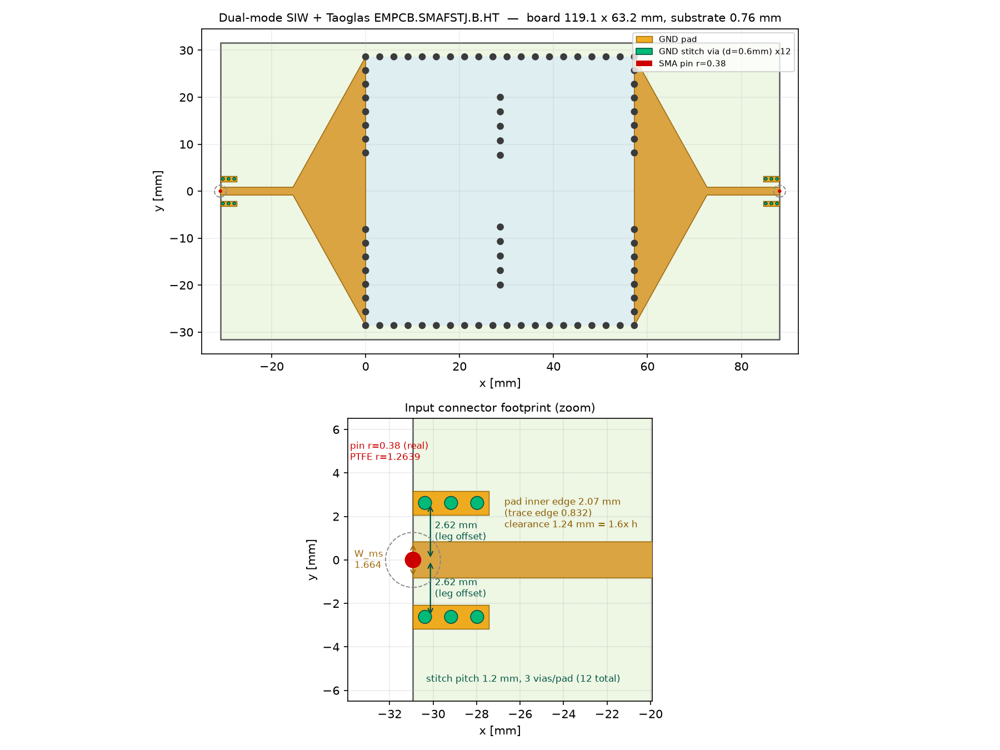
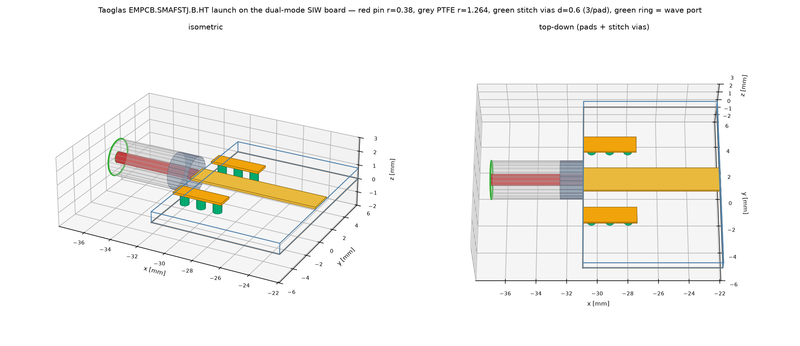
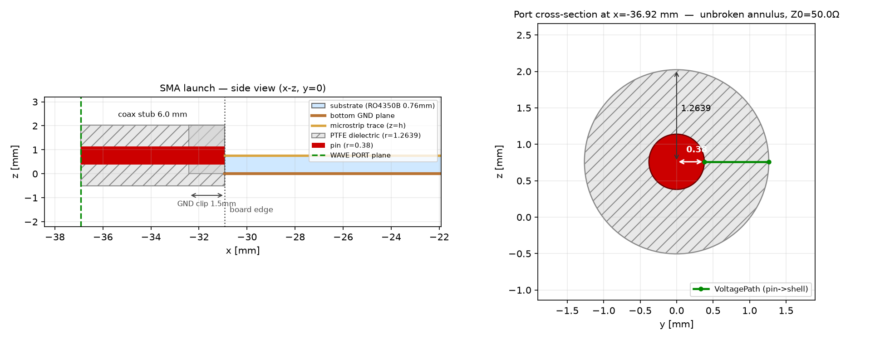

# SMA connector modeling — findings and status

Branch `sma_conn`. Answers a question raised after a presentation: the SIW
filter had only ever been simulated with an idealized wave/lumped port
sitting directly on the microstrip trace. That kind of port self-normalizes
to whatever the local trace impedance happens to be, so it can't reveal
whether the trace is actually 50 ohm, or what a real SMA launch does to the
response. This work adds a real 3D coax launch to the Palace driven model
(`src/siwfilter/palace_driven.py`, `build_mesh(..., with_sma=True)`) and
re-tunes the filter against it.

## v1 — first attempt, and what it found


First pass modeled the coax launch at full SMA/RG-401 body size (pin radius
0.82 mm, PTFE OD 2.73 mm — the standard cable dimensions). Two things came
out of it:

1. **The idealized-port methodology was hiding a real problem.** Computing
   the actual microstrip impedance for the existing design (`W_ms = 2.26 mm`
   on 0.76 mm RO4350B) gives ≈41 Ω, not 50 Ω — `W_ms` had been tuned to
   2.26 mm specifically because it "looked" better matched against the
   self-normalizing port, not because it's a real 50 Ω line. True 50 Ω width
   for this substrate/thickness is 1.664 mm.
2. **The full-size pin made it much worse than that alone would explain.**
   With the coax launch attached, worst-case in-band S11 came out at
   **-0.2 dB** — essentially total reflection, far beyond what a ~41→50 Ω
   mismatch predicts on its own. Root cause: a pin radius of 0.82 mm is
   *larger than the board itself* (0.76 mm thick). Bisection showed this
   reproduces even on a bare 50 Ω line with no filter at all, and confirmed
   it's genuine physics, not a bug — real connectors for boards this thin
   use a proportionally thinner launch pin for exactly this reason.

Reproduce: `uv run python scripts/sma_compare_run.py` (baseline vs. v1
connector), `scripts/sma_compare_plot.py` for the figure.

## Connector geometry, and the bugs along the way

`build_mesh(with_sma=True)` bolts a coax stub (pin + PTFE + grounded shell)
onto each feed end, beyond the existing board edge — the SIW/taper/feed
pipeline itself is untouched. Getting this right took a few rounds:


- **Ring-severing bug (fixed).** The shell needs a ground path to the
  board's bottom plane, which means clipping some of the PTFE cylinder to
  z≥0. Doing this over the *whole* stub length severs the coax ring into a
  simply-connected "C" cross-section wherever the pin radius exceeds the
  board thickness (both the pin and shell hit z<0 at the bottom angle) — a
  simply-connected port cross-section has no TEM mode, only evanescent
  higher modes, which is a second, independent way to get catastrophic
  S11. Fixed by clipping only a short (~1.5 mm) ground-contact segment right
  at the board edge, leaving the port face and most of the stub a proper
  unbroken ring. Verified against Palace's own `examples/coaxial` (finds
  clean TEM, Z=50.0Ω on an unclipped ring) before and after.
- **Oversized pin (fixed, see v1 above).** Not a code bug — a genuine
  physical mismatch from using full cable-size dimensions on a thin board.
- **A razor-thin "meshing instability" — ROOT-CAUSED AND FIXED (2026-08-22).**
  Bisecting pin radius found a sharp cliff between rin=0.375 mm (clean) and
  rin=0.379 mm (extra spurious PEC faces appear, near-total reflection
  again) — a ~4 micron window. It was originally worked around by backing the
  default off to 0.35 mm.

  It was never a meshing/tolerance effect: it is a **face-classification bug**
  in `build_mesh()`. The end-cap test was

  ```python
  rad = math.hypot(cy, cz - h)                      # centroid dist. from pin axis
  if (_near(cx, X0) or _near(cx, X1)) and rad < sma_rin_mm * 1.05:
      on_sma_cap = True                              # -> PEC
  ```

  Clipping the PTFE cylinder to z>=0 for the ground contact removes its lower
  part, which drags the **annulus end-face centroid** up toward the pin axis
  (to rad ~0.396 mm). The threshold `sma_rin_mm * 1.05` grows with the pin, so
  it crosses that value at **rin ~0.3773 mm** and swallows the annulus — i.e.
  the coax *dielectric* cross-section gets tagged PEC, **shorting the launch**.
  Hence the "near-total reflection": measured S21 = -79.5 dB, S11 = -0.01 dB.

  Fixed by disambiguating on face EXTENT rather than centroid alone (the real
  cap disk spans ~rin, the PTFE annulus spans ~rout):

  ```python
  and yext <= sma_rin_mm * 1.5
  ```

  Verified after the fix: PEC face count is a constant 128 across
  rin = 0.350-0.410 mm (was 128 -> 130 at the cliff), and rin=0.380 mm now
  gives S21 = -1.890 dB / S11 = -9.60 dB, matching rin=0.375 mm
  (-1.890 / -9.58) to within max|dS21| = 0.018 dB, max|dS11| = 0.99 dB —
  smooth physical variation, no discontinuity.

  Consequences: the real Taoglas EMPCB.SMAFSTJ.B.HT pin (0.38 mm radius) can
  be modelled at its true size, and the historical 0.35 mm backoff for the
  Cinch part is no longer required. Applied to both `palace_driven.py` and
  `palace_dualmode_driven.py`.

Connector dimensions are meant to track a real, sourceable part: initially
Cinch/Johnson Components 142-0701-881 (DigiKey #210495, SMA jack, board-edge
end-launch, 0.031in/0.79mm board thickness, 0.030in/0.76mm round contact —
almost exactly this board). Backed off from its exact 0.381mm radius to
0.35mm to clear the meshing cliff above.

## v2 — corrected connector + re-tuned filter

With `W_ms` fixed at the true 50Ω value (can't be a free search parameter —
letting it float again risks re-discovering the same self-normalizing-port
artifact), the cavity/iris/taper geometry was re-tuned
(`src/siwfilter/palace_opt_sma.py`) against the *real* connector model this
time, using Bayesian optimization (Gaussian-process surrogate, `skopt`)
instead of one-variable-at-a-time coordinate descent — each Palace
evaluation costs 6-20 minutes, so sample efficiency and capturing
cross-parameter interactions (L_cav vs. w_ext, etc.) matter more here than
in a cheap-eval problem. 30 evals (coarse grid) + 1 fine-grid confirmation.


**Result — old params vs. new:**

| | L_cav (end/mid) | w_iris | w_ext | L_taper | W_ms |
|---|---|---|---|---|---|
| Old (mismatch-blind) | 34.4 / 34.4 mm | 13.0 mm | 16.0 mm | 15.46 mm | 2.26 mm |
| New (re-tuned) | 32.81 / 33.86 mm | 13.0 mm | 16.5 mm | 15.73 mm | 1.664 mm (fixed, true 50Ω) |

Fine-grid confirm: fc=2.89 GHz, worst in-band S11=-15.98 dB, BW=280 MHz,
peak IL=-1.46 dB.

**Final validation — three ways:**


Worst-case in-band S11 (2.80-2.94 GHz):
- Old optimum + real connector: **-4.6 dB** — confirms the original design
  doesn't actually work once fed by a real connector.
- New optimum, idealized port (no connector): -9.9 dB.
- New optimum + real connector: **-16.0 dB** — meets the target, and
  notably *better* than the idealized-port case above it, because the
  cavity geometry was optimized against the connector's real loading the
  whole time, not against an abstract 50Ω reference.

Reproduce: `uv run python -m siwfilter.palace_opt_sma` (long — several
hours; run detached, see the module docstring), then
`scripts/sma_3way_run.py` + `scripts/sma_3way_plot.py` for the final figure.

## Key files

- `src/siwfilter/palace_driven.py` — `build_mesh(with_sma=True, ...)`: the
  coax launch geometry, bolted onto the existing feed.
- `src/siwfilter/palace_opt_sma.py` — Bayesian re-optimization against the
  connector model, `W_ms` fixed.
- `scripts/sma_compare_run.py`, `sma_compare_run_with_only.py`,
  `sma_compare_plot.py` — v1 discovery (with/without connector on the old
  design).
- `scripts/sma_progress_plot.py` — quick mid-run progress check.
- `scripts/sma_3way_run.py`, `sma_3way_plot.py` — final v2 validation
  (old+connector / new,no-connector / new+connector).
- `output/data/versions/sma-v1.json` — machine-readable manifest of the v1
  finding (params, numbers, what changed).

## Taoglas EMPCB.SMAFSTJ.B.HT — the real, sourceable connector

Replaces the idealised continuous-ring model with the actual part. Pin is
modelled at its TRUE datasheet size (0.76mm dia -> r=0.38mm): the historical
0.35mm backoff existed only to dodge the classification bug fixed above.







### Verified against the datasheet, 2026-09-04

The datasheet is now IN THIS REPO —
[`EMPCB.SMAFSTJ.B.HT_SPE-12-8-134-C-WY.pdf`](EMPCB.SMAFSTJ.B.HT_SPE-12-8-134-C-WY.pdf)
(Taoglas SPE-12-8-134/C/WY, 4 pages, drawings are images) — so these numbers
never again have to be taken on trust. What it says:

* §2 spec table: impedance 50Ω, 0–12.4 GHz, connector 6.35 × 6.35 × 13.3 mm,
  **connector pin diameter 0.76 mm**, **max. acceptable PCB thickness 0.8 mm**.
* §3 drawing: body SQ 6.35±0.1, total length 13.3±0.3, leg length 3.8±0.2,
  thread 1/4"-36UNS-2A, pin shown as Ø0.7±0.1 on the rear view (the §2
  table's 0.76 mm sits inside that tolerance band).
* §3.1 footprint: three front pads on a **2.62 / 2.62 mm** pitch, all
  **4.56±0.2 mm** long; the two ground pads **1±0.2 mm** wide, the centre
  signal pad **0.85±0.2 mm** wide. Two matching ground pads on the back at
  5.23 mm spacing, no back centre pad. Note: **"Maximum board thickness is
  0.79 mm"**.

| Quantity | Value | Source | vs datasheet |
|---|---|---|---|
| Pin radius | 0.38 mm | datasheet §2 (0.76 mm dia) | ✔ exact |
| Ground-leg offset | ±2.62 mm | datasheet §3.1 pitch | ✔ exact |
| Ground pad length (x) | 5.0 mm (`cpwg_len_mm`) | design | ✔ covers the 4.56 mm pad and the 3.8 mm leg |
| Ground pad span (y) | 0.8512 … 3.600 mm | CPWG solve | ✔ contains the leg's 2.12 … 3.12 mm |
| Signal trace width | 1.2 mm (`cpwg_w_feed_mm`) | CPWG 50Ω solve | ✘ **outside** the 0.85±0.2 band — deliberate, see below |
| PTFE outer radius | 1.2639 mm | **DERIVED** — Z0=50Ω, eps_r=2.08 (rout/rin=3.326). The datasheet gives no dielectric OD, so this stays derived. | — |
| Stitch vias | 4/pad, d=0.6 mm, 1.2 mm pitch (**16** total) | design choice within JLCPCB rules (`config.VIA_PRESETS`) | not a datasheet feature |
| Coax stub length | 6 mm | model-only (port standoff), not a physical dimension | — |

**Two things the datasheet changes.**

1. **Board thickness is marginal, and 0.5 oz copper is what makes it fit.**
   The finished stack is 0.760 mm dielectric + 2 × 17.5 µm copper =
   **0.795 mm**. The §2 table allows 0.8 mm; the §3.1 footprint note says
   0.79 mm. We sit between the two, 5 µm over the tighter figure, before
   ENIG. It will fit — the fork is sprung — but there is no margin, and
   **1 oz copper would give 0.830 mm and would not fit at all**. The 0.5 oz
   choice in FAB_NOTES is therefore load-bearing, not a preference.
2. **This is not the recommended footprint, on purpose.** The datasheet's
   ground pads are 1 mm wide starting 2.12 mm off centre; ours are a CPWG
   pour whose inner edge is at 0.8512 mm, because that gap (0.2512 mm
   against a 1.2 mm trace) is what solves to 50 Ω on this substrate. The
   connector's own pads all land on copper — pin on the trace, both legs
   inside the pours — so it solders normally. The deviation is the signal
   trace being 1.2 mm where the datasheet draws 0.85 mm. Recorded rather
   than silently "matching the footprint".

The earlier "GND pad x-extent ~3.4 mm, INFERRED" line in this table was a
guess, and it was wrong: the datasheet pad is 4.56 mm. It did no harm
because the actual pour is 5.0 mm and covers it, but the row is corrected
above. The stitch-via count was also stale here (3/pad, 12 total); the CPWG
launch builds **4/pad, 16 total**, which is what the mesh, the gerbers and
the drill file all agree on.

Two corrections made while building this, both worth remembering:

- **Discrete pads, not a pour.** The first cut ran continuous ground copper
  down the whole feed at 0.3mm clearance. That turns the 50-ohm microstrip
  into a grounded coplanar line and detunes the very match this model exists
  to evaluate. The datasheet footprint is discrete pads, which also keeps the
  feed a true microstrip — the coplanar perturbation is now confined to the
  launch.
- **Stitch vias are not fence vias.** They initially reused `d_via`=1.5mm (the
  SIW cavity wall size, ~5x a realistic stitching via), which wasted pad area
  and capped the count. At 0.6mm they give 12 vias instead of 8 AND improve
  trace clearance from 0.84mm (1.1x h) to 1.24mm (1.6x h).

Figures regenerate via `scripts/figures/plot_{taoglas_footprint,sma_3d,sma_cross_section}.py`.

## Open items / next

Compaction is the next axis under discussion — candidates ranked roughly by
effort: shorten `L_feed`/`L_taper` (cheap re-tune, likely low-risk since
taper length wasn't found to matter much for match), push `fc_target`
higher for a narrower `a_eff` (reshapes more than it shrinks — cavities
lengthen to compensate), a higher-εr substrate (scales every dimension by
1/√εr, but a material change), folding the cavity chain into an L/U shape
(shrinks the board's bounding box, needs corner-iris redesign), and
dual-mode cavities (mode-splitting to implement two poles per physical
cavity — biggest length win, real topology/synthesis change, needs a
literature pass before touching the geometry pipeline).
