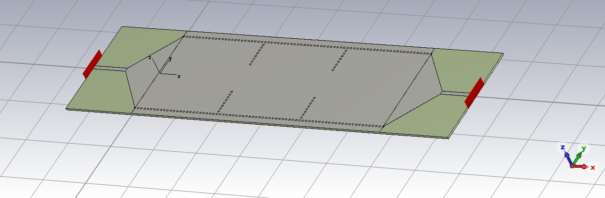
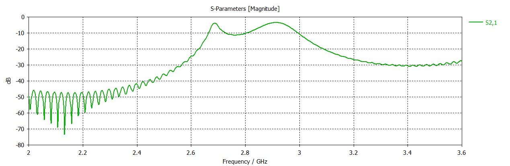

```{=latex}
\begin{IEEEkeywords}
banda S, filtro pasabanda, guía de onda integrada en sustrato, SIW,
cavidades resonantes, síntesis de Chebyshev, simulación electromagnética
\end{IEEEkeywords}
```

# Introducción

La tecnología de guía de onda integrada en sustrato (SIW, del inglés
*Substrate Integrated Waveguide*) permite implementar estructuras de guía de
onda rectangular sobre sustrato laminado de microondas, combinando el bajo
costo y la integrabilidad de los circuitos planos con el alto factor de calidad
y la capacidad de manejo de potencia de las guías de onda metálicas
[@deslandes2001integrated; @bozzi2011review]. Una guía SIW se forma confinando
el campo entre dos filas de vías metalizadas que conectan los planos de masa
superior e inferior, emulando las paredes laterales de una guía rectangular.

Los filtros pasabanda constituyen un bloque fundamental en cualquier cadena de
recepción o transmisión de radiofrecuencia. En este trabajo se diseña un filtro
SIW de tercer orden centrado en $f_0 = 2.87$ GHz, con una respuesta de
Chebyshev de ancho de banda fraccional $\text{FBW} = 5\%$ y rizado de 0.1 dB.
La Tabla \ref{tab:specs} resume las especificaciones de partida.

```{=latex}
\begin{table}[t]
\centering
\caption{Especificaciones del filtro}
\label{tab:specs}
\begin{tabular}{ll}
\hline
\textbf{Parámetro} & \textbf{Valor} \\
\hline
Frecuencia central $f_0$ & 2.87 GHz \\
Orden $N$ & 3 cavidades \\
Ancho de banda fraccional & 5 \% \\
Rizado (Chebyshev) & 0.1 dB \\
Sustrato & Rogers RO4350B \\
Espesor $h$ & 0.76 mm \\
Permitividad $\varepsilon_r$ & 3.66 \\
Tangente de pérdidas $\tan\delta$ & 0.0037 \\
Diámetro de vía $d$ & 0.8 mm \\
Paso de vía $p$ & 1.5 mm \\
\hline
\end{tabular}
\end{table}
```

# Síntesis del filtro

El punto de partida es el prototipo pasabajos de Chebyshev, cuyos valores
normalizados $g_i$ se obtienen por recursión [@hong2001microstrip]. Para
$N = 3$ y rizado de 0.1 dB resultan $g_1 = g_3 = 1.0316$, $g_2 = 1.1474$ y
$g_4 = 1.0$.

A partir de estos valores se calculan los coeficientes de acoplamiento entre
cavidades adyacentes y el factor de calidad externo de los puertos de entrada
y salida:

$$ k_{i,i+1} = \frac{\text{FBW}}{\sqrt{g_i \, g_{i+1}}}, \qquad
   Q_e = \frac{g_0 \, g_1}{\text{FBW}}. $$

Con $\text{FBW} = 0.05$ se obtienen $k_{12} = k_{23} = 0.0460$ y
$Q_e = 20.63$. Estos parámetros son independientes de la frecuencia y de la
implementación física, y constituyen el objetivo que debe reproducir la
geometría SIW.

Conviene destacar que, al ser el rizado de solo 0.1 dB, la banda de paso de
$|S_{21}|$ aparenta ser de máxima planicidad: una variación de 0.1 dB resulta
visualmente imperceptible en escala logarítmica. El carácter equirizado
(Chebyshev) se manifiesta en cambio en $|S_{11}|$, que presenta exactamente
$N = 3$ ceros de reflexión con picos de igual nivel ($\approx -15.5$ dB), firma
inequívoca de una respuesta de Chebyshev y no de Butterworth.

# Diseño geométrico

El ancho equivalente de la guía SIW se elige para que la frecuencia de corte
del modo fundamental TE10 quede en $f_c \approx 0.7\,f_0$, operando así cerca
de $1.4\,f_c$ donde la guía es monomodo y de bajas pérdidas:

$$ a_{\text{eff}} = \frac{c}{2 \, f_c \, \sqrt{\varepsilon_r}}. $$

La separación física entre filas de vías se corrige según la fórmula de
Cassivi--Wu [@cassivi2002dispersion]:

$$ a_{\text{siw}} = a_{\text{eff}} + \frac{d^2}{0.95 \, p}. $$

La longitud de cada cavidad se obtiene de la condición de resonancia del modo
TE101:

$$ f_{101} = \frac{c}{2\sqrt{\varepsilon_r}}
   \sqrt{\left(\frac{1}{a_{\text{eff}}}\right)^2 +
         \left(\frac{1}{L}\right)^2}. $$

Las reglas de diseño de las vías ($0.5 \le p/d \le 2.5$ y $d < \lambda_g/5$)
se verifican para evitar fugas por radiación entre vías. La Tabla
\ref{tab:dim} resume las dimensiones resultantes; la Fig. \ref{fig:layout}
muestra la vista superior del layout.

```{=latex}
\begin{table}[t]
\centering
\caption{Dimensiones físicas del filtro}
\label{tab:dim}
\begin{tabular}{ll}
\hline
\textbf{Dimensión} & \textbf{Valor} \\
\hline
Ancho equivalente $a_{\text{eff}}$ & 39.00 mm \\
Separación de vías $a_{\text{siw}}$ & 39.45 mm \\
Longitud de cavidad $L_{\text{cav}}$ & 38.23 mm \\
Ancho de iris $w_{12} = w_{23}$ & 13.66 mm \\
Ancho de microstrip 50 $\Omega$ & 1.664 mm \\
\hline
\end{tabular}
\end{table}
```

{#fig:layout width=88%}

# Calibración electromagnética con openEMS

Las fórmulas cerradas para el ancho de iris en SIW son poco confiables, por lo
que el acoplamiento se extrae mediante simulación de onda completa con openEMS
[@liebig2013openems]. Se simula una estructura de dos cavidades acopladas por
un iris de ancho variable; del par de modos resonantes desdoblados $(f_1, f_2)$
se obtiene el coeficiente de acoplamiento:

$$ k = \frac{f_2^2 - f_1^2}{f_2^2 + f_1^2}. $$

Ajustando $w(k)$ se determina que el acoplamiento objetivo $k = 0.046$ se
consigue con un iris de $w = 13.66$ mm, valor notablemente mayor que la
estimación analítica inicial, lo que confirma la necesidad de la calibración.

## Verificación de la longitud de cavidad

La longitud de cavidad se verifica con simulación de onda completa. Conviene
distinguir dos modelos de excitación, ya que conducen a conclusiones diferentes:

- Un modelo de **puertos concentrados** (sondas de 50 $\Omega$ dentro de la
  cavidad) permite ubicar la resonancia de forma rápida y económica, pero no
  incluye la carga del alimentador real; resulta sesgado en frecuencia y su
  nivel absoluto de $|S_{21}|$ no es representativo.
- El modelo **físico**, con alimentación microstrip de 50 $\Omega$ adaptada
  mediante una transición cónica (taper) microstrip--SIW
  [@deslandes2006accurate], reproduce las condiciones de medición y es el que se
  toma como referencia.

Con el feed adaptado, openEMS y CST coinciden: la longitud analítica de
$L_{\text{cav}} = 38.23$ mm ubica el centro de la banda de paso en 2.82 GHz
(openEMS, $-3$ dB) / 2.905 GHz (pico) y 2.818 GHz (CST), todos a menos de
50 MHz del objetivo de 2.87 GHz. Es decir, el
cálculo analítico de la longitud de cavidad es adecuado y **no requiere
corrección apreciable**; acortar la cavidad desplazaría la banda por encima del
objetivo, como muestra la Tabla \ref{tab:sweep} y la Fig. \ref{fig:cmpall}.

```{=latex}
\begin{table}[t]
\centering
\caption{Barrido de $L_{\text{cav}}$ con feed microstrip adaptado (openEMS)}
\label{tab:sweep}
\begin{tabular}{cc}
\hline
$L_{\text{cav}}$ (mm) & $f_{\text{centro}}$ (GHz) \\
\hline
\textbf{38.23} & \textbf{2.905} \\
35.93 & 2.982 \\
33.64 & 3.077 \\
\hline
\end{tabular}
\end{table}
```

```{=latex}
\begin{figure*}[t]
\centering
\includegraphics[width=0.86\textwidth]{compare_all.png}
\caption{Barrido de la longitud de cavidad en openEMS con alimentación
microstrip adaptada (res.\ media), comparado con la respuesta objetivo de
síntesis y con la simulación de CST. La longitud analítica de 38.2 mm (curva en
banda) coincide con el objetivo, validando el diseño.}
\label{fig:cmpall}
\end{figure*}
```

Con el feed adaptado y la longitud analítica, openEMS reproduce una banda de
paso de tres polos con una pérdida de inserción de unos pocos decibelios,
comparable a la de CST, confirmando la validez del diseño tanto en frecuencia
como en forma de respuesta.

# Modelo 3D en CST Studio Suite 2021

A partir de las dimensiones se construye el modelo tridimensional
paramétrico en CST Studio Suite 2021 mediante una macro generada
automáticamente. El modelo está compuesto por sólidos nativos (sustrato,
planos de masa, vías metalizadas y transiciones microstrip), con todas las
dimensiones almacenadas como parámetros editables, de modo que el diseño puede
re-sintonizarse directamente en el entorno gráfico. Las Figs. \ref{fig:cst1},
\ref{fig:cst2} y \ref{fig:cst3} muestran distintas vistas del modelo.

La simulación de CST se realizó con la longitud de cavidad analítica
$L_{\text{cav}} = 38.23$ mm, el mismo valor validado por el barrido con feed
adaptado en openEMS.

{#fig:cst1 width=88%}

{#fig:cst2 width=88%}

{#fig:cst3 width=88%}

# Resultados y comparación

La Fig. \ref{fig:compare} superpone la respuesta objetivo de síntesis con la
simulación de CST. Las Figs. \ref{fig:s11} y \ref{fig:s21} muestran los
parámetros $S_{11}$ y $S_{21}$ obtenidos en CST. La Tabla \ref{tab:res}
resume la comparación cuantitativa.

```{=latex}
\begin{figure*}[t]
\centering
\includegraphics[width=0.86\textwidth]{compare.png}
\caption{Comparación de la respuesta objetivo de síntesis (líneas
discontinuas) con la simulación de CST (líneas continuas, $L_{\text{cav}} =
38.23$ mm, $w_{12} = w_{23} = 13.66$ mm, $W_{\text{ms}} = 1.66$ mm), para
$|S_{11}|$ (superior) y $|S_{21}|$ (inferior).}
\label{fig:compare}
\end{figure*}
```

```{=latex}
\begin{table}[t]
\centering
\caption{Comparación síntesis vs. simulación CST ($L_{\text{cav}} = 38.23$ mm analítico)}
\label{tab:res}
\begin{tabular}{lcc}
\hline
\textbf{Parámetro} & \textbf{Objetivo} & \textbf{CST} \\
\hline
Frecuencia central & 2.870 GHz & 2.818 GHz \\
Ancho de banda ($-3$ dB) & 143 MHz & 293 MHz \\
Pérdida de inserción & $\sim$0 dB & 3.65 dB \\
Pérdida de retorno & $>$16 dB & 1.02 dB \\
\hline
\end{tabular}
\end{table}
```

{#fig:s11 width=88%}

{#fig:s21 width=88%}

La simulación de CST confirma una respuesta pasabanda con tres polos, en
concordancia con el orden $N = 3$ del diseño. La frecuencia central (2.818 GHz)
queda a unos 50 MHz del objetivo, dentro de la tolerancia esperable entre la
síntesis y la simulación de onda completa, y coincide con la predicción de
openEMS para la misma longitud de cavidad. El ancho de banda resulta más
amplio que el objetivo porque el acoplamiento externo $Q_e$, provisto por las
transiciones microstrip, aún no fue calibrado electromagnéticamente y se
encuentra sobreacoplado. La pérdida de inserción ($3.65$ dB en CST y unos pocos
decibelios en el modelo microstrip adaptado de openEMS) combina una leve
desadaptación residual con la pérdida dieléctrica propia del sustrato
($\tan\delta = 0.0037$); ambos simuladores coinciden en el orden de magnitud.

# Ajuste paramétrico y sintonización

El diseño de un filtro de cavidades acopladas admite dos grados de libertad de
sintonización prácticamente independientes, que se están explorando de forma
iterativa sobre el modelo paramétrico de CST.

## Frecuencia central y longitud de cavidad

La frecuencia central la fija la resonancia TE101 de cada cavidad, dominada por
la longitud $L_{\text{cav}}$. De la relación de resonancia se desprende que al
alargar la cavidad la frecuencia baja, y viceversa. El barrido con feed
adaptado de la Sección IV cuantifica esta sensibilidad: entre 33.64 mm y
38.23 mm la frecuencia central varía de 3.077 GHz a 2.905 GHz, es decir, una
pendiente de $\approx -37$ MHz/mm. Esta relación casi lineal permite centrar la
banda con un único ajuste de $L_{\text{cav}}$ sin alterar el resto del filtro.

## Ancho de banda y acoplamientos

El ancho de banda lo determina la intensidad de los acoplamientos, que escalan
con el ancho de banda fraccional: los acoplamientos internos cumplen
$k_{i,i+1} \propto \text{FBW}$ y el factor de calidad externo
$Q_e \propto 1/\text{FBW}$. En consecuencia existen dos perillas:

- Los **iris internos** ($w_{12}, w_{23}$): un iris más ancho aumenta $k$ y
  ensancha la banda; uno más angosto la estrecha.
- El **iris externo** de entrada/salida, que fija $Q_e$: una apertura más
  angosta debilita el acoplamiento al alimentador (aumenta $Q_e$) y estrecha la
  banda.

La simulación de CST arroja un ancho de banda de 293 MHz, aproximadamente el
doble del objetivo de 143 MHz, lo que indica que el acoplamiento externo está
sobreacoplado ($Q_e$ resulta cercano a la mitad del valor de síntesis). Para
corregirlo se introdujo en el modelo un iris inductivo de entrada/salida
parametrizable (apertura $w_{\text{ext}}$): una fila transversal de vías con un
hueco central ajustable que regula $Q_e$. Reduciendo $w_{\text{ext}}$ se
incrementa $Q_e$ y se estrecha la banda hacia el objetivo. Como regla de orden
de magnitud, para pasar de 293 MHz a 143 MHz se requiere aproximadamente la
mitad del acoplamiento interno y el doble de $Q_e$.

Se intentó calibrar $Q_e$ en openEMS por el método del retardo de grupo de
$S_{11}$ sobre una cavidad única alimentada a través del iris de entrada
[@hong2001microstrip]; sin embargo, el modelo no exhibe una resonancia limpia
(la estructura permanece sobreacoplada y la frecuencia de resonancia se adhiere
al borde de la banda), por lo que la extracción no convergió. En consecuencia,
la calibración fina de $w_{\text{ext}}$ se realiza directamente sobre el modelo
paramétrico de CST, y la determinación robusta de $Q_e$ por simulación
electromagnética queda como tarea pendiente.

# Conclusiones y trabajo futuro

Se completó la síntesis de Chebyshev y la calibración electromagnética del
acoplamiento de los iris mediante un modelo de dos cavidades en openEMS. El
barrido de la longitud de cavidad con alimentación adaptada, en acuerdo con CST,
validó que el valor analítico ($L_{\text{cav}} = 38.23$ mm) ubica la banda de
paso a menos de 50 MHz del objetivo, sin necesidad de corrección. El modelo 3D
paramétrico en CST confirma una respuesta pasabanda de tercer orden.

Como trabajo futuro queda la calibración del acoplamiento externo $Q_e$
(diseño del iris de entrada y salida, ya incorporado como parámetro
$w_{\text{ext}}$ ajustable) para ajustar el ancho de banda al objetivo, y la
fabricación y caracterización experimental del prototipo con un analizador
vectorial de redes.

```{=latex}
\FloatBarrier
\clearpage
```

# Referencias

::: {#refs}
:::
